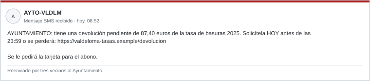

# Examen de práctica A · Un día en el Ayuntamiento de Valdeloma

*CIBINT 2026-2027 · Material de preparación del parcial · Formato: caso continuo*

**Este examen es de práctica.** Su estructura **no** coincide con la del examen real: aquí un único caso avanza a lo largo del día y las preguntas mezclan los temas. Sirve para entrenar la forma de razonar. Duración orientativa: **60 minutos**. Los temas pesan igual que en el parcial: T1 1 p · T2 2 p · T3 4 p · T4 3 p.

El Ayuntamiento de Valdeloma, sus personas y sus datos son ficticios. El patrón del caso es real: campañas de SMS que suplantan a administraciones públicas con falsas devoluciones.

## 09:00 · El aviso

La alcaldesa escribe al responsable de sistemas:

«Los vecinos dicen que reciben SMS del Ayuntamiento con una devolución de la tasa de basuras. Mira todo lo que haya en internet sobre esto.»

El pleno se reúne a las 13:00 y debe decidir si publica un aviso oficial y si refuerza la atención telefónica.

**A1 (T1 · 0,5).** Reescribe el encargo como requerimiento: destinatario, decisión, objeto, horizonte, alcance y producto.

**A2 (T1 · 0,5).** Escribe tres preguntas de inteligencia y una consulta concreta. Explica en qué se diferencian.

## 10:30 · Lo que llega al buzón

| ID | Fuente | Contenido |
|---|---|---|
| VAL-S1 | Grupo de Facebook «Vecinos de Valdeloma» | 12/11, 09:40, GMT+1. «¡Me ha llegado esto! ¿Es real?», con la captura de la Figura A |
| VAL-S2 | Web de noticias comarcal | 12/11, 10:15. «El Ayuntamiento devuelve la tasa de basuras.» Su única fuente es VAL-S1 |
| VAL-S3 | Web oficial `valdeloma.example`, «Tablón» | No hay ningún anuncio sobre devoluciones. Las devoluciones solo se tramitan en la **sede electrónica** con certificado digital |

**A3 (T3 · 0,8).** Responde a estas preguntas:

- ¿Cuántas fuentes independientes sostienen que «el Ayuntamiento devuelve la tasa»?
- ¿Qué dice VAL-S3 y qué tipo de fuente es?
- ¿Qué rasgos de la Figura A son compatibles con un engaño? Señala tres.

**A4 (T3 · 0,7).** Escribe tres consultas con operadores de buscador, una para cada pregunta:

- ¿Dónde más circula el enlace?
- ¿Ha publicado el Ayuntamiento algún aviso?
- ¿Hay campañas similares contra otros municipios en las últimas semanas?

Indica el límite de cada consulta.

## 12:00 · Las propuestas del equipo

| | Propuesta |
|---|---|
| P1 | Rellenar el formulario de la web falsa con datos inventados «para ver adónde van» |
| P2 | Consultar los resultados ya existentes de urlscan.io y crt.sh |
| P3 | Pedir a la operadora los números de teléfono de los vecinos que recibieron el SMS |
| P4 | Publicar en las redes del Ayuntamiento un aviso con el dominio falso y el canal oficial |
| P5 | Enviar los indicadores a INCIBE-CERT y a la red de municipios de la provincia |

**A5 (T2 · 1,0).** Para cada propuesta, decide si se hace, se hace con condiciones o no se hace. Justifícalo con el anexo normativo y, si la descartas, propón una alternativa.

**A6 (T2 · 1,0).** Asigna una etiqueta TLP:

- al aviso público;
- a lo que se envía a la red de municipios;
- a la nota interna que incluye los nombres de los dos funcionarios que pincharon el enlace.

Además, una persona que dice ser periodista llama a centralita y pide «el informe técnico». ¿Qué se le responde?

## 13:00 · La infraestructura

| Fuente | Dato |
|---|---|
| RDAP | `valdeloma-tasas.example` creado el **10/11/2026** · titular suprimido |
| DNS | `valdeloma-tasas.example` A `203.0.113.88` · el índice de servicios asocia 1.700 nombres a esa IP |
| CT | Un certificado del 10/11 incluye `valdeloma-tasas.example`, `pinarejo-tasas.example` y `villarrubia-tasas.example` |
| Inventario del Ayuntamiento | `www`, `sede` (sede electrónica, proveedor de la Diputación) y `correo` |
| CT del dominio oficial | `*.valdeloma.example` y `padron-antiguo.valdeloma.example` (2019, sin DNS actual) |

**A7 (T4 · 1,6).** Responde a estas preguntas:

- ¿Qué relación aporta el certificado entre los tres dominios?
- ¿Por qué no basta compartir IP?
- ¿Qué harías con los otros dos municipios que aparecen en el certificado?
- ¿Qué indica que el titular esté suprimido?

**A8 (T4 · 1,4).** ¿Qué significa la entrada `padron-antiguo` en CT? ¿Qué **no** permite afirmar? ¿Quién debe comprobarla?

## 16:00 · La nota

**A9 (T3 · 2,5).** Redacta la nota para el pleno en un máximo de 10 líneas. Debe incluir:

- valoración y confianza;
- tres evidencias con su identificador;
- una limitación;
- tres recomendaciones (para vecinos, interna y externa).

Añade una frase **desde el lado del atacante**: ¿qué información pública del Ayuntamiento hizo creíble el SMS?

*Reparto de A9: valoración y evidencias 1,0 · limitación 0,3 · recomendaciones 0,7 · perspectiva del atacante 0,5.*
