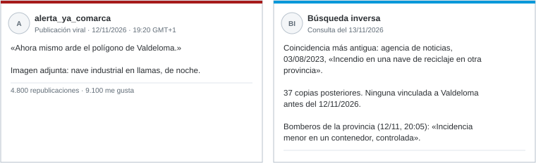

# Examen de práctica B · Ocho minicasos

*CIBINT 2026-2027 · Material de preparación del parcial · Formato: batería de casos breves*

**Este examen es de práctica.** Contiene ocho situaciones breves e independientes. Cada una ocupa una pregunta, y su estructura **no** coincide con la del examen real. Duración orientativa: **60 minutos**. Los temas pesan igual que en el parcial: T1 1 p · T2 2 p · T3 4 p · T4 3 p. Todos los casos son ficticios salvo que se indique lo contrario.

## M1 · Verdadero o falso, con justificación (T1 · 1,0)

Indica si cada afirmación es verdadera o falsa y justifícalo en una línea. Cada afirmación vale 0,2 puntos.

1. Una lista de 300 IP maliciosas es ya un producto de inteligencia.
2. La retroalimentación puede obligar a volver a la fase de dirección y planificación.
3. Un informe estratégico necesita más detalle técnico que una alerta.
4. «Es probable que la campaña continúe» es una valoración, no un hecho.
5. Un producto que llega después de que se tome la decisión puede ser correcto, pero no es útil.

## M2 · El portátil del becario (T2 · 1,0)

Una empresa sospecha que un becario ha copiado documentos de clientes. El jefe de área pide al analista de ciberinteligencia que «mire su Instagram, su LinkedIn y, si puede, su correo de la empresa». La empresa **no** tiene una política de uso de dispositivos comunicada a la plantilla.

¿Qué partes de la petición plantean problemas y por qué? Usa el anexo. ¿Quién debe intervenir? ¿Qué parte de la investigación sí puede hacer el equipo de seguridad?

## M3 · El fichero inesperado (T2 · 1,0)

Mientras revisa un foro público, una analista encuentra un fichero de texto titulado con el nombre de su empresa. La vista previa muestra lo que parecen **direcciones de correo corporativas y contraseñas**.

Ordena qué debe hacer y qué no debe hacer, con al menos tres acciones de cada tipo. Justifícalo con el anexo, apartados B, D y E.

## M4 · Tres Pablo Serrano (T3 · 1,0)

| Perfil | Datos |
|---|---|
| X `@pserrano` | Periodista deportivo en Sevilla desde 2012 |
| LinkedIn «Pablo Serrano» | Director financiero de Nortia Energía. Enlazado desde la web de Nortia |
| Telegram `@pablo_serrano_cfo` | Se presenta como «CFO de Nortia» y pide a un empleado una transferencia urgente |

¿Qué relación puede afirmarse entre los tres perfiles? ¿Qué comprobación haría el empleado **antes** de transferir?

## M5 · La foto del incendio (T3 · 1,5)

1. ¿Qué demuestra el resultado de la búsqueda inversa? Distingue la fecha de publicación, la fecha atribuida al hecho y la fecha de consulta.
2. Un medio local reproduce la foto y cita como única fuente la publicación viral. ¿Cuántas fuentes independientes hay?
3. Redacta una frase comprobable para un informe.

## M6 · Dos sociedades con el mismo nombre (T3 · 1,5)

Un proveedor escribe para cambiar la cuenta de cobro. Firma «Ferralla Ibérica, S.L.», que es el nombre del proveedor habitual. El BORME muestra **dos** sociedades con ese nombre:

- una constituida en 2004 en Bilbao;
- otra constituida hace tres semanas en Madrid.

El correo llega desde `ferralla-iberica.example`. El proveedor habitual usa `ferrallaiberica.example`.

1. ¿Qué permite afirmar el registro y qué no?
2. Escribe dos consultas con operadores de buscador que ayuden a avanzar.
3. ¿Qué verificación debe hacer el departamento de compras y por qué canal?

## M7 · Un mapa con trampas (T4 · 1,5)

1. ¿Cuáles de los nombres de la figura pueden añadirse al inventario de Nortia y cuáles no? Justifícalo.
2. ¿Qué significa que `vpn-old` aparezca solo en CT?
3. ¿Qué **no** permite afirmar el comodín?

## M8 · Encuentra el error (T4 · 1,5)

Un compañero ha escrito estas cinco frases en un informe. Corrige cada una (0,3 cada frase).

1. «El dominio ha sido creado por un actor malicioso porque el titular está oculto.»
2. «Shodan muestra el puerto 3389 abierto en nuestra IP, por lo que hemos sufrido una intrusión.»
3. «El TTL de 86 400 indica que el registro lleva un día activo.»
4. «El banner declara la versión 2.4.29, que tiene vulnerabilidades: el servidor es vulnerable.»
5. «Según el PTR `cliente-55.operadora.example`, la IP pertenece a nuestro cliente.»
