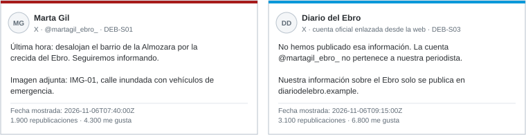
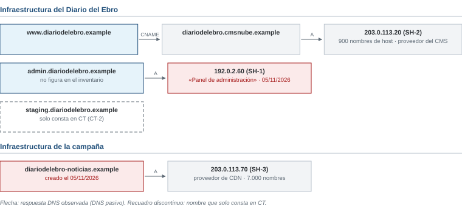

# Examen de ejemplo R1 · Diario del Ebro

*Ciberinteligencia (CIBINT) · Examen parcial · Ejemplo*

| Nombre y apellidos | Profesor |
|---|---|
| | |

Responde en este mismo documento, debajo de cada pregunta o en sus tablas. Los casos están en las **hojas de referencia**, al final del documento. Las normas y los operadores de búsqueda están en el [anexo de referencia](../../../anexo-de-referencia.md).

# Ejercicios

## Bloque 1 · Fundamentos y ciclo de inteligencia

Hojas de referencia: **Caso 1**.

### 1.1 · Requerimiento de inteligencia

a) Convierte el mensaje de la directora en un requerimiento. Completa cada componente.

| Componente | Respuesta |
|---|---|
| Destinatario | |
| Decisión que apoya | |
| Objeto | |
| Horizonte | |
| Alcance (incluido y excluido) | |
| Producto | |

b) Partiendo del caso real de Twitter, formula dos preguntas de inteligencia para el comité de dirección del diario.

## Bloque 2 · OSINT de personas y organizaciones

Hojas de referencia: **Caso 2**. Pregunta de la directora: «¿Ha publicado nuestra periodista esa noticia? ¿Qué decimos a los lectores?».

### 2.1 · Perfiles y personas

Indica la relación de cada perfil con la periodista Marta Gil Lasheras, del Diario del Ebro: confirmada, no confirmada, no relacionada o no determinable. Justifícalo con una evidencia.

| Perfil | Relación | Evidencia |
|---|---|---|
| DEB-P01 | | |
| DEB-P02 | | |
| DEB-P03 | | |
| DEB-P04 | | |

### 2.2 · Publicaciones y contexto

a) Indica qué publicaciones son originales y de cuál depende cada una de las demás.

b) Ordena DEB-S01 a DEB-S04 en GMT+1.

c) ¿Qué demuestra DEB-I01 y qué no demuestra?

d) ¿Qué tipo de fuente es DEB-S04 y qué aporta frente a DEB-S01?

### 2.3 · Valoración de fuentes

Valora cada fuente respecto de la afirmación «hay desalojos en la Almozara por la crecida».

| Fuente | Fiabilidad de la fuente | Credibilidad de la afirmación |
|---|---|---|
| DEB-S01 | | |
| DEB-S02 | | |
| DEB-S04 | | |

### 2.4 · Búsqueda y nota

a) Escribe dos consultas para Google, con operadores del anexo E, que respondan a preguntas distintas del caso. Indica qué buscas con cada una.

b) Redacta la nota para la directora con una valoración, su grado de confianza, dos evidencias citadas, una limitación y dos recomendaciones.

## Bloque 3 · Marco legal, ética y OPSEC

Hojas de referencia: **Caso 3** y anexo.

### 3.1 · El archivo que llega a la redacción

Para cada propuesta, indica si se realiza, se realiza con condiciones o no se realiza. Justifícalo con una referencia del anexo.

| Propuesta | Decisión | Justificación y referencia |
|---|---|---|
| A1 | | |
| A2 | | |
| A3 | | |
| A4 | | |
| A5 | | |

### 3.2 · Difusión y seguridad operacional

a) Asigna una etiqueta TLP a cada producto del Caso 3.

| Producto | TLP | Justificación |
|---|---|---|
| T1 | | |
| T2 | | |
| T3 | | |

b) Propón dos medidas de seguridad operacional para proteger a la fuente y a la redacción.

## Bloque 4 · OSINT técnico e infraestructura

Hojas de referencia: **Caso 4**. El encargo solo autoriza la obtención pasiva.

### 4.1 · Formas de obtención

Indica si cada acción está dentro o fuera del encargo y por qué.

| Acción | ¿Dentro o fuera? | Motivo |
|---|---|---|
| a. Consultar crt.sh para %.diariodelebro.example | | |
| b. Abrir diariodelebro-noticias.example desde la red de la redacción | | |
| c. Leer en Shodan la ficha existente de 192.0.2.60 | | |
| d. Probar las contraseñas por defecto en el panel de 192.0.2.60 | | |
| e. Leer el análisis ya existente en urlscan.io | | |

### 4.2 · Interpretación de los datos

a) ¿Pueden añadirse al inventario del diario los 900 nombres de host de SH-2?

b) ¿Qué permite afirmar CT-2 y qué propones?

c) ¿Qué aporta el RDAP de diariodelebro-noticias.example y qué no?

d) ¿Qué revela el registro TXT y qué no permite afirmar?

### 4.3 · Identificación de tecnologías

a) Con DEB-H01, formula una hipótesis sobre la tecnología de diariodelebro-noticias.example.

b) ¿Qué indica la cabecera Server: cloudflare sobre el servidor de origen?

### 4.4 · Priorización

Asigna a cada hallazgo una prioridad y el siguiente paso.

| Hallazgo | Prioridad | Siguiente paso y responsable |
|---|---|---|
| H1 · SH-1, panel de administración | | |
| H2 · CT-2, staging | | |
| H3 · TXT con boletin-pro | | |
| H4 · diariodelebro-noticias.example | | |

**Hallazgo prioritario y justificación:**

# Hojas de referencia

**Contexto común.** El Diario del Ebro es un periódico digital de Zaragoza con dominio diariodelebro.example. Formas parte de su pequeño equipo de seguridad. El diario es ficticio; el caso de Twitter de 2020 es real. En noviembre, la hora de Madrid es GMT+1; la marca Z indica UTC.

## Caso 1 · El mensaje de la directora

Lunes 09/11/2026, 08:50 GMT+1. La directora escribe:

«Alguien se está haciendo pasar por Marta Gil en redes y está colando noticias falsas con nuestro nombre. Investiga todo lo que puedas y dime algo.»

A las 12:00 se reúne el comité de dirección. Debe decidir:

- si publica un aviso a los lectores;
- si pide a las plataformas la retirada de las cuentas;
- si revisa los accesos a las cuentas oficiales del diario.

**Caso real: Twitter (15/07/2020).** Varias cuentas muy conocidas de Twitter publicaron a la vez mensajes que pedían enviar bitcoin con la promesa de devolver el doble. Twitter explicó después que los atacantes habían engañado por teléfono a algunos empleados para obtener acceso a herramientas internas. Se vieron afectadas unas 130 cuentas, y desde 45 de ellas se publicaron mensajes. Fuente: comunicados de Twitter de julio de 2020.

## Caso 2 · La noticia falsa

**Perfiles**

| ID | Cuenta | Datos |
|---|---|---|
| DEB-P01 | X @martagil_ebro | Cuenta enlazada desde la ficha de la periodista en la web del diario (DEB-F01). Alta en 2017. |
| DEB-P02 | X @martagil_ebro_ | Mismo nombre y misma foto que DEB-P01. Alta el 05/11/2026. 310 seguidores. |
| DEB-P03 | Instagram «Marta Gil» | Fotógrafa en Valparaíso (Chile). Sin relación visible con el diario. |
| DEB-P04 | Canal de Telegram «Diario del Ebro · Última hora» | 2.400 miembros. No está enlazado desde la web oficial. Reenvía todo lo que publica DEB-P02. |

**Publicaciones**

| ID | Origen | Fecha y hora | Contenido |
|---|---|---|---|
| DEB-S01 | DEB-P02 | 2026-11-06 07:40Z | «Desalojan el barrio de la Almozara por la crecida del Ebro», con la fotografía IMG-01 (figura 1). |
| DEB-S02 | DEB-P04 | 06/11/2026 08:55 GMT+1 | Reenvío de DEB-S01 con el texto «Lo confirma el Diario del Ebro». |
| DEB-S03 | Cuenta oficial del diario | 2026-11-06 09:15Z | «No hemos publicado esa información. La cuenta @martagil_ebro_ no pertenece a nuestra periodista.» |
| DEB-S04 | Web de Protección Civil del Ayuntamiento | 06/11/2026 08:30 GMT+1 | «El caudal del Ebro se mantiene en niveles normales. No hay desalojos.» |

**DEB-I01 · Búsqueda inversa de IMG-01 (Google Lens y TinEye).** La coincidencia más antigua es una fotografía de agencia publicada en marzo de 2015 con el pie «Crecida del Ebro a su paso por Zaragoza».

## Caso 3 · Un archivo enviado por una fuente anónima

Una fuente anónima envía al correo de la redacción un archivo comprimido. Asegura que contiene datos de clientes de una aseguradora de la ciudad, con nombres, teléfonos y contraseñas de su área de clientes. La redacción quiere saber si la noticia tiene fundamento. Propuestas:

| Propuesta | Contenido |
|---|---|
| A1 | Abrir el archivo en el ordenador de la redacción para ver qué contiene. |
| A2 | Probar algunas de las contraseñas en el área de clientes de la aseguradora para comprobar si son reales. |
| A3 | Informar a la aseguradora por un canal oficial e indicar que puede notificar a INCIBE-CERT. |
| A4 | Publicar una muestra del archivo con nombres reales para dar credibilidad a la noticia. |
| A5 | Registrar en la bitácora la recepción del archivo, con su huella SHA-256, sin copiar los datos personales. |

**Productos que va a preparar el diario**

| Producto | Contenido |
|---|---|
| T1 | Nota interna para la dirección con el nombre de la periodista que mantiene el contacto con la fuente. |
| T2 | Informe para el responsable de seguridad de la aseguradora con la descripción del archivo recibido. |
| T3 | Aviso público a los lectores sobre posibles mensajes fraudulentos que usen el nombre de la aseguradora. |

## Caso 4 · Exposición técnica del diario

Fecha de consulta: 09/11/2026. Activos que figuran en el inventario:

- www: web, gestionada por el proveedor del gestor de contenidos.
- suscripciones: plataforma de pago de un proveedor.
- correo: correo corporativo en la nube.

| Fuente | Dato |
|---|---|
| RDAP de diariodelebro-noticias.example | Creado el 05/11/2026. Datos del titular suprimidos. |
| RDAP de diariodelebro.example | Creado en 2009. Datos del titular suprimidos. |
| TXT de diariodelebro.example | v=spf1 include:_spf.correonube.example include:envios.boletin-pro.example -all |
| CT-1 | *.diariodelebro.example (01/2026) |
| CT-2 | staging.diariodelebro.example (precertificado del 03/08/2026, sin respuestas en DNS pasivo) |
| CT-3 | diariodelebro-noticias.example y www.diariodelebro-noticias.example (05/11/2026) |

**DEB-H01 · Análisis ya existente en urlscan.io de diariodelebro-noticias.example (06/11/2026)**

| Cabecera de la respuesta | Valor |
|---|---|
| Server | cloudflare |
| X-Powered-By | Express |

La página copia la portada del diario e incluye la noticia de DEB-S01.
