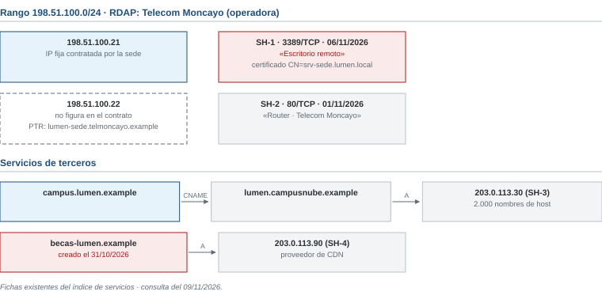
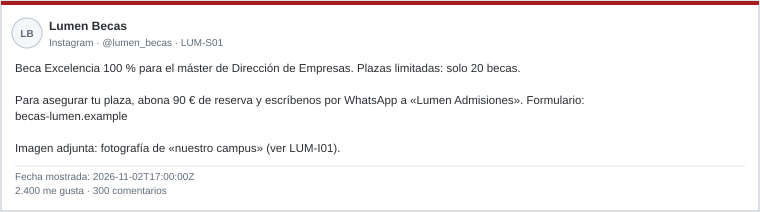

# Examen de ejemplo R2 · Lumen Business School

*Ciberinteligencia (CIBINT) · Examen parcial · Ejemplo*

| Nombre y apellidos | Profesor |
|---|---|
| | |

Responde en este mismo documento, debajo de cada pregunta o en sus tablas. Los casos están en las **hojas de referencia**, al final del documento. Las normas y los operadores de búsqueda están en el [anexo de referencia](../../../anexo-de-referencia.md).

# Ejercicios

## Bloque 1 · OSINT técnico e infraestructura

Hojas de referencia: **Caso 1**. El encargo solo autoriza la obtención pasiva.

### 1.1 · Clasificación de las fichas

Las fichas SH-1 a SH-4 de la figura 1 son resultados de Shodan. Indica si cada una corresponde a un equipo de la escuela, a un proveedor externo o si no puede saberse con los datos disponibles, y justifícalo.

| Ficha | Clasificación | Justificación |
|---|---|---|
| SH-1 | | |
| SH-2 | | |
| SH-3 | | |
| SH-4 | | |

### 1.2 · El acceso remoto

a) Explica en una frase qué se observó en SH-1, en qué fuente y en qué fecha.

b) ¿Por qué no coincide con lo que dice el inventario de la escuela?

c) ¿Qué debe hacerse y quién debe hacerlo?

### 1.3 · Consultas

a) Escribe dos consultas para Shodan que busquen solo equipos de la escuela.

b) Escribe la consulta para crt.sh que mostraría todos los certificados emitidos para nombres bajo lumen.example.

c) CT-3 muestra un mismo certificado para los dos dominios de becas. ¿Qué indica eso y qué no demuestra?

### 1.4 · Priorización

Indica para cada hallazgo si su prioridad es alta, media o baja, qué debe hacerse a continuación y quién debe hacerlo.

| Hallazgo | Prioridad | Siguiente paso y responsable |
|---|---|---|
| H1 · SH-1, escritorio remoto | | |
| H2 · SH-2, router en 198.51.100.22 | | |
| H3 · CT-2, encuestas.lumen.example | | |
| H4 · becas-lumen.example (CT-3) | | |

**Hallazgo prioritario y justificación:**

## Bloque 2 · Marco legal, ética y OPSEC

Hojas de referencia: **Caso 2** y anexo.

### 2.1 · El grupo que vende exámenes

Para cada propuesta, indica si se realiza, se realiza con condiciones o no se realiza. Justifícalo con una referencia del anexo.

| Propuesta | Decisión | Justificación y referencia |
|---|---|---|
| P1 | | |
| P2 | | |
| P3 | | |
| P4 | | |
| P5 | | |

### 2.2 · La bitácora

Reescribe correctamente la entrada B-03 del Caso 2.

| Fecha y hora (con zona horaria) | Propósito | Fuente | Acción y resultado | Decisión siguiente |
|---|---|---|---|---|
| | | | | |

## Bloque 3 · OSINT de personas y organizaciones

Hojas de referencia: **Caso 3**. Pregunta del director de admisiones: «¿Estamos ofreciendo becas que no existen? ¿Qué decimos a los candidatos?».

### 3.1 · Perfiles y personas

Indica la relación de cada perfil con Lumen: confirmada, no confirmada, suplantación probable o no determinable. Justifícalo con una evidencia.

| Perfil | Relación | Evidencia |
|---|---|---|
| LUM-P01 | | |
| LUM-P02 | | |
| LUM-P03 | | |
| LUM-P04 | | |

### 3.2 · Publicaciones y contexto

a) Ordena LUM-S01 a LUM-S03 en GMT+1.

b) La oferta tiene 2.400 «me gusta» y 300 comentarios positivos. ¿La hace eso más creíble? Justifícalo.

c) ¿Qué indica LUM-I01 sobre la fotografía del campus?

d) ¿Cuántas fuentes independientes sostienen que la beca existe?

### 3.3 · La organización que convoca

a) Con LUM-R01 a LUM-R03, indica qué puede afirmarse sobre «Lumen Education Group Ltd» y su relación con Lumen y qué no.

b) Valora cada fuente respecto de la afirmación «la Beca Excelencia 100 % es una convocatoria oficial de Lumen».

| Fuente | Fiabilidad de la fuente | Credibilidad de la afirmación |
|---|---|---|
| LUM-S01 | | |
| LUM-F01 | | |
| LUM-R02 | | |

### 3.4 · Búsqueda y nota

a) Escribe dos consultas para Google, con operadores del anexo E, que ayuden a avanzar en el caso.

b) Redacta la nota para el director de admisiones con una valoración, su grado de confianza, dos evidencias citadas, una limitación y una recomendación para los candidatos.

c) Desde la perspectiva del atacante, indica qué información pública de Lumen hizo creíble el engaño.

## Bloque 4 · Fundamentos y ciclo de inteligencia

Hojas de referencia: **Caso 4**.

### 4.1 · Niveles de inteligencia

Indica a qué nivel de inteligencia corresponde principalmente cada elemento: estratégico, operacional, táctico o técnico. Justifícalo en una línea.

| Elemento | Nivel | Justificación |
|---|---|---|
| E1 | | |
| E2 | | |
| E3 | | |
| E4 | | |
| E5 | | |

# Hojas de referencia

**Contexto común.** Lumen Business School es una escuela de negocios de Zaragoza con dominio lumen.example. Formas parte de su equipo de seguridad. La escuela es ficticia; el caso de MGM Resorts es real. En noviembre, la hora de Madrid es GMT+1; la marca Z indica UTC.

## Caso 1 · Exposición técnica de la escuela

Fecha de consulta: 09/11/2026. Según el inventario y el contrato con la operadora:

- www: web, gestionada por una agencia.
- campus: campus virtual, gestionado por un proveedor SaaS.
- La sede tiene contratada la IP fija 198.51.100.21. El escritorio remoto solo debe usarse a través de la VPN.

| Fuente | Dato |
|---|---|
| CT-1 | *.lumen.example (01/2026) |
| CT-2 | encuestas.lumen.example (certificado del 14/09/2026). El DNS pasivo no registra que ese nombre se haya usado nunca. |
| CT-3 | becas-lumen.example y becas-lumenbs.example, en un mismo certificado del 01/11/2026 |
| RDAP de becas-lumen.example | Creado el 31/10/2026. Datos del titular suprimidos. |

## Caso 2 · El grupo que vende exámenes

Un profesor avisa de que en un grupo privado de Telegram, «Lumen Apuntes», se ofrecen «exámenes del parcial» por 30 euros. En el grupo hay unas 200 personas. Un alumno ha enviado una captura del anuncio. Propuestas de la coordinación:

| Propuesta | Contenido |
|---|---|
| P1 | Crear un perfil ficticio de estudiante para entrar en el grupo y averiguar quién vende los exámenes. |
| P2 | Usar el usuario y la contraseña del campus que un alumno ha compartido en el grupo para ver qué se ha descargado. |
| P3 | Revisar los registros de descargas del campus virtual, conforme a la política de uso comunicada a profesores y alumnos. |
| P4 | Publicar en el tablón del campus la lista de alumnos que están en el grupo. |
| P5 | Cambiar los exámenes previstos y documentar el incidente en la bitácora. |

**Borrador de bitácora**

| Entrada | Fecha y hora | Propósito | Fuente | Acción y resultado | Decisión |
|---|---|---|---|---|---|
| B-03 | 05/11, por la tarde | — | Captura enviada por un alumno | Copio en la bitácora los nombres y teléfonos que se ven en la captura | Seguir mirando |

## Caso 3 · La Beca Excelencia 100 %

**Perfiles**

| ID | Perfil | Datos |
|---|---|---|
| LUM-P01 | Página de LinkedIn «Lumen Business School» | Enlazada desde la web oficial (LUM-F01). |
| LUM-P02 | Instagram @lumen_becas | Alta en 10/2026. Usa el logotipo de la escuela. No está enlazada desde LUM-F01. |
| LUM-P03 | LinkedIn «Ana Ruiz Pardo», directora de admisiones de Lumen | Figura en LUM-F01. |
| LUM-P04 | WhatsApp Business «Lumen Admisiones» | Número que aparece en LUM-S01. No consta en ninguna fuente oficial. |

**Fuentes y registros**

| ID | Fuente | Contenido |
|---|---|---|
| LUM-F01 | lumen.example/becas | Becas vigentes: «Beca Mérito 30 %» y «Beca Empresa 20 %». «Lumen nunca cobra por solicitar una beca.» |
| LUM-R01 | BORME | Lumen Business School, S.L., constituida en 2004. |
| LUM-R02 | Registro de Malta (OpenCorporates) | «Lumen Education Group Ltd», constituida el 20/10/2026. Domicilio en una empresa de domiciliación. |
| LUM-R03 | Aviso legal de lumen.example | Solo menciona a Lumen Business School, S.L. |

**Publicaciones**

| ID | Origen | Fecha y hora | Contenido |
|---|---|---|---|
| LUM-S01 | LUM-P02 | 2026-11-02 17:00Z | Oferta de la «Beca Excelencia 100 %» (figura 2). |
| LUM-S02 | Foro de estudiantes | 03/11/2026 09:30 GMT+1 | «¿Alguien ha pedido la beca del 100 %? Piden 90 € de reserva.» |
| LUM-S03 | LUM-P01 | 2026-11-04 08:00Z | «Circulan becas falsas en nuestro nombre. Solo publicamos convocatorias en lumen.example/becas.» |

**LUM-I01 · Búsqueda inversa.** La fotografía del campus de LUM-S01 coincide con una imagen de un banco de imágenes publicada en 2020 con el título «Edificio universitario moderno».

## Caso 4 · MGM Resorts y Lumen

**Caso real: MGM Resorts (septiembre de 2023).** La cadena hotelera MGM Resorts sufrió un ciberataque que afectó a sus sistemas durante días. Según la prensa, los atacantes consiguieron el acceso inicial engañando por teléfono al servicio de soporte informático. La empresa estimó en un documento remitido al regulador bursátil un impacto de unos 100 millones de dólares en sus resultados del trimestre. Fuentes: comunicado de MGM Resorts (octubre de 2023) y prensa económica.

| Elemento | Descripción |
|---|---|
| E1 | Los números de teléfono desde los que se llamó al servicio de soporte. |
| E2 | La forma de actuar: llamar al soporte haciéndose pasar por un empleado para restablecer sus credenciales. |
| E3 | El aumento de los ataques que empiezan por ingeniería social contra los servicios de soporte y su impacto económico en el sector. |
| E4 | La campaña contra MGM en septiembre de 2023 y su duración. |
| E5 | Una regla que exija verificar por un segundo canal cualquier petición de restablecer una contraseña. |
