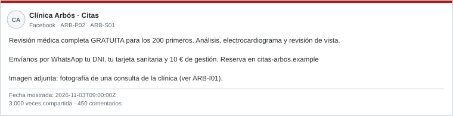
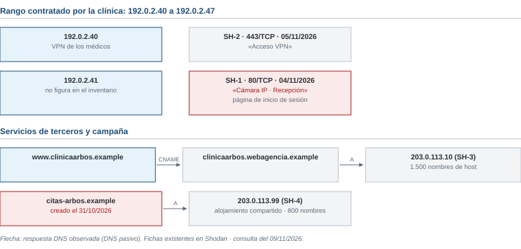

# Examen de ejemplo R3 · Clínica Arbós

*Ciberinteligencia (CIBINT) · Examen parcial · Ejemplo*

| Nombre y apellidos | Profesor |
|---|---|
| | |

Responde en este mismo documento, debajo de cada pregunta o en sus tablas. Los casos están en las **hojas de referencia**, al final del documento. Las normas y los operadores de búsqueda están en el [anexo de referencia](../../../anexo-de-referencia.md).

# Ejercicios

## Bloque 1 · OSINT de personas y organizaciones

Hojas de referencia: **Caso 1**. Pregunta de la gerente: «¿Es nuestra la oferta de revisión gratuita? ¿Qué decimos a los pacientes?».

### 1.1 · Perfiles y personas

Indica la relación de cada perfil con la Clínica Arbós: oficial, suplantación probable o no se puede saber. Justifícalo con una evidencia.

| Perfil | Relación | Evidencia |
|---|---|---|
| ARB-P01 | | |
| ARB-P02 | | |
| ARB-P03 | | |
| ARB-P04 | | |

### 1.2 · Publicaciones

a) Pasa las horas de ARB-S01 a ARB-S04 a GMT+1 y ordena las publicaciones.

b) ¿Qué publicación es la original? ¿Cuáles se limitan a repetir otra?

c) Según ARB-I01, ¿de dónde sale la fotografía de la oferta? ¿Demuestra eso quién creó la oferta?

d) La oferta se ha compartido 3.000 veces. ¿Es eso una razón para creerla?

### 1.3 · Valoración de fuentes

Valora cada fuente respecto de la afirmación «la Clínica Arbós ofrece revisiones gratuitas a quien envíe sus datos por WhatsApp».

| Fuente | Fiabilidad de la fuente | Credibilidad de la afirmación |
|---|---|---|
| ARB-S01 | | |
| ARB-S03 | | |
| ARB-S04 | | |

### 1.4 · Búsqueda y nota

a) Escribe dos consultas para Google con operadores del anexo E. Indica qué buscas con cada una.

b) Redacta una nota breve para la gerente con una valoración, su grado de confianza, dos evidencias citadas, una limitación y dos recomendaciones.

## Bloque 2 · Fundamentos y ciclo de inteligencia

Hojas de referencia: **Caso 2**.

### 2.1 · Requerimiento y tipos de información

a) Convierte el mensaje del director médico en un requerimiento. Completa cada componente.

| Componente | Respuesta |
|---|---|
| Destinatario | |
| Decisión que apoya | |
| Objeto | |
| Horizonte | |
| Alcance (incluido y excluido) | |
| Producto | |

b) Indica si cada elemento es un dato, información o inteligencia.

| Elemento | Dato, información o inteligencia |
|---|---|
| X1 | |
| X2 | |
| X3 | |
| X4 | |

## Bloque 3 · OSINT técnico e infraestructura

Hojas de referencia: **Caso 3**. La gerencia solo autoriza la obtención pasiva: consultar fuentes y servicios públicos sin conectarse a los equipos ni interactuar con nadie.

### 3.1 · ¿Dentro o fuera del encargo?

Indica si cada acción está dentro o fuera del encargo y por qué.

| Acción | ¿Dentro o fuera? | Motivo |
|---|---|---|
| a. Buscar %.clinicaarbos.example en crt.sh | | |
| b. Leer en Shodan la ficha existente de 192.0.2.41 | | |
| c. Entrar en la página de la cámara con el usuario admin y la contraseña admin | | |
| d. Rellenar el formulario de citas-arbos.example con datos inventados para ver qué ocurre | | |
| e. Consultar el RDAP de citas-arbos.example | | |

### 3.2 · ¿De quién es cada equipo?

Las fichas SH-1 a SH-4 de la figura 2 son resultados de Shodan. Indica si cada una corresponde a un equipo de la clínica, a un proveedor externo o a la campaña de la oferta falsa, y justifícalo.

| Ficha | ¿De quién es? | Justificación |
|---|---|---|
| SH-1 | | |
| SH-2 | | |
| SH-3 | | |
| SH-4 | | |

### 3.3 · Interpretación

a) CT-3 muestra un mismo certificado para citas-arbos.example y arbos-salud.example. ¿Qué indica eso y qué no demuestra?

b) La gerente quiere bloquear la IP 203.0.113.99 en la red de la clínica. ¿Es buena idea? ¿Qué bloquearías tú?

c) Escribe una consulta para crt.sh y otra para Shodan que se limiten a la clínica.

### 3.4 · Prioridades

Indica para cada hallazgo si su prioridad es alta, media o baja, qué debe hacerse y quién debe hacerlo.

| Hallazgo | Prioridad | Qué hacer y quién |
|---|---|---|
| H1 · SH-1, cámara de recepción | | |
| H2 · SH-2, acceso VPN | | |
| H3 · CT-2, pruebas.clinicaarbos.example | | |
| H4 · citas-arbos.example | | |

**Hallazgo prioritario y justificación:**

## Bloque 4 · Marco legal, ética y OPSEC

Hojas de referencia: **Caso 4** y anexo.

### 4.1 · Propuestas del comité

Para cada propuesta, indica si se realiza, se realiza con condiciones o no se realiza. Justifícalo con una referencia del anexo.

| Propuesta | Decisión | Justificación y referencia |
|---|---|---|
| P1 | | |
| P2 | | |
| P3 | | |
| P4 | | |
| P5 | | |

### 4.2 · Difusión y seguridad operacional

a) Asigna una etiqueta TLP a cada producto del Caso 4.

| Producto | TLP | Justificación |
|---|---|---|
| T1 | | |
| T2 | | |
| T3 | | |

b) Propón dos medidas para investigar la oferta falsa sin exponer a la clínica ni a quien investiga.

# Hojas de referencia

**Contexto común.** La Clínica Arbós es un centro médico privado de Huesca con dominio clinicaarbos.example. Formas parte de su equipo de sistemas. La clínica es ficticia; el caso del Hospital Clínic es real. En noviembre, la hora de Madrid es GMT+1; la marca Z indica UTC.

## Caso 1 · La revisión gratuita

**Perfiles**

| ID | Perfil | Datos |
|---|---|---|
| ARB-P01 | Facebook «Clínica Arbós» | Enlazada desde la web oficial clinicaarbos.example. Activa desde 2016. |
| ARB-P02 | Facebook «Clínica Arbós · Citas» | Creada en 10/2026. Usa el logotipo de la clínica. No está enlazada desde la web oficial. |
| ARB-P03 | LinkedIn «Elena Sanz Bielsa», gerente de la Clínica Arbós | Figura en la página «Equipo» de la web oficial. |
| ARB-P04 | Instagram «elena.sanz» | Sin foto. 15 seguidores. Publica fotos de montaña. Ningún dato la relaciona con la clínica. |

**Publicaciones**

| ID | Origen | Fecha y hora | Contenido |
|---|---|---|---|
| ARB-S01 | ARB-P02 | 2026-11-03 09:00Z | Oferta de «revisión médica gratuita» (figura 1). |
| ARB-S02 | Grupo de Facebook «Vecinos de Huesca» | 03/11/2026 11:15 GMT+1 | Comparte ARB-S01: «¡Aprovechad, es gratis!». |
| ARB-S03 | Periódico digital local | 03/11/2026 13:00 GMT+1 | «La Clínica Arbós niega haber lanzado la oferta». Cita ARB-S04. |
| ARB-S04 | ARB-P01 | 2026-11-03 11:30Z | «No hemos publicado ninguna oferta. Nunca pedimos datos de salud por WhatsApp. Las citas solo se piden en clinicaarbos.example.» |

**ARB-I01 · Búsqueda inversa de la imagen.** La fotografía de la consulta que aparece en ARB-S01 se publicó en 2024 en la web oficial de la clínica, en una noticia sobre la reforma de sus instalaciones.

## Caso 2 · El ataque al Hospital Clínic

**Caso real: Hospital Clínic de Barcelona (marzo de 2023).** Un ataque de ransomware dejó al hospital sin sus sistemas informáticos durante días. Hubo que aplazar consultas y operaciones y trabajar en papel. Los atacantes pidieron un rescate, que no se pagó, y después publicaron datos robados. Fuentes: comunicados del hospital y de la Generalitat de Cataluña y prensa generalista.

**Mensaje del director médico de la Clínica Arbós:** «Después de lo del Clínic, quiero saber antes del comité de diciembre si podríamos seguir atendiendo a los pacientes si nos pasara algo así y en qué invertir el presupuesto de 2027. No quiero detalles técnicos: dame algo que pueda entender en diez minutos.»

| ID | Elemento |
|---|---|
| X1 | La dirección IP 198.51.100.7 aparece en el registro del cortafuegos de la clínica. |
| X2 | Lista de doce hospitales europeos atacados con ransomware en 2023, con su fecha y el grupo atacante. |
| X3 | «Es probable que los centros sanitarios privados medianos sigan siendo objetivo en 2027, porque dependen de sus sistemas para atender. Se recomienda priorizar las copias de seguridad aisladas.» |
| X4 | Registro del cortafuegos del 02/11/2026, con 4.000 líneas sin revisar. |

## Caso 3 · Exposición técnica de la clínica

Fecha de consulta: 09/11/2026. Según el inventario de la clínica:

- La web la aloja una agencia en una plataforma compartida.
- La clínica tiene contratado el rango de IP 192.0.2.40 a 192.0.2.47.
- La VPN de los médicos está en 192.0.2.40.
- Las cámaras de seguridad solo deben verse desde la red interna.

| Fuente | Dato |
|---|---|
| CT-1 | *.clinicaarbos.example (certificado de 01/2026) |
| CT-2 | pruebas.clinicaarbos.example (certificado de 03/2025). El DNS pasivo no registra que ese nombre se haya usado nunca. |
| CT-3 | citas-arbos.example y arbos-salud.example, en un mismo certificado del 01/11/2026 |
| RDAP de citas-arbos.example | Creado el 31/10/2026. Datos del titular ocultos. |

## Caso 4 · Decisiones del comité

Propuestas del comité de dirección después de la oferta falsa:

| Propuesta | Contenido |
|---|---|
| P1 | Crear un perfil falso de paciente y escribir por WhatsApp al número de la oferta para averiguar quién está detrás. |
| P2 | Denunciar la página ARB-P02 a Facebook por suplantación, con capturas y enlaces. |
| P3 | Publicar en la web la lista de pacientes que comentaron que habían enviado sus datos, «para que tengan cuidado». |
| P4 | Revisar el correo de una recepcionista que pudo pasar la fotografía, aunque la clínica no ha fijado ni comunicado normas de uso del correo. |
| P5 | Enviar a INCIBE-CERT los dominios de la campaña. |

**Productos que hay que difundir**

| ID | Producto |
|---|---|
| T1 | Aviso para todos los pacientes: «La clínica no ha lanzado ninguna oferta. Nunca pedimos datos por WhatsApp». |
| T2 | Informe para la gerente y el responsable de sistemas sobre la cámara expuesta (H1), con su dirección IP. |
| T3 | Lista de los dominios de la campaña para las demás clínicas de la asociación sanitaria provincial. |
