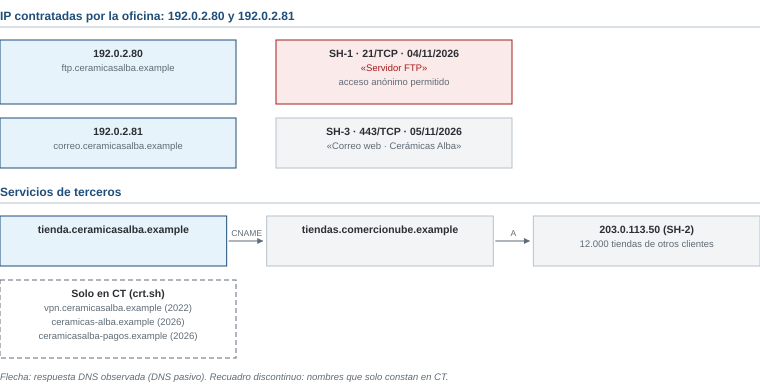

# Examen de ejemplo R4 · Cerámicas Alba

*Ciberinteligencia (CIBINT) · Examen parcial · Ejemplo*

| Nombre y apellidos | Profesor |
|---|---|
| | |

Responde en este mismo documento, debajo de cada pregunta o en sus tablas. Los casos están en las **hojas de referencia**, al final del documento. Las normas y los operadores de búsqueda están en el [anexo de referencia](../../../anexo-de-referencia.md).

# Ejercicios

## Bloque 1 · OSINT técnico e infraestructura

Hojas de referencia: **Caso 1**. La dirección solo autoriza la obtención pasiva: consultar fuentes y servicios públicos sin conectarse a los equipos ni interactuar con nadie.

### 1.1 · ¿De quién es cada equipo?

Las fichas SH-1 a SH-3 de la figura 1 son resultados de Shodan. Indica si cada una corresponde a un equipo de Cerámicas Alba o a un proveedor externo, y justifícalo.

| Ficha | ¿De quién es? | Justificación |
|---|---|---|
| SH-1 | | |
| SH-2 | | |
| SH-3 | | |

### 1.2 · El servidor de ficheros

a) Explica en una frase qué se observó en SH-1, en qué fuente y en qué fecha.

b) ¿Por qué es un riesgo para la empresa?

c) ¿Qué debe hacerse y quién debe hacerlo?

### 1.3 · Dominios parecidos

a) Según CT-3 y el RDAP, ¿qué indica que existan ceramicas-alba.example y ceramicasalba-pagos.example?

b) ¿Qué no permiten afirmar esos datos?

c) Propón una medida para que los clientes no caigan en un engaño con esos dominios.

### 1.4 · Consultas

a) Escribe dos consultas para Shodan que busquen solo equipos de la empresa.

b) Escribe la consulta para crt.sh que mostraría todos los certificados de nombres bajo ceramicasalba.example.

c) CT-2 muestra vpn.ceramicasalba.example, pero hoy ese nombre no responde en el DNS. ¿Qué significa y qué harías?

### 1.5 · ¿Dentro o fuera del encargo?

Indica si cada acción está dentro o fuera del encargo y por qué.

| Acción | ¿Dentro o fuera? | Motivo |
|---|---|---|
| a. Leer en Shodan la ficha existente de 192.0.2.80 | | |
| b. Conectarse al FTP de 192.0.2.80 como anónimo para ver qué ficheros hay | | |
| c. Consultar el RDAP de ceramicas-alba.example | | |
| d. Buscar ceramicasalba-pagos.example en urlscan.io | | |
| e. Enviar un correo a ceramicas-alba.example para ver quién contesta | | |

## Bloque 2 · OSINT de personas y organizaciones

Hojas de referencia: **Caso 2**. Pregunta del gerente: «¿Es de fiar Northbay Trading? ¿Les servimos el pedido?».

### 2.1 · Perfiles y registros

Indica la relación de cada elemento con la empresa que ha hecho el pedido: confirmada, no confirmada, identidad probablemente falsa u otra empresa con el mismo nombre. Justifícalo con una evidencia.

| Elemento | Relación | Evidencia |
|---|---|---|
| NOR-P01 | | |
| NOR-P02 | | |
| NOR-P03 | | |
| NOR-P04 | | |

### 2.2 · Documentos y fechas

a) La web dice «más de 20 años de experiencia». ¿Qué datos del caso lo contradicen?

b) ¿Qué demuestra la primera captura de la Wayback Machine (NOR-D02) y qué no demuestra?

c) ¿Qué aportan los metadatos del pedido (NOR-D03)? ¿Bastan para descartar la empresa?

### 2.3 · Valoración de fuentes

Valora cada fuente respecto de la afirmación «Northbay Trading es una empresa británica con más de 20 años de actividad».

| Fuente | Fiabilidad de la fuente | Credibilidad de la afirmación |
|---|---|---|
| NOR-D04 | | |
| NOR-P03 | | |
| NOR-D02 | | |

### 2.4 · Búsqueda y nota

a) Escribe dos consultas para Google con operadores del anexo E. Indica qué buscas con cada una.

b) Redacta una nota para el gerente con una valoración, su grado de confianza, dos evidencias citadas, una limitación y una recomendación.

## Bloque 3 · Marco legal, ética y OPSEC

Hojas de referencia: **Caso 3** y anexo.

### 3.1 · Propuestas del equipo comercial

Para cada propuesta, indica si se realiza, se realiza con condiciones o no se realiza. Justifícalo con una referencia del anexo.

| Propuesta | Decisión | Justificación y referencia |
|---|---|---|
| P1 | | |
| P2 | | |
| P3 | | |
| P4 | | |
| P5 | | |

### 3.2 · La bitácora

Reescribe correctamente la entrada B-02 del Caso 3.

| Fecha y hora (con zona horaria) | Propósito | Fuente | Acción y resultado | Decisión siguiente |
|---|---|---|---|---|
| | | | | |

## Bloque 4 · Fundamentos y ciclo de inteligencia

Hojas de referencia: **Caso 4**.

### 4.1 · Fases del ciclo de inteligencia

Indica en qué fase del ciclo de inteligencia está cada actividad: planificación y dirección, obtención, procesamiento, análisis, difusión o retroalimentación. Justifícalo en una línea.

| Actividad | Fase | Justificación |
|---|---|---|
| A1 | | |
| A2 | | |
| A3 | | |
| A4 | | |
| A5 | | |

# Hojas de referencia

**Contexto común.** Cerámicas Alba, S.L. es un fabricante de azulejos de Teruel que exporta a varios países. Su dominio es ceramicasalba.example. Formas parte de su departamento de sistemas. La empresa y Northbay Trading son ficticias; el caso de Toyota Boshoku es real. En noviembre, la hora de Madrid es GMT+1; la marca Z indica UTC.

## Caso 1 · Exposición técnica de la empresa

Fecha de consulta: 09/11/2026. Según el inventario:

- La tienda en línea está en una plataforma de comercio electrónico compartida.
- La oficina tiene contratadas las IP 192.0.2.80 y 192.0.2.81.
- El antiguo servidor de ficheros (FTP) se apagó en 2024, según el inventario.

| Fuente | Dato |
|---|---|
| CT-1 | *.ceramicasalba.example (certificado de 02/2026) |
| CT-2 | vpn.ceramicasalba.example (certificado de 2022). Hoy no responde en el DNS. |
| CT-3 | ceramicas-alba.example y ceramicasalba-pagos.example, en un mismo certificado del 30/10/2026 |
| RDAP de ceramicas-alba.example | Creado el 29/10/2026. Datos del titular ocultos. |

## Caso 2 · El nuevo cliente

El 02/11/2026, Cerámicas Alba recibe de «Northbay Trading Ltd» (Reino Unido) un pedido de 2.000 cajas de azulejos con pago a 90 días. Es su primer pedido. El gerente quiere saber si la empresa es real antes de servirlo.

**Perfiles y registros**

| ID | Elemento | Datos |
|---|---|---|
| NOR-P01 | Página de LinkedIn «Northbay Trading» | Creada en 09/2026. Tres empleados. Enlaza a northbay-trading.example. |
| NOR-P02 | LinkedIn «James Carter», director comercial de Northbay Trading | 41 contactos. Firma el correo del pedido. Su foto es de un banco de imágenes (NOR-I01). |
| NOR-P03 | Registro mercantil británico (Companies House) | «NORTHBAY TRADING LIMITED», constituida en 2011, activa, domicilio en Bristol. Actividad: venta de pescado. Web: northbaytrading.example (sin guion). Ningún directivo se llama James Carter. |
| NOR-P04 | Cuenta de X @northbay_tr | Dos publicaciones, de 10/2026. Ninguna mención a otras fuentes. |

**Documentos**

| ID | Fuente | Contenido |
|---|---|---|
| NOR-D01 | Correo del pedido | Enviado desde ventas@northbay-trading.example el 2026-11-02 a las 08:30Z. |
| NOR-D02 | Wayback Machine | Primera captura de northbay-trading.example: 20/10/2026. |
| NOR-D03 | Metadatos del PDF del pedido | Autor: «Usuario». Creado el 02/11/2026 con un procesador de textos gratuito. |
| NOR-D04 | Web northbay-trading.example, «Quiénes somos» | «Más de 20 años de experiencia en materiales de construcción.» |

**NOR-I01 · Búsqueda inversa de la imagen.** La foto de perfil de NOR-P02 aparece en un banco de imágenes desde 2019 con el título «Hombre de negocios sonriente».

## Caso 3 · Propuestas y bitácora

Propuestas del equipo comercial:

| Propuesta | Contenido |
|---|---|
| P1 | Llamar al teléfono del pedido haciéndose pasar por periodista para preguntar por la empresa. |
| P2 | Consultar el registro mercantil británico y OpenCorporates. |
| P3 | Enviar a Northbay un correo con un enlace que revele su dirección IP cuando lo abran. |
| P4 | Revisar el correo personal del comercial que habló con ellos, aunque la empresa no tiene normas sobre el uso del correo. |
| P5 | Pedir a Northbay referencias comerciales y un pago por adelantado del primer pedido. |

**Borrador de bitácora**

| Entrada | Fecha y hora | Propósito | Fuente | Acción y resultado | Decisión |
|---|---|---|---|---|---|
| B-02 | 03/11, por la mañana | — | Internet | He mirado la web y parece falsa | — |

## Caso 4 · Toyota Boshoku y el ciclo de inteligencia

**Caso real: Toyota Boshoku (agosto de 2019).** Una filial europea de este fabricante de componentes del grupo Toyota transfirió unos 37 millones de dólares a una cuenta de los atacantes. Recibió instrucciones falsas de cambio de cuenta bancaria que parecían de alguien de confianza (fraude del CEO o *BEC*). Fuentes: comunicado de la empresa (septiembre de 2019) y prensa económica.

Después de conocer el caso, Cerámicas Alba encarga un estudio. Actividades:

| ID | Actividad |
|---|---|
| A1 | El gerente pide saber, antes de enero, si la empresa podría sufrir un fraude así y qué controles le faltan. |
| A2 | Se recopilan noticias, avisos de INCIBE y casos parecidos en empresas del sector. |
| A3 | Se traducen al español los textos en inglés y se ordenan por fecha. |
| A4 | Se concluye que el riesgo es alto, porque cualquier cambio de cuenta se acepta por correo sin confirmarlo por teléfono. |
| A5 | El gerente dice que el informe le ha servido, pero que quiere saber también qué cuesta cada control. |
