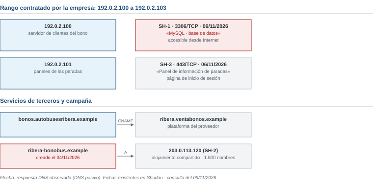
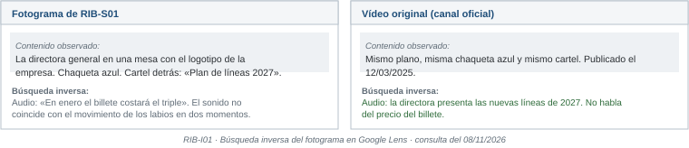

# Examen de ejemplo R5 · Autobuses Ribera

*Ciberinteligencia (CIBINT) · Examen parcial · Ejemplo*

| Nombre y apellidos | Profesor |
|---|---|
| | |

Responde en este mismo documento, debajo de cada pregunta o en sus tablas. Los casos están en las **hojas de referencia**, al final del documento. Las normas y los operadores de búsqueda están en el [anexo de referencia](../../../anexo-de-referencia.md).

# Ejercicios

## Bloque 1 · Marco legal, ética y OPSEC

Hojas de referencia: **Caso 1** y anexo.

### 1.1 · Propuestas del comité de dirección

Para cada propuesta, indica si se realiza, se realiza con condiciones o no se realiza. Justifícalo con una referencia del anexo.

| Propuesta | Decisión | Justificación y referencia |
|---|---|---|
| P1 | | |
| P2 | | |
| P3 | | |
| P4 | | |
| P5 | | |

### 1.2 · Difusión y principios

a) Asigna una etiqueta TLP a cada producto del Caso 1.

| Producto | TLP | Justificación |
|---|---|---|
| T1 | | |
| T2 | | |
| T3 | | |

b) ¿Qué principio del Informe Menlo incumple la propuesta P3? Explícalo en una línea.

## Bloque 2 · OSINT técnico e infraestructura

Hojas de referencia: **Caso 2**. El comité solo autoriza la obtención pasiva: consultar fuentes y servicios públicos sin conectarse a los equipos ni interactuar con nadie.

### 2.1 · ¿Dentro o fuera del encargo?

Indica si cada acción está dentro o fuera del encargo y por qué.

| Acción | ¿Dentro o fuera? | Motivo |
|---|---|---|
| a. Leer en Shodan la ficha existente de 192.0.2.100 | | |
| b. Intentar conectarse a la base de datos de 192.0.2.100 para comprobar si pide contraseña | | |
| c. Buscar %.autobusesribera.example en crt.sh | | |
| d. Consultar el RDAP de ribera-bonobus.example | | |
| e. Comprar un bono en ribera-bonobus.example para ver si llega | | |

### 2.2 · ¿De quién es cada equipo?

Las fichas SH-1 a SH-3 de la figura 1 son resultados de Shodan. Indica si cada una corresponde a un equipo de la empresa, a un proveedor externo o a la venta falsa de bonos, y justifícalo.

| Ficha | ¿De quién es? | Justificación |
|---|---|---|
| SH-1 | | |
| SH-2 | | |
| SH-3 | | |

### 2.3 · La base de datos de clientes

a) Explica en una frase qué se observó en SH-1, en qué fuente y en qué fecha.

b) ¿Por qué no coincide con lo que dice el inventario de la empresa?

c) ¿Qué debe hacerse y quién debe hacerlo?

### 2.4 · Certificados

a) CT-3 muestra un mismo certificado para ribera-bonobus.example y ribera-abonos.example. ¿Qué indica eso?

b) ¿Qué no demuestra?

c) CT-2 muestra dev-clientes.autobusesribera.example, que hoy no responde en el DNS. ¿Qué harías?

### 2.5 · Consultas

a) Escribe dos consultas para Shodan que busquen solo equipos de la empresa.

b) Escribe una consulta para urlscan.io que busque análisis ya hechos de ribera-bonobus.example.

c) ¿Por qué no basta con bloquear la IP de SH-2 para frenar la venta falsa de bonos?

## Bloque 3 · Fundamentos y ciclo de inteligencia

Hojas de referencia: **Caso 3**.

### 3.1 · Un requerimiento mal planteado

a) Señala cuatro problemas del mensaje del consejero delegado como requerimiento de inteligencia.

b) Reescríbelo como requerimiento. Completa cada componente.

| Componente | Respuesta |
|---|---|
| Destinatario | |
| Decisión que apoya | |
| Objeto | |
| Horizonte | |
| Alcance (incluido y excluido) | |
| Producto | |

## Bloque 4 · OSINT de personas y organizaciones

Hojas de referencia: **Caso 4**. Pregunta del consejero delegado: «¿Ha dicho nuestra directora eso? ¿Qué decimos a los viajeros?».

### 4.1 · Perfiles y personas

Indica la relación de cada perfil con la empresa o con su directora general: oficial, no oficial, cuenta anónima o no se puede saber. Justifícalo con una evidencia.

| Perfil | Relación | Evidencia |
|---|---|---|
| RIB-P01 | | |
| RIB-P02 | | |
| RIB-P03 | | |
| RIB-P04 | | |

### 4.2 · Publicaciones

a) Pasa las horas de RIB-S01 a RIB-S04 a GMT+1 y ordena las publicaciones.

b) ¿Qué publicación es la original? ¿Cuáles dependen de otras?

c) Según RIB-I01, ¿de dónde sale la imagen del vídeo? ¿Qué no demuestra?

d) ¿Qué tipo de fuente es RIB-S04 y qué aporta?

### 4.3 · Valoración de fuentes

Valora cada fuente respecto de la afirmación «la directora general anunció en rueda de prensa que el billete costará el triple».

| Fuente | Fiabilidad de la fuente | Credibilidad de la afirmación |
|---|---|---|
| RIB-S01 | | |
| RIB-S03 | | |
| RIB-S04 | | |

### 4.4 · Búsqueda y nota

a) Escribe dos consultas para Google con operadores del anexo E. Indica qué buscas con cada una.

b) Redacta una nota breve para el consejero delegado con una valoración, su grado de confianza, dos evidencias citadas, una limitación y dos recomendaciones.

# Hojas de referencia

**Contexto común.** Autobuses Ribera, S.A. es la empresa de autobuses urbanos de Logroño, con dominio autobusesribera.example. Formas parte de su equipo de comunicación y sistemas. La empresa es ficticia; el caso de Arup es real. En noviembre, la hora de Madrid es GMT+1; la marca Z indica UTC.

## Caso 1 · Propuestas del comité de dirección

Después de que circule el vídeo del Caso 4, el comité de dirección propone:

| Propuesta | Contenido |
|---|---|
| P1 | Denunciar el vídeo a TikTok por suplantación, con su enlace y capturas. |
| P2 | Crear un perfil falso de viajero para entrar en el grupo privado de Telegram «Ribera Filtraciones» y preguntar quién hizo el vídeo. |
| P3 | Publicar el nombre y el barrio del vecino que, según un rumor, difundió el vídeo primero. |
| P4 | Entrar en la cuenta RIB-P02 con una contraseña que alguien ha publicado en un foro. |
| P5 | Guardar una copia del vídeo con su enlace, la fecha y una huella digital (hash), y anotarlo en la bitácora. |

**Productos que hay que difundir**

| ID | Producto |
|---|---|
| T1 | Comunicado para los viajeros: «El vídeo está manipulado. El original es de una rueda de prensa de 2025». |
| T2 | Informe para el consejero delegado y el responsable de sistemas sobre la base de datos expuesta (Caso 2), con su dirección IP. |
| T3 | Los dominios de la venta falsa de bonos, para las demás empresas de transporte urbano. |

## Caso 2 · Exposición técnica de la empresa

Fecha de consulta: 09/11/2026. Según el inventario de la empresa:

- La venta de bonos en línea la gestiona una empresa externa en su plataforma.
- La empresa tiene contratado el rango de IP 192.0.2.100 a 192.0.2.103.
- La base de datos de clientes del bono solo debe ser accesible desde el servidor web de la empresa, nunca desde Internet.

| Fuente | Dato |
|---|---|
| CT-1 | *.autobusesribera.example (certificado de 03/2026) |
| CT-2 | dev-clientes.autobusesribera.example (certificado de 2024). Hoy no responde en el DNS. |
| CT-3 | ribera-bonobus.example y ribera-abonos.example, en un mismo certificado del 05/11/2026 |
| RDAP de ribera-bonobus.example | Creado el 04/11/2026. Datos del titular ocultos. |

## Caso 3 · El caso Arup

**Caso real: Arup (Hong Kong, 2024).** Un empleado de la oficina de Hong Kong de la ingeniería Arup hizo varias transferencias por unos 25 millones de dólares. Lo hizo después de una videoconferencia en la que el «director financiero» y otros «compañeros» eran imágenes y voces falsas creadas con inteligencia artificial (*deepfakes*). Fuentes: Policía de Hong Kong (febrero de 2024), confirmación de Arup (mayo de 2024) y prensa internacional.

**Mensaje del consejero delegado de Autobuses Ribera:** «Investigad todo lo de los deepfakes y decidme algo cuando podáis.»

Información adicional: el consejo de administración se reúne el 15/12/2026 para aprobar el presupuesto de 2027. La empresa hace pagos importantes a proveedores de combustible y talleres, a veces con prisa a final de mes.

## Caso 4 · El vídeo de la directora

**Perfiles**

| ID | Perfil | Datos |
|---|---|---|
| RIB-P01 | X @autobusesribera | Enlazada desde la web oficial de la empresa. |
| RIB-P02 | TikTok @ribera_filtraciones | Creada en 10/2026. Sin nombre real. Solo publica vídeos de la empresa. |
| RIB-P03 | LinkedIn «Laura Ortega Ruiz», directora general de Autobuses Ribera | Enlazada desde la web oficial de la empresa. |
| RIB-P04 | X «Laura Ortega» @lauraortega_ | 30 seguidores. Publica sobre coches. Ningún dato la relaciona con la empresa. |

**Publicaciones**

| ID | Origen | Fecha y hora | Contenido |
|---|---|---|---|
| RIB-S01 | RIB-P02 | 2026-11-07 21:10Z | Vídeo de 20 segundos: la directora, en rueda de prensa, parece anunciar que el billete costará el triple en enero (figura 2). |
| RIB-S02 | Cuenta de X de una asociación de vecinos | 07/11/2026 23:00 GMT+1 | Comparte RIB-S01: «¡Esto es un abuso!». |
| RIB-S03 | RIB-P01 | 2026-11-08 09:00Z | «El vídeo está manipulado. La rueda de prensa original es del 12/03/2025 y está en nuestro canal oficial.» Incluye el enlace. |
| RIB-S04 | Periódico regional | 08/11/2026 11:30 GMT+1 | Compara los dos vídeos: misma imagen, distinto sonido. En el original, la directora habla de las nuevas líneas de 2027. |

**RIB-I01 · Búsqueda inversa de un fotograma.** El fotograma de RIB-S01 coincide con el vídeo de la rueda de prensa del 12/03/2025, publicado en el canal oficial de la empresa: mismo plano, misma ropa y mismo fondo.

