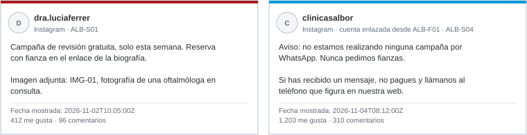
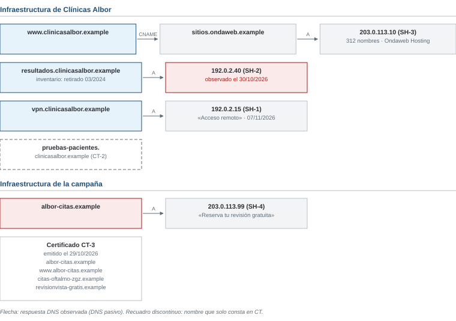

# Examen parcial · Modelo E1 · Clínicas Albor

*Ciberinteligencia (CIBINT) · Curso 2026-2027 · Temas 1 a 4*

| Nombre y apellidos | Profesor |
|---|---|
| | Hector Lazaro Arrechea Elissalt |

## Instrucciones

- **Duración:** parte individual, hasta 1 h 30 min (diseñada para unos 60 min). Parte grupal, 30 min, con enunciado aparte; empieza al recoger la individual.
- **Documentos y material:** este examen, las hojas de referencia (dossier de casos y anexo) y las hojas de respuesta. **Solo se corrigen las hojas de respuesta.** No se permiten apuntes, dispositivos ni comunicación con otras personas.
- **Referencias y horas:** cita el dossier por sus identificadores (por ejemplo, ALB-S01) y las normas por su referencia del anexo (N-xx). La marca Z indica UTC; la hora de Madrid en noviembre es GMT+1.
- **Advertencia:** el dossier contiene datos que pueden inducir a error de forma deliberada.

## Puntuación

| Bloque 1 | Bloque 2 | Bloque 3 | Bloque 4 | Parte grupal | Total |
|---|---|---|---|---|---|
| Tema 3 · 3,5 | Tema 1 · 1,0 | Tema 4 · 2,5 | Tema 2 · 1,5 | Temas 2, 3 y 4 · 1,5 | 10 |

Cada pregunta indica su puntuación y, cuando tiene varios elementos, la de cada uno. Se puntúa cada elemento correcto y justificado, por lo que una respuesta incompleta puede obtener puntuación parcial. Las respuestas incorrectas no restan. El parcial pesa un 25 % en la calificación final.

## Penalizaciones

| Situación | Penalización |
|---|---|
| Presentar inferencias como hechos, atribuir sin evidencia o presentar una exposición como intrusión | Hasta -0,25 por bloque |
| Proponer como válida una acción ilícita o un engaño | 0 en ese apartado |
| No unificar las zonas horarias cuando se pide | -0,1 en esa pregunta |
| Citar una norma o una fuente sin aplicarla al caso | Ese elemento no puntúa |
| Respuestas ilegibles o escritas fuera de las hojas de respuesta | No se corrigen |
| Copiar o usar dispositivos | 0 en el examen |

# Ejercicios

En el examen, las respuestas se escribían en hojas de respuesta aparte. Aquí puedes responder debajo de cada pregunta o en sus tablas.

## Bloque 1 · OSINT de personas y organizaciones (3,5 puntos)

Hojas de referencia: **Caso 1**. Pregunta del responsable de seguridad: «¿Procede de Clínicas Albor la campaña de revisión gratuita con fianza?».

### 1.1 · Perfiles y personas (0,8 puntos)

Indica la relación de cada perfil con la Dra. Lucía Ferrer Gil de Albor: confirmada, no confirmada, no relacionada o no determinable. Justifica cada respuesta con la evidencia del dossier.

Puntuación: 0,1 por relación correcta y 0,1 por evidencia, en cada perfil.

| Perfil | Relación | Evidencia |
|---|---|---|
| ALB-P01 | | |
| ALB-P02 | | |
| ALB-P03 | | |
| ALB-P04 | | |

### 1.2 · Publicaciones y contexto (0,9 puntos)

a) Indica qué publicaciones son originales y de cuál depende cada una de las demás. (0,3)

b) ¿Cuántas fuentes independientes sostienen que Albor ofrece revisiones gratuitas con fianza? Justifícalo. (0,2)

c) Ordena las publicaciones ALB-S01 a ALB-S04 en GMT+1. (0,2)

d) ¿Qué demuestra ALB-I01 y qué no demuestra? (0,2)

### 1.3 · Organización y búsqueda (0,8 puntos)

a) ¿Qué permite afirmar ALB-R02 sobre «Albor Salud Digital, S.L.»? (0,2)

b) ¿Qué no permite afirmar sobre su relación con la campaña? (0,2)

c) Escribe dos consultas para Google, con operadores del anexo E, que respondan a preguntas distintas del caso. Indica qué buscas con cada una. (0,4 · 0,2 por consulta)

### 1.4 · Valoración (1,0 puntos)

a) Redacta para la nota del responsable un hecho, una inferencia, una limitación y una recomendación, citando los identificadores del dossier. (0,6 · 0,15 por frase)

b) Desde la perspectiva del atacante, indica dos datos públicos que aprovechó la campaña y una medida defensiva proporcionada para cada uno. (0,4 · 0,1 por dato y 0,1 por medida)

## Bloque 2 · Fundamentos y ciclo de inteligencia (1,0 puntos)

Hojas de referencia: **Caso 2**.

### 2.1 · Requerimiento de inteligencia (1,0 puntos)

a) Convierte el mensaje del director gerente en un requerimiento. Completa cada componente. (0,6 · 0,1 por componente)

| Componente | Respuesta |
|---|---|
| Destinatario | |
| Decisión que apoya | |
| Objeto | |
| Horizonte | |
| Alcance (incluido y excluido) | |
| Producto | |

b) A partir de lo que enseña el caso Vastaamo, formula dos preguntas de inteligencia para el comité de crisis. (0,4 · 0,2 por pregunta)

## Bloque 3 · OSINT técnico e infraestructura (2,5 puntos)

Hojas de referencia: **Caso 3**. El encargo solo autoriza la obtención pasiva.

### 3.1 · Formas de obtención (0,5 puntos)

Indica si cada acción está dentro o fuera del encargo y por qué.

Puntuación: 0,1 por acción correctamente clasificada y justificada.

| Acción | ¿Dentro o fuera? | Motivo |
|---|---|---|
| a. Consultar crt.sh para %.clinicasalbor.example | | |
| b. Abrir albor-citas.example desde el puesto corporativo | | |
| c. Leer en Shodan la ficha existente de 192.0.2.40 | | |
| d. Pedir al índice un escaneo nuevo de 192.0.2.40 | | |
| e. Leer el análisis ya existente en urlscan.io | | |

### 3.2 · Interpretación de los datos (0,8 puntos)

a) Los dos dominios tienen los datos del titular suprimidos. ¿Qué significa eso para el análisis? (0,2)

b) ¿Pueden añadirse al inventario de Albor los 312 nombres de host de SH-3? (0,2)

c) ¿Qué relación establece CT-3 entre sus nombres? ¿Es más fuerte o más débil que compartir una IP? (0,2)

d) ¿Qué permite afirmar CT-2 y qué propones hacer? (0,2)

### 3.3 · Identificación de tecnologías (0,4 puntos)

a) Con la muestra ALB-H01, formula una hipótesis sobre la tecnología de albor-citas.example. (0,2)

b) Indica una explicación alternativa o un límite de esa hipótesis. (0,2)

### 3.4 · Priorización (0,8 puntos)

Asigna a cada hallazgo una prioridad: alta para validación, verificación de cierre, pendiente, revisión ordinaria o acción defensiva externa. Indica el siguiente paso.

Puntuación: 0,15 por hallazgo y 0,2 por la justificación del hallazgo prioritario.

| Hallazgo | Prioridad | Siguiente paso y responsable |
|---|---|---|
| H1 · SH-2, resultados | | |
| H2 · CT-2, pruebas-pacientes | | |
| H3 · SH-1, vpn | | |
| H4 · albor-citas.example y CT-3 | | |

**Hallazgo prioritario y justificación:**

## Bloque 4 · Marco legal, ética y OPSEC (1,5 puntos)

Hojas de referencia: **Caso 4** y anexo.

### 4.1 · Acciones propuestas por el comité (1,0 puntos)

Para cada acción, indica si se realiza, se realiza con condiciones o no se realiza. Justifícalo con una referencia del anexo.

Puntuación: 0,1 por decisión y 0,1 por justificación con referencia, en cada acción.

| Acción | Decisión | Justificación y referencia |
|---|---|---|
| A1 | | |
| A2 | | |
| A3 | | |
| A4 | | |
| A5 | | |

### 4.2 · Notificación de la violación de seguridad (0,5 puntos)

El director gerente dice: «Si no hay pruebas de intrusión, no notificamos».

a) ¿Desde cuándo cuenta el plazo de N-08 y qué permite hacer si todavía falta información? (0,25)

b) ¿A quién corresponde la decisión de notificar y qué aporta la valoración del analista? (0,25)

# Hojas de referencia

Las normas, los criterios y los operadores de búsqueda están en el [anexo de referencia](../../anexo-de-referencia.md).

**Contexto común.** Clínicas Albor es una red de nueve clínicas oftalmológicas privadas de Zaragoza, con dominio clinicasalbor.example. Formas parte de su equipo interno de seguridad. Albor es una organización ficticia; el caso Vastaamo es real. En noviembre, la hora de Madrid es GMT+1; la marca Z indica UTC.

## Caso 1 · La campaña de «revisión gratuita»

Desde el 2 de noviembre, varios pacientes reciben mensajes de WhatsApp firmados por «Dra. Lucía Ferrer, Clínicas Albor». En ellos se les ofrece una revisión gratuita y se les pide pagar una fianza de 20 euros en albor-citas.example.

**Perfiles**

| ID | Cuenta | Lo que muestra | Datos de la plataforma |
|---|---|---|---|
| ALB-P01 | Instagram @dra.luciaferrer | «Oftalmóloga en Clínicas Albor. Citas: albor-citas.example». 2.300 seguidores. | Alta en 10/2026. Dos cambios de nombre de usuario. |
| ALB-P02 | LinkedIn «Lucía Ferrer Gil» | Oftalmóloga en Albor desde 2019. | Enlazado desde la web oficial (ALB-F01). |
| ALB-P03 | Facebook «Lucía Ferrer» | Fisioterapeuta en Valencia. | Sin relación visible con Albor. |
| ALB-P04 | TikTok @luciaferrer_oftalmo | Un único vídeo: fragmento de una conferencia de la doctora. | Alta hace tres semanas. Sin enlaces. |

**Fuentes corporativas y registros**

| ID | Fuente | Contenido |
|---|---|---|
| ALB-F01 | clinicasalbor.example/equipo | Incluye a la «Dra. Lucía Ferrer Gil» y enlaza a ALB-P02 y a la cuenta oficial @clinicasalbor. No enlaza ninguna cuenta personal de Instagram ni de TikTok. |
| ALB-R01 | BORME | «Clínicas Albor, S.L.», constituida en 2011, domicilio en Zaragoza. |
| ALB-R02 | BORME | «Albor Salud Digital, S.L.», constituida el 12/10/2026, domicilio en Madrid. El pie de la página de pago dice: «Servicio prestado por Albor Salud Digital, S.L.». |

**Publicaciones**

| ID | Cuenta o medio | Fecha y hora mostradas | Contenido |
|---|---|---|---|
| ALB-S01 | ALB-P01 | 2026-11-02 10:05Z | Anuncio de la campaña con la imagen IMG-01 (figura 1). |
| ALB-S02 | Grupo de Facebook «Familias de Zaragoza» | 03/11/2026 08:30 GMT+1 | Captura de ALB-S01 con el texto «Confirmado por la clínica». |
| ALB-S03 | Medio local zaragozaaldia.example | 03/11/2026 19:40 GMT+1 | «Albor lanza revisiones gratuitas». Única fuente citada: ALB-S01. |
| ALB-S04 | Cuenta oficial @clinicasalbor | 2026-11-04 08:12Z | Desmentido oficial (figura 1). |

**ALB-I01 · Búsqueda inversa de IMG-01 (Google Lens y TinEye).** La coincidencia más antigua encontrada es el boletín del congreso regional de oftalmología del 10/05/2022, con el pie de foto «Dra. Lucía Ferrer Gil (Clínicas Albor)». La imagen también aparece en ALB-F01.

## Caso 2 · El mensaje del director gerente

Martes 10/11/2026, 09:20 GMT+1. El director gerente escribe:

«Un paciente nos avisa de que en un canal de Telegram hay capturas que parecen de nuestras historias clínicas. Investiga todo lo que haya sobre nosotros en internet y dime algo.»

A las 17:00 se reúne el comité de crisis, formado por la gerencia, la dirección médica, la delegada de protección de datos (DPD) y sistemas. Debe tomar estas decisiones:

- Si notifica la violación de seguridad a la autoridad de control.
- Si avisa a los pacientes.
- Si publica un comunicado.

**Información disponible:**

- El aviso del paciente.
- Los registros de acceso al portal del paciente, que custodia el proveedor.
- El inventario de sistemas.

**Caso real: Vastaamo (Finlandia).** Vastaamo era un centro privado de psicoterapia. Según la Fiscalía:

- En 2018, un atacante accedió a su red y descargó los datos de unos 33.000 pacientes.
- El caso no se conoció públicamente hasta 2020.
- Ese año, el atacante exigió un rescate a la empresa y después escribió directamente a los pacientes. Les pidió unos 200 euros a cada uno, cantidad que subía a 500 euros si no pagaban en 24 horas.
- En abril de 2024, un tribunal de distrito condenó al autor a 6 años y 3 meses de prisión.
- El exconsejero delegado de la empresa recibió una condena condicional por un delito de protección de datos.

Fuentes: AP (30/04/2024), The Record y Yle.

## Caso 3 · Revisión de exposición

Fecha de consulta de todas las fuentes: 09/11/2026. Activos que recoge el inventario de septiembre de 2026:

- www: web corporativa, gestionada por la agencia Ondaweb.
- vpn: acceso remoto del personal, gestionado por sistemas.
- resultados: portal antiguo de resultados, retirado en marzo de 2024.

**Registro de dominios (RDAP)**

| Dominio | Creado | Registrador | Titular |
|---|---|---|---|
| clinicasalbor.example | 14/04/2009 | Registrador Uno | Datos suprimidos por política de privacidad |
| albor-citas.example | 28/10/2026 | Registrador Dos | Datos suprimidos por política de privacidad |

**Transparencia de certificados (crt.sh)**

| ID | Nombres incluidos | Válido desde | Tipo |
|---|---|---|---|
| CT-1 | *.clinicasalbor.example, clinicasalbor.example | 01/03/2026 | Certificado |
| CT-2 | pruebas-pacientes.clinicasalbor.example | 02/09/2026 | Precertificado, sin respuestas en DNS pasivo |
| CT-3 | albor-citas.example, www.albor-citas.example, citas-oftalmo-zgz.example, revisionvista-gratis.example | 29/10/2026 | Certificado |

**ALB-H01 · Análisis ya existente en urlscan.io de albor-citas.example (04/11/2026)**

| Cabecera de la respuesta | Valor |
|---|---|
| Server | nginx |
| X-Powered-By | PHP/8.1.2 |
| Set-Cookie | ci_session=… (valor omitido) |

La página muestra un formulario «Datos del paciente» y el botón «Pagar fianza (20 €)». El logotipo se carga desde www.clinicasalbor.example.

## Caso 4 · Propuestas del comité de crisis

En relación con el canal de Telegram del Caso 2, los miembros del comité proponen estas acciones:

| Acción | Propuesta |
|---|---|
| A1 | Revisar el canal desde su vista web pública, sin iniciar sesión, con el equipo de investigación de la organización, y anotar lo observado en la bitácora. |
| A2 | Descargar en el portátil del analista el archivo «muestra_pacientes.zip» que ofrece el canal, para comprobar si los datos son reales. |
| A3 | Escribir al administrador del canal haciéndose pasar por un comprador para conseguir más muestras. |
| A4 | Copiar en la bitácora los nombres y diagnósticos visibles en las capturas, como prueba. |
| A5 | Pedir al proveedor del portal del paciente, por el canal previsto en el contrato, los registros de acceso de las dos últimas semanas. |
