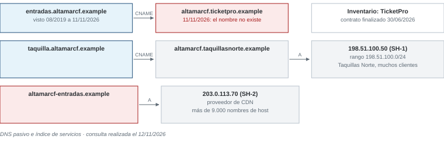
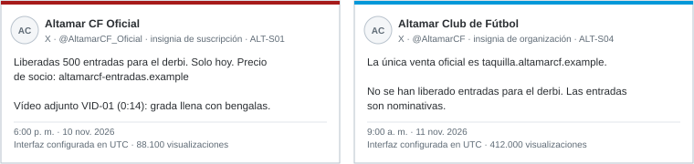
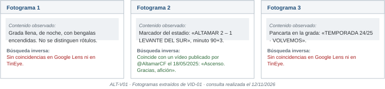

# Examen parcial · Modelo E2 · Altamar Club de Fútbol

*Ciberinteligencia (CIBINT) · Curso 2026-2027 · Temas 1 a 4*

| Nombre y apellidos | Profesor |
|---|---|
| | Hector Lazaro Arrechea Elissalt |

## Instrucciones

- **Duración:** parte individual, hasta 1 h 30 min (diseñada para unos 60 min). Parte grupal, 30 min, con enunciado aparte; empieza al recoger la individual.
- **Documentos y material:** este examen, las hojas de referencia (dossier de casos y anexo) y las hojas de respuesta. **Solo se corrigen las hojas de respuesta.** No se permiten apuntes, dispositivos ni comunicación con otras personas.
- **Referencias y horas:** cita el dossier por sus identificadores (por ejemplo, ALT-S01) y las normas por su referencia del anexo (N-xx). La marca Z indica UTC; la hora de Madrid en noviembre es GMT+1.
- **Advertencia:** el dossier contiene datos que pueden inducir a error de forma deliberada.

## Puntuación

| Bloque 1 | Bloque 2 | Bloque 3 | Bloque 4 | Parte grupal | Total |
|---|---|---|---|---|---|
| Tema 2 · 1,5 | Tema 4 · 2,5 | Tema 1 · 1,0 | Tema 3 · 3,5 | Temas 2, 3 y 4 · 1,5 | 10 |

Cada pregunta indica su puntuación y, cuando tiene varios elementos, la de cada uno. Se puntúa cada elemento correcto y justificado, por lo que una respuesta incompleta puede obtener puntuación parcial. Las respuestas incorrectas no restan. El parcial pesa un 25 % en la calificación final.

## Penalizaciones

| Situación | Penalización |
|---|---|
| Presentar inferencias como hechos, atribuir sin evidencia o presentar una exposición como intrusión | Hasta -0,25 por bloque |
| Proponer como válida una acción ilícita o un engaño | 0 en ese apartado |
| No unificar las zonas horarias cuando se pide | -0,1 en esa pregunta |
| Citar una norma o una fuente sin aplicarla al caso | Ese elemento no puntúa |
| Respuestas ilegibles o escritas fuera de las hojas de respuesta | No se corrigen |
| Copiar o usar dispositivos | 0 en el examen |

# Ejercicios

En el examen, las respuestas se escribían en hojas de respuesta aparte. Aquí puedes responder debajo de cada pregunta o en sus tablas.

## Bloque 1 · Marco legal, ética y OPSEC (1,5 puntos)

Hojas de referencia: **Caso 1** y anexo.

### 1.1 · Propuestas ante la filtración (1,0 puntos)

Para cada propuesta, indica si se realiza, se realiza con condiciones o no se realiza. Justifícalo con una referencia del anexo e indica, si procede, quién debería ocuparse.

Puntuación: 0,1 por decisión y 0,1 por justificación con referencia, en cada propuesta.

| Propuesta | Decisión | Justificación, referencia y responsable |
|---|---|---|
| P1 | | |
| P2 | | |
| P3 | | |
| P4 | | |
| P5 | | |

### 1.2 · La petición del presidente (0,5 puntos)

El presidente insiste: «Quiero el nombre del topo el viernes».

a) Indica dos motivos por los que la petición no puede atenderse tal como está formulada. (0,25)

b) Reformula el encargo en una frase que el equipo de seguridad pueda responder de forma legítima. (0,25)

## Bloque 2 · OSINT técnico e infraestructura (2,5 puntos)

Hojas de referencia: **Caso 2**. El encargo solo autoriza la obtención pasiva sobre activos del club y sobre la infraestructura de la campaña.

### 2.1 · Dominios parecidos (0,6 puntos)

Indica si cada dominio está relacionado con la campaña, no está relacionado o queda pendiente, y justifícalo.

Puntuación: 0,1 por clasificación y 0,1 por justificación, en cada dominio.

| Dominio | Relación con la campaña | Justificación |
|---|---|---|
| altamarcf-entradas.example | | |
| altarmarcf.example | | |
| altamar-cf.example | | |

### 2.2 · El subdominio entradas.altamarcf.example (0,8 puntos)

a) Describe lo que se observa en el DNS pasivo y en el inventario. (0,3)

b) Formula el riesgo como una hipótesis que hay que validar. (0,3)

c) Indica quién debe actuar y qué no debe hacer el analista para comprobarlo. (0,2)

### 2.3 · Consultas en Censys (0,6 puntos)

a) ¿Por qué ALT-Q1 y ALT-Q2 devuelven un número distinto de resultados? (0,3)

b) ¿Qué problema de alcance tienen las dos consultas? (0,15)

c) Reescribe una consulta en Censys que respete el alcance. (0,15)

### 2.4 · Intermediarios y retirada (0,5 puntos)

a) ¿Puede afirmarse que 203.0.113.70 es el servidor de los estafadores? Justifícalo con SH-2 y ALT-H01. (0,25)

b) ¿Qué fuente consultarías para dirigir una solicitud de retirada y qué datos incluirías? (0,25)

## Bloque 3 · Fundamentos y ciclo de inteligencia (1,0 puntos)

Hojas de referencia: **Caso 3**.

### 3.1 · Hechos y afirmaciones (1,0 puntos)

Para cada frase del Caso 3, indica si un analista podría escribirla tal cual como un hecho en su nota y explica por qué. Si la respuesta es no, reescríbela para que pueda incluirse.

Puntuación: 0,2 por frase (0,1 por la decisión y 0,1 por la explicación o la reescritura).

| Frase | ¿Como hecho? | Explicación o reescritura |
|---|---|---|
| a | | |
| b | | |
| c | | |
| d | | |
| e | | |

## Bloque 4 · OSINT de personas y organizaciones (3,5 puntos)

Hojas de referencia: **Caso 4**. Pregunta de la directora de comunicación: «¿Ha liberado alguien entradas en nuestro nombre? ¿Qué decimos a la afición?».

### 4.1 · Cuenta, publicación y afirmación (0,7 puntos)

a) En ALT-S01, identifica la cuenta, la publicación y tres afirmaciones que podrían comprobarse por separado. (0,5 · 0,1 por elemento)

b) ¿Qué acredita la insignia azul de ALT-C02 y qué no acredita? (0,2)

### 4.2 · El vídeo VID-01 (0,9 puntos)

a) ¿Qué demuestra la coincidencia del fotograma 2? Distingue la fecha de publicación, la fecha atribuida al hecho y la fecha de consulta. (0,3)

b) Indica dos indicios del propio contenido que debiliten que el vídeo sea del derbi de 2026. (0,2 · 0,1 por indicio)

c) ¿Qué conclusión puede sacarse de que los fotogramas 1 y 3 no tengan coincidencias? (0,2)

d) Escribe la conclusión sobre VID-01 en una frase comprobable. (0,2)

### 4.3 · Valoración de fuentes (0,9 puntos)

Valora cada fuente respecto de la afirmación «el club ha liberado 500 entradas».

Puntuación: 0,1 por celda correcta.

| Fuente | Fiabilidad de la fuente | Credibilidad de la afirmación | ¿Es independiente? ¿De qué depende? |
|---|---|---|---|
| ALT-S01 | | | |
| ALT-S03 | | | |
| ALT-S04 | | | |

### 4.4 · Organización y nota (1,0 puntos)

a) Con ALT-R01 a ALT-R03, indica qué puede afirmarse sobre «Altamar Ticketing Limited» y qué no. (0,3)

b) Escribe dos consultas para Google, con operadores del anexo E, que ayuden a avanzar en el caso. (0,2 · 0,1 por consulta)

c) Redacta la nota para la directora de comunicación con una valoración, su grado de confianza, dos evidencias citadas, una limitación y una recomendación. Si citas horas, exprésalas en GMT+1. (0,5 · 0,1 por elemento)

# Hojas de referencia

Las normas, los criterios y los operadores de búsqueda están en el [anexo de referencia](../../anexo-de-referencia.md).

**Contexto común.** Altamar Club de Fútbol, S.A.D. es un club de Primera División con dominio altamarcf.example. El derbi contra el Ribera CF se juega el sábado 21/11/2026 a las 21:00 GMT+1, y las entradas están agotadas desde el 02/11. Formas parte del equipo interno de seguridad del club. Altamar es ficticio; los casos del Stade de France y de Eli Lilly son reales. En noviembre, la hora de Madrid es GMT+1; la marca Z indica UTC.

## Caso 1 · La alineación publicada antes de tiempo

La cuenta anónima de X @vestuario_altamar publicó la alineación del partido y un extracto del parte médico de un jugador 20 horas antes que el club. Datos relevantes:

- Solo seis empleados reciben el parte médico.
- El club tiene una política de uso de dispositivos y sistemas, comunicada a la plantilla en 2025.
- El presidente sospecha de «alguien de dentro».

| Propuesta | Contenido |
|---|---|
| P1 | Revisar «por si acaso» el correo y el móvil de empresa de los seis empleados, sin seguir ningún procedimiento. |
| P2 | Contratar a una consultora de ciberinteligencia para averiguar quién es la persona que está detrás de la cuenta. |
| P3 | Crear un perfil ficticio de aficionado para pedir acceso al grupo privado de Telegram «Peña Vestuario», enlazado en la cuenta. |
| P4 | Abrir una cuenta en X con el nombre y la foto de un periodista deportivo conocido para ganarse la confianza de la cuenta anónima. |
| P5 | Revisar la lista de distribución del parte y el registro de accesos del sistema documental, conforme a la política comunicada y con la delegada de protección de datos. |

## Caso 2 · Dominios del club y dominios parecidos

Fecha de consulta de todas las fuentes: 12/11/2026. El club vende sus entradas en taquilla.altamarcf.example, que gestiona Taquillas Norte, S.A. El inventario indica que entradas.altamarcf.example pertenecía al antiguo proveedor TicketPro, cuyo contrato terminó el 30/06/2026.

**Registro de dominios (RDAP)**

| Dominio | Creado | Titular | Observaciones |
|---|---|---|---|
| altamarcf-entradas.example | 08/11/2026 | Datos suprimidos | Servidores de nombres de un proveedor de CDN. Enlazado desde ALT-S01 (Caso 4). |
| altarmarcf.example | 15/03/2024 | Datos suprimidos | Página de aparcamiento de dominios con anuncios. |
| altamar-cf.example | 22/05/2015 | Asociación Peña Altamar Centenaria (visible) | Web con noticias de la peña. |

**Consultas de un compañero en Censys**

| ID | Consulta | Resultados |
|---|---|---|
| ALT-Q1 | host.ip: "198.51.100.0/24" and host.services.port=8443 and host.services.protocol=HTTP | 14 hosts |
| ALT-Q2 | host.ip: "198.51.100.0/24" and host.services: (port=8443 and protocol=HTTP) | 3 hosts |

**ALT-H01 · Análisis ya existente en urlscan.io de altamarcf-entradas.example**

| Cabecera de la respuesta | Valor |
|---|---|
| Server | cloudflare |
| X-Powered-By | Express |

## Caso 3 · Final de la Liga de Campeones (caso real)

La final del 28/05/2022 en el Stade de France tuvo graves problemas de acceso y empezó con retraso. Las frases siguientes resumen la información publicada (fuentes: AFP, The Irish Times del 13/07/2022, Daily Sabah):

a) El ministro del Interior francés afirmó que entre 30.000 y 40.000 aficionados acudieron con entradas falsas o sin entrada.

b) Entre 30.000 y 40.000 aficionados acudieron con entradas falsas.

c) Según fuentes de la UEFA y de la federación francesa citadas por AFP, en los tornos se detectaron unas 2.600-2.800 entradas falsas.

d) El informe del Senado francés del 13/07/2022 atribuyó el caos a una serie de disfunciones y concluyó que se culpó injustamente a los aficionados.

e) El ministro es una fuente oficial; por tanto, su cifra es la más fiable.

## Caso 4 · Las entradas «liberadas»

**Cuentas**

| ID | Cuenta | Datos |
|---|---|---|
| ALT-C01 | X @AltamarCF | Cuenta oficial con insignia de organización, enlazada desde la web oficial (ALT-F01). Creada en 2010. |
| ALT-C02 | X @AltamarCF_Oficial | Insignia azul de la suscripción de pago. 8.400 seguidores. Una captura de la Wayback Machine de 03/2025 muestra la misma cuenta con el nombre @cryptoprizes_88 y sorteos de criptomonedas. |
| ALT-C03 | Canal de Telegram «Altamar Entradas Socios» | 3.100 miembros. No está enlazado desde ALT-F01. |

**Publicaciones**

| ID | Origen | Fecha y hora | Contenido |
|---|---|---|---|
| ALT-S01 | ALT-C02 | Figura 2 | «Liberadas 500 entradas…», con un enlace a altamarcf-entradas.example y el vídeo VID-01. |
| ALT-S02 | ALT-C03 | 10/11/2026 19:15 GMT+1 | Reenvío de ALT-S01 con el texto «Lo ha confirmado el club». |
| ALT-S03 | Blog fichajesyrumores.example | 11/11/2026 | «El Altamar libera 500 entradas». Fuentes citadas: ALT-S01 y ALT-S02. |
| ALT-S04 | ALT-C01 | Figura 2 | Desmentido oficial. |

**Caso real: Eli Lilly (10/11/2022).** Poco después de que Twitter permitiera obtener la insignia de verificación pagando unos 8 dólares al mes, una cuenta verificada que usaba el nombre y el logotipo de la farmacéutica publicó que «la insulina ahora es gratis». La empresa pidió disculpas por el mensaje engañoso de una cuenta falsa y recordó cuál era su cuenta oficial. Su cotización cayó al día siguiente en torno a un 4 %. Fuentes: Fortune y Semafor, 11/11/2022.

**Organización**

| ID | Fuente | Contenido |
|---|---|---|
| ALT-F01 | Web oficial | Enlaza a ALT-C01. La venta de entradas se hace en taquilla.altamarcf.example, que gestiona Taquillas Norte, S.A. |
| ALT-R01 | Pie de página de altamarcf-entradas.example | «Gestionado por Altamar Ticketing Limited, Dublín.» |
| ALT-R02 | OpenCorporates | «Altamar Ticketing Limited»: registrada en Irlanda el 30/09/2026, activa. |
| ALT-R03 | BORME | En los actos publicados de Altamar Club de Fútbol, S.A.D. entre 2020 y 2026 no consta ninguna referencia a «Altamar Ticketing». |
