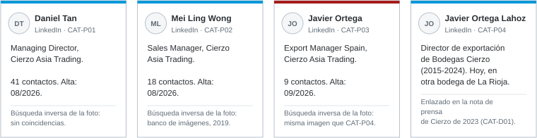
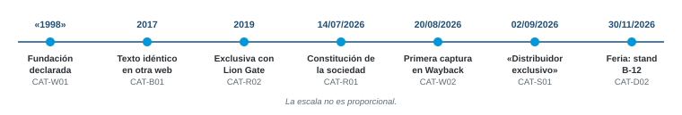

# Examen parcial · Modelo E3 · Bodegas Cierzo

*Ciberinteligencia (CIBINT) · Curso 2026-2027 · Temas 1 a 4*

| Nombre y apellidos | Profesor |
|---|---|
| | Hector Lazaro Arrechea Elissalt |

## Instrucciones

- **Duración:** parte individual, hasta 1 h 30 min (diseñada para unos 60 min). Parte grupal, 30 min, con enunciado aparte; empieza al recoger la individual.
- **Documentos y material:** este examen, las hojas de referencia (dossier de casos y anexo) y las hojas de respuesta. **Solo se corrigen las hojas de respuesta.** No se permiten apuntes, dispositivos ni comunicación con otras personas.
- **Referencias y horas:** cita el dossier por sus identificadores (por ejemplo, CAT-R01) y las normas por su referencia del anexo (N-xx). La marca Z indica UTC; la hora de Madrid en noviembre es GMT+1.
- **Advertencia:** el dossier contiene datos que pueden inducir a error de forma deliberada.

## Puntuación

| Bloque 1 | Bloque 2 | Bloque 3 | Bloque 4 | Parte grupal | Total |
|---|---|---|---|---|---|
| Tema 4 · 2,5 | Tema 3 · 3,5 | Tema 2 · 1,5 | Tema 1 · 1,0 | Temas 2, 3 y 4 · 1,5 | 10 |

Cada pregunta indica su puntuación y, cuando tiene varios elementos, la de cada uno. Se puntúa cada elemento correcto y justificado, por lo que una respuesta incompleta puede obtener puntuación parcial. Las respuestas incorrectas no restan. El parcial pesa un 25 % en la calificación final.

## Penalizaciones

| Situación | Penalización |
|---|---|
| Presentar inferencias como hechos, atribuir sin evidencia o presentar una exposición como intrusión | Hasta -0,25 por bloque |
| Proponer como válida una acción ilícita o un engaño | 0 en ese apartado |
| No unificar las zonas horarias cuando se pide | -0,1 en esa pregunta |
| Citar una norma o una fuente sin aplicarla al caso | Ese elemento no puntúa |
| Respuestas ilegibles o escritas fuera de las hojas de respuesta | No se corrigen |
| Copiar o usar dispositivos | 0 en el examen |

# Ejercicios

En el examen, las respuestas se escribían en hojas de respuesta aparte. Aquí puedes responder debajo de cada pregunta o en sus tablas.

## Bloque 1 · OSINT técnico e infraestructura (2,5 puntos)

Hojas de referencia: **Caso 1**. El encargo solo autoriza la obtención pasiva sobre activos de la bodega.

### 1.1 · Metadatos de documentos publicados (0,8 puntos)

a) ¿Qué revelan DOC-1, DOC-2 y DOC-3 y cómo podría aprovecharlo un atacante? (0,3 · 0,1 por dato bien interpretado)

b) Indica dos lecturas incorrectas que deben evitarse al interpretar estos metadatos. (0,2 · 0,1 por lectura)

c) ¿Cómo deben presentarse estos datos en un informe y qué medida propones a la bodega? (0,3)

### 1.2 · Registros DNS (0,6 puntos)

a) Indica qué servicios de terceros revelan los registros MX y TXT. (0,2)

b) Explica cómo podría usar esa información un atacante para preparar un correo fraudulento creíble y propón una medida. (0,2)

c) ¿Qué no permiten afirmar los registros TXT? (0,2)

### 1.3 · Identificación de tecnologías de la tienda (0,4 puntos)

a) A partir de CAT-H01, indica qué tecnología está mejor apoyada y con qué señales. (0,2)

b) Explica por qué la extensión de detección da otro resultado y qué indica la cabecera Server: cloudflare. (0,2)

### 1.4 · Priorización (0,7 puntos)

Asigna a cada hallazgo una prioridad y el siguiente paso.

Puntuación: 0,1 por hallazgo y 0,3 por la justificación de los dos primeros.

| Hallazgo | Prioridad | Siguiente paso y responsable |
|---|---|---|
| H1 · SH-1, erp | | |
| H2 · Expiración del dominio | | |
| H3 · Comentario oculto en DOC-3 | | |
| H4 · PTR de 192.0.2.78 | | |

**Justificación de los dos primeros:**

## Bloque 2 · OSINT de personas y organizaciones (3,5 puntos)

Hojas de referencia: **Caso 2**. Pregunta de la directora comercial: «¿Es Cierzo Asia Trading lo que dice ser? ¿Qué hacemos antes de la feria?».

### 2.1 · Huella de la organización (0,5 puntos)

Indica el tipo de huella de cada elemento: profesional, corporativa, documental o de canales.

Puntuación: 0,1 por elemento.

| Elemento | Tipo de huella |
|---|---|
| CAT-W01 | |
| CAT-R01 | |
| CAT-D02 | |
| CAT-P01 | |
| CAT-B01 | |

### 2.2 · Perfiles profesionales (0,8 puntos)

a) ¿Qué permiten afirmar los resultados de la búsqueda inversa en CAT-P01 y CAT-P02? ¿Significa lo mismo «sin coincidencias» que «foto de un banco de imágenes»? (0,3)

b) ¿Qué relación hay entre CAT-P03 y CAT-P04? ¿Qué harías, de forma proporcionada, respecto de la persona real? (0,3)

c) Un comercial de Cierzo marcó «Me gusta» en CAT-S01. ¿Qué permite afirmar esa interacción? (0,2)

### 2.3 · Lo que declara la empresa frente a lo que consta (1,0 puntos)

a) Señala tres contradicciones entre CAT-W01 y otras fuentes del dossier. (0,3 · 0,1 por contradicción)

b) ¿Qué no demuestra la fecha de la primera captura en la Wayback Machine? (0,2)

c) Valora la fiabilidad de CAT-W01 y la credibilidad de la afirmación «somos el importador exclusivo». (0,3)

d) ¿Qué demuestra CAT-D02 y qué no demuestra? (0,2)

### 2.4 · Búsqueda y decisión (1,2 puntos)

a) Escribe la consulta de Google con la que pudo localizarse CAT-B01 y explica por qué funciona. (0,2)

b) Escribe otra consulta de Google con filtro de fecha que responda a una pregunta distinta del caso. (0,2)

c) Indica qué opciones de O1 a O5 recomiendas y cuáles no, con una justificación breve. (0,5 · 0,1 por opción)

d) Desde la perspectiva del atacante, ¿qué información publicada por la propia bodega facilitó el engaño? Propón una medida que no perjudique su actividad comercial. (0,3)

## Bloque 3 · Marco legal, ética y OPSEC (1,5 puntos)

Hojas de referencia: **Caso 3**.

### 3.1 · Errores de seguridad operacional (1,0 puntos)

Para cada acción del analista, indica qué amenaza o vulnerabilidad de OPSEC abre y cuál era la contramedida correcta.

Puntuación: 0,1 por amenaza y 0,1 por contramedida, en cada acción.

| Acción | Amenaza o vulnerabilidad | Contramedida correcta |
|---|---|---|
| 1 | | |
| 2 | | |
| 3 | | |
| 4 | | |
| 5 | | |

### 3.2 · Exposición del analista (0,5 puntos)

a) ¿Qué riesgo personal se ha materializado y qué acciones lo facilitaron? (0,2)

b) Propón dos medidas que la organización debe adoptar ahora. (0,2 · 0,1 por medida)

c) ¿Por qué el analista no debe responder desde su cuenta personal? (0,1)

## Bloque 4 · Fundamentos y ciclo de inteligencia (1,0 puntos)

Hojas de referencia: **Caso 4**.

### 4.1 · Fases del ciclo de inteligencia (1,0 puntos)

Asigna a cada acción su fase del ciclo: DP (dirección y planificación), OB (obtención), PR (procesamiento), AP (análisis y producción), DI (difusión) o RE (retroalimentación).

Puntuación: 0,1 por acción.

| a | b | c | d | e | f | g | h | i | j |
|---|---|---|---|---|---|---|---|---|---|
| | | | | | | | | | |

# Hojas de referencia

Las normas, los criterios y los operadores de búsqueda están en el [anexo de referencia](../../anexo-de-referencia.md).

**Contexto común.** Bodegas Cierzo, S.A. es una bodega de Cariñena que exporta el 60 % de su producción. Su dominio es bodegascierzo.example. Desde 2019, su distribuidor exclusivo en el Sudeste Asiático es Lion Gate Wines Pte. Ltd., por contrato. Formas parte del equipo de seguridad de la bodega. La bodega es ficticia; el caso Kurniawan es real.

## Caso 1 · Exposición técnica y documental

Fecha de consulta de todas las fuentes: 12/11/2026. Según el inventario:

- erp.bodegascierzo.example (ERP de gestión) solo es accesible a través de la VPN.
- La tienda en línea la gestiona una agencia externa.

**CAT-M01 · Metadatos de seis PDF publicados en bodegascierzo.example (FOCA).** Los usuarios aparecen seudonimizados como USR-01 y USR-02; el formato observado es nombre.apellido.

| Documento | Autor | Programa de creación | Productor del PDF | Otros datos | Fecha |
|---|---|---|---|---|---|
| DOC-1 · ficha-tecnica-reserva-2021.pdf | USR-01 | Microsoft Word 2016 | Conversor de PDF | Ruta: C:\Users\USR-01\Documents\Export\Fichas\ | 02/2024 |
| DOC-2 · catalogo-exportacion-2026.pdf | USR-02 | Programa de maquetación | Biblioteca PDF del fabricante | Ruta: \\SRV-ARCHIVO01\Marketing\2026\ | 03/2026 |
| DOC-3 · tarifa-distribuidores-2026.pdf | USR-01 | Microsoft Word 2016 | Conversor de PDF | Comentario no visible en la página: «revisar margen de Lion Gate antes de enviar» | 01/2026 |
| DOC-4 a DOC-6 | — | — | — | Sin metadatos | 2025-2026 |

**Registros DNS y de registro**

| Fuente | Dato |
|---|---|
| MX | 10 mx.correonube.example |
| TXT | v=spf1 include:_spf.correonube.example include:mail.tiendasaas.example -all |
| TXT | ofimatica-verificacion=ms-48213377 (verificación de un servicio de ofimática en la nube) |
| TXT | firma-verificacion=7c1e… (verificación de un servicio de firma electrónica) |
| RDAP del dominio | Creado el 02/12/2004. Expira el 02/12/2026. No consta la renovación automática. |
| PTR de 192.0.2.78 | bodegascierzo-erp.operadora.example |
| SH-1 (Shodan) | 192.0.2.80, 443/TCP, observado el 09/11/2026: título «Acceso ERP · Bodegas Cierzo», certificado para erp.bodegascierzo.example |

**CAT-H01 · Señales de la tienda en línea (análisis ya existente en urlscan.io, 10/11/2026)**

| Señal | Valor observado |
|---|---|
| Cabecera Server | cloudflare |
| Cookie | woocommerce_items_in_cart=0 |
| Cabecera Link | enlace a /wp-json/ |
| Rutas de recursos | /wp-content/plugins/woocommerce/… |
| Extensión de detección (prueba de un compañero) | «Magento 2», confianza del 50 % |

## Caso 2 · Cierzo Asia Trading

**Web, archivo y registros**

| ID | Fuente | Contenido |
|---|---|---|
| CAT-W01 | cierzoasia.example, «Sobre nosotros» | «Fundada en 1998, somos líderes en importación de vinos europeos en Asia y el importador exclusivo de Bodegas Cierzo en el Sudeste Asiático.» Sus precios son un 40 % inferiores a los de Lion Gate. |
| CAT-W02 | Wayback Machine | Primera captura de cierzoasia.example: 20/08/2026. |
| CAT-B01 | Resultado de búsqueda | El mismo párrafo aparece literalmente, con otro nombre, en la web de un importador alemán, archivada desde 2017. |
| CAT-R01 | Registro de Singapur (OpenCorporates) | «Cierzo Asia Trading Pte. Ltd.», constituida el 14/07/2026. |
| CAT-R02 | Documentación interna | Contrato de exclusiva con Lion Gate Wines Pte. Ltd., vigente hasta 2029. |
| CAT-R03 | Base de datos internacional de marcas | La marca «CIERZO» pertenece a Bodegas Cierzo, S.A., con designación de Singapur desde 2018. |
| CAT-D01 | Nota de prensa de Cierzo (2023) | «Javier Ortega Lahoz, director de exportación, presentará la añada en Singapur», con su fotografía. |
| CAT-D02 | Programa de la feria Wine Asia Expo 2026 (30/11) | Expositor: «Cierzo Asia Trading Pte. Ltd.», stand B-12. |
| CAT-S01 | Publicación de CAT-P01 (02/09/2026) | «Orgullosos de ser el distribuidor exclusivo de Bodegas Cierzo.» 26 «Me gusta», uno de ellos de un comercial de Bodegas Cierzo. |

**Opciones que plantea la dirección**

| Opción | Contenido |
|---|---|
| O1 | Enviar un requerimiento formal por uso de la marca, a través de la asesoría jurídica. |
| O2 | Informar a Lion Gate y a los importadores de la región con un producto etiquetado con TLP. |
| O3 | Denunciar ante LinkedIn los perfiles CAT-P02 y CAT-P03. |
| O4 | Que un comercial escriba a «Daniel Tan» haciéndose pasar por un comprador. |
| O5 | Comunicar a la organización de la feria que Cierzo Asia Trading no es distribuidor autorizado. |

## Caso 3 · Lo que hizo el analista en prácticas (lunes 09/11)

| Acción | Descripción |
|---|---|
| 1 | Visitó desde la red de la bodega la web de Cierzo Asia Trading y recorrió su tienda. |
| 2 | Revisó con su cuenta personal de LinkedIn los perfiles de los «empleados» de la empresa. |
| 3 | Subió a un servicio público de análisis en línea un PDF que Cierzo Asia Trading había enviado a un comercial. |
| 4 | Preguntó en un grupo de WhatsApp del sector, de 240 miembros, si alguien conocía a la empresa, y explicó la investigación. |
| 5 | Respondió por correo, con detalles de la investigación, a una supuesta periodista que le escribió. |

**Situación posterior (11/11).** En un foro del sector aparece una publicación anónima con el nombre, la foto y el enlace al LinkedIn personal del analista, al que presenta como «el espía de Bodegas Cierzo», acompañada de comentarios hostiles.

## Caso 4 · Botellas sospechosas en Singapur

El 02/11, Lion Gate avisa de que en Singapur se venden botellas de «Cierzo Reserva 2021» muy por debajo de su precio. El equipo realiza estas acciones, que aquí aparecen desordenadas:

a) Ordenar en una tabla las 23 fotografías de etiquetas recibidas, con su fecha, país y lote.

b) Acordar con la directora comercial que la valoración debe estar lista antes de la feria del 30/11.

c) Pedir al distribuidor fotografías de las botellas y facturas de compra.

d) Contrastar dos hipótesis: falsificación o desvío de botellas auténticas desde otro mercado.

e) Enviar a la directora una nota de dos páginas con la valoración y las opciones.

f) Tras leer la nota, la directora pide ampliar el análisis a Hong Kong.

g) Al ordenar las fotografías, se comprueba que seis no tienen el lote legible y se piden nuevas.

h) Consultar la base de datos internacional de marcas.

i) Concluir que la falsificación del lote 2021 es probable y que el desvío es menos probable.

j) Definir qué decisiones debe apoyar el análisis: retirar producto, denunciar o avisar a los importadores.

**Caso real: Rudy Kurniawan (EE. UU.).** Kurniawan era un conocido coleccionista y comerciante de vinos. En diciembre de 2013, un jurado federal de Nueva York lo declaró culpable de fraude por fabricar y vender vinos falsificados que hacía pasar por grandes añadas francesas. En agosto de 2014 fue condenado a 10 años de prisión y a pagar 28,4 millones de dólares a siete víctimas. Fuentes: Fiscalía federal del Distrito Sur de Nueva York (07/08/2014) y Decanter.
