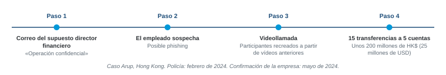
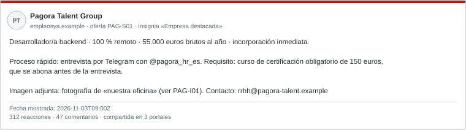
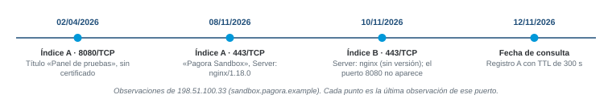

# Examen parcial · Modelo E4 · Pagora

*Ciberinteligencia (CIBINT) · Curso 2026-2027 · Temas 1 a 4*

| Nombre y apellidos | Profesor |
|---|---|
| | Hector Lazaro Arrechea Elissalt |

## Instrucciones

- **Duración:** parte individual, hasta 1 h 30 min (diseñada para unos 60 min). Parte grupal, 30 min, con enunciado aparte; empieza al recoger la individual.
- **Documentos y material:** este examen, las hojas de referencia (dossier de casos y anexo) y las hojas de respuesta. **Solo se corrigen las hojas de respuesta.** No se permiten apuntes, dispositivos ni comunicación con otras personas.
- **Referencias y horas:** cita el dossier por sus identificadores (por ejemplo, PAG-S01) y las normas por su referencia del anexo (N-xx). La marca Z indica UTC; la hora de Madrid en noviembre es GMT+1.
- **Advertencia:** el dossier contiene datos que pueden inducir a error de forma deliberada.

## Puntuación

| Bloque 1 | Bloque 2 | Bloque 3 | Bloque 4 | Parte grupal | Total |
|---|---|---|---|---|---|
| Tema 1 · 1,0 | Tema 3 · 3,5 | Tema 2 · 1,5 | Tema 4 · 2,5 | Temas 2, 3 y 4 · 1,5 | 10 |

Cada pregunta indica su puntuación y, cuando tiene varios elementos, la de cada uno. Se puntúa cada elemento correcto y justificado, por lo que una respuesta incompleta puede obtener puntuación parcial. Las respuestas incorrectas no restan. El parcial pesa un 25 % en la calificación final.

## Penalizaciones

| Situación | Penalización |
|---|---|
| Presentar inferencias como hechos, atribuir sin evidencia o presentar una exposición como intrusión | Hasta -0,25 por bloque |
| Proponer como válida una acción ilícita o un engaño | 0 en ese apartado |
| No unificar las zonas horarias cuando se pide | -0,1 en esa pregunta |
| Citar una norma o una fuente sin aplicarla al caso | Ese elemento no puntúa |
| Respuestas ilegibles o escritas fuera de las hojas de respuesta | No se corrigen |
| Copiar o usar dispositivos | 0 en el examen |

# Ejercicios

En el examen, las respuestas se escribían en hojas de respuesta aparte. Aquí puedes responder debajo de cada pregunta o en sus tablas.

## Bloque 1 · Fundamentos y ciclo de inteligencia (1,0 puntos)

Hojas de referencia: **Caso 1**.

### 1.1 · Niveles de inteligencia (1,0 puntos)

Clasifica cada elemento según el nivel de inteligencia al que corresponde principalmente: estratégico, operacional, táctico o técnico. Justifícalo en una línea.

Puntuación: 0,1 por nivel correcto y 0,1 por justificación, en cada elemento.

| Elemento | Nivel | Justificación |
|---|---|---|
| E1 | | |
| E2 | | |
| E3 | | |
| E4 | | |
| E5 | | |

## Bloque 2 · OSINT de personas y organizaciones (3,5 puntos)

Hojas de referencia: **Caso 2**. Pregunta de la directora de personas: «¿Quién ofrece empleos en nuestro nombre y qué hacemos?».

### 2.1 · Perfiles y personas (0,8 puntos)

Indica la relación de cada perfil con Pagora: confirmada, no confirmada, suplantación probable o no determinable. Justifícala con una evidencia.

Puntuación: 0,1 por relación correcta y 0,1 por evidencia, en cada perfil.

| Perfil | Relación | Evidencia |
|---|---|---|
| PAG-P01 | | |
| PAG-P02 | | |
| PAG-P03 | | |
| PAG-P04 | | |

### 2.2 · Publicaciones (0,9 puntos)

a) Ordena PAG-S01, PAG-S02 y PAG-S04 en GMT+1. (0,3)

b) Indica qué publicaciones dependen de otra. (0,2)

c) La oferta tiene más de 300 reacciones, una insignia de «Empresa destacada» y aparece en tres portales. Un compañero dice que eso la hace creíble. Rebátelo. (0,2)

d) ¿Qué indica PAG-I01 sobre la fotografía de la oficina? (0,2)

### 2.3 · La empresa que contrata (0,9 puntos)

a) Con PAG-R01 a PAG-R03, indica qué puede afirmarse sobre «Pagora Talent Group LLP» y su relación con Pagora y qué no. (0,3)

b) Valora cada fuente respecto de la afirmación «Pagora Talent Group es la división de selección de Pagora». (0,6 · 0,1 por celda)

| Fuente | Fiabilidad de la fuente | Credibilidad de la afirmación |
|---|---|---|
| PAG-S01 | | |
| PAG-F01 | | |
| PAG-R02 | | |

### 2.4 · Verificación y nota (0,9 puntos)

a) Según el caso Arup, ¿por qué no sirve como verificación contactar con el reclutador por Telegram o por videollamada? ¿Qué verificación sí sirve? (0,3)

b) Redacta la nota para la directora de personas con una valoración, su grado de confianza, dos evidencias citadas, una limitación y una recomendación para los candidatos. (0,6 · 0,1 por elemento)

## Bloque 3 · Marco legal, ética y OPSEC (1,5 puntos)

Hojas de referencia: **Caso 3** y anexo.

### 3.1 · La bitácora (1,0 puntos)

a) Identifica cinco problemas distintos del borrador de bitácora. Indica la entrada afectada y el principio o la regla que incumple. (0,5 · 0,1 por problema)

| Entrada | Problema | Principio o regla |
|---|---|---|
| | | |
| | | |
| | | |
| | | |
| | | |

b) Reescribe correctamente la entrada B-04. (0,5 · 0,1 por campo)

| Fecha y hora (con zona horaria) | Propósito | Fuente | Acción y resultado | Decisión siguiente |
|---|---|---|---|---|
| | | | | |

### 3.2 · Preservación de evidencias (0,5 puntos)

a) Indica cuatro prácticas para conservar la oferta PAG-S01 como evidencia. (0,4 · 0,1 por práctica)

b) ¿Por qué la bitácora no sustituye a una cadena de custodia forense? (0,1)

## Bloque 4 · OSINT técnico e infraestructura (2,5 puntos)

Hojas de referencia: **Caso 4**. El encargo solo autoriza la obtención pasiva.

### 4.1 · Transparencia de certificados (0,6 puntos)

a) ¿Qué nombres de los registros CT no figuran en el inventario? (0,15)

b) Para cada uno, indica qué permite afirmar su entrada en CT y qué no. (0,3)

c) ¿Qué indica CT-4 sobre la campaña del Caso 2? Distingue el hecho de la inferencia. (0,15)

### 4.2 · DNS e índice de servicios (0,6 puntos)

a) ¿Por qué importa el registro AAAA de portal para el inventario? (0,2)

b) El TTL de sandbox es de 300 segundos y el DNS pasivo lo registra desde 02/2023. ¿Cuánto tiempo lleva activo? (0,2)

c) Escribe dos consultas para Shodan que se limiten a lo autorizado. (0,2 · 0,1 por consulta)

### 4.3 · Observaciones y prioridades (1,3 puntos)

a) Según la figura 3, ¿se contradicen los dos índices sobre el puerto 8080? (0,3)

b) Redacta el hallazgo del puerto 8080 en una frase, con su fuente y su fecha. (0,2)

c) ¿Qué no puede concluirse de la versión que declara el banner? (0,2)

d) Asigna una prioridad a cada hallazgo. (0,4 · 0,1 por hallazgo)

| Hallazgo | Prioridad | Siguiente paso y responsable |
|---|---|---|
| H1 · Puerto 8080 de sandbox | | |
| H2 · admin-test en CT-2 | | |
| H3 · AAAA de portal | | |
| H4 · pagora-talent.example (CT-4) | | |

e) Justifica cuál de los hallazgos va primero. No puedes basar la prioridad solo en que el nombre contenga «admin» o «test». (0,2)

# Hojas de referencia

Las normas, los criterios y los operadores de búsqueda están en el [anexo de referencia](../../anexo-de-referencia.md).

**Contexto común.** Pagora Pagos, S.L. es una empresa de pagos para comercios, con sede en Madrid y 180 empleados. Su dominio es pagora.example y publica sus ofertas de empleo solo en pagora.example/empleo. Formas parte del equipo interno de ciberinteligencia. Pagora es ficticia; el caso Arup es real. En noviembre, la hora de Madrid es GMT+1; la marca Z indica UTC.

## Caso 1 · Arup y Pagora

| Elemento | Descripción |
|---|---|
| E1 | La lista de las cinco cuentas bancarias que recibieron las transferencias en el caso Arup. |
| E2 | El patrón de actuación: un correo de un directivo seguido de una videollamada con participantes recreados a partir de vídeos reales. |
| E3 | El aumento del fraude con suplantación audiovisual de directivos y su efecto en los controles de pago de las empresas. |
| E4 | La campaña dirigida a la oficina de Hong Kong con el pretexto de una «operación confidencial». |
| E5 | Una regla del filtro de correo que marque los mensajes externos que usan el nombre del director financiero de Pagora. |

## Caso 2 · Ofertas de empleo que Pagora no publicó

**Perfiles**

| ID | Perfil | Datos |
|---|---|---|
| PAG-P01 | Página de empresa «Pagora» en LinkedIn | Enlazada desde PAG-F01. |
| PAG-P02 | LinkedIn «Lucía Benavente Ruiz», responsable de selección de Pagora desde 2021 | Figura en PAG-F01 como responsable de selección. |
| PAG-P03 | LinkedIn «Laura Benavente», «Senior Recruiter, Pagora Talent Group» | Misma fotografía que PAG-P02. Creado en 10/2026. 12 contactos. |
| PAG-P04 | Telegram @pagora_hr_es, nombre visible «Pagora RRHH» | Escribe a los candidatos. No está enlazado desde ninguna fuente oficial. |

**Fuentes y registros**

| ID | Fuente | Contenido |
|---|---|---|
| PAG-F01 | pagora.example/empleo | Ninguna oferta vigente coincide con PAG-S01. «Pagora nunca solicita pagos a los candidatos.» |
| PAG-R01 | BORME | Pagora Pagos, S.L., constituida en 2018, con domicilio en Madrid. |
| PAG-R02 | Registro mercantil del Reino Unido (OpenCorporates) | «Pagora Talent Group LLP», constituida el 01/10/2026. Su domicilio es el de una empresa de domiciliación que aloja a cientos de sociedades. |
| PAG-R03 | Aviso legal de pagora.example | Sociedades del grupo: Pagora Pagos, S.L. y Pagora Portugal, Lda. |

**Publicaciones**

| ID | Origen | Fecha y hora | Contenido |
|---|---|---|---|
| PAG-S01 | Portal empleosya.example | 2026-11-03 09:00Z | Oferta (figura 2). |
| PAG-S02 | Tres agregadores de empleo | 04/11/2026 12:00 GMT+1 | Mismo texto que PAG-S01, con la indicación «Fuente: empleosya.example». |
| PAG-S03 | Publicación pública de un empleado de Pagora en LinkedIn | 14/09/2026 | «Mi primer día en Pagora. Gracias a Lucía Benavente por un proceso tan ágil.» Fotografía con su acreditación en la recepción. |
| PAG-S04 | PAG-P01 | 2026-11-05 07:30Z | «Circulan ofertas falsas en nuestro nombre. Solo publicamos en pagora.example/empleo y nunca pedimos pagos.» |

**PAG-I01 · Búsqueda inversa.** La fotografía de la oficina de PAG-S01 coincide con una imagen publicada en 2021 por un espacio de coworking de Lisboa en su propia web.

## Caso 3 · Borrador de bitácora de un analista en prácticas

| Entrada | Fecha y hora | Propósito | Fuente | Acción y resultado | Decisión |
|---|---|---|---|---|---|
| B-01 | 10/11 10:00 | Localizar la oferta | LinkedIn, con la cuenta personal del analista | Encontrada la página «Pagora Talent Group» | Buscar más |
| B-02 | 10/11 10:20 | — | Portal de empleo | Oferta copiada | — |
| B-03 | Escrita el 13/11 «con lo que recuerdo» de la tarde del 10/11 | Revisar agregadores | Varios | Parece que había otras tres copias | — |
| B-04 | 11/11, por la mañana | Revisar el canal público de Telegram «Candidatos Pagora 2026», citado por un denunciante | Telegram | Encontrado un listado con nombre, DNI y teléfono de unos 40 candidatos. «Lo copio aquí abajo para no perderlo: […]» | Buscar más listados |
| B-05 | 11/11 12:00 | Conservar la oferta | Portal de empleo | Captura guardada en el escritorio como captura1.png | — |

Nota del responsable: el analista decidió no escribir al contacto de Telegram de la oferta, pero no lo anotó en la bitácora.

## Caso 4 · Exposición técnica de pagora.example

Fecha de consulta: 12/11/2026. El inventario recoge estos activos:

- www.pagora.example
- app.pagora.example
- portal.pagora.example, solo con la IPv4 192.0.2.60
- sandbox.pagora.example: entorno de pruebas para integradores, público solo en 443/TCP

**Transparencia de certificados (crt.sh)**

| ID | Nombres incluidos | Válido desde | Observaciones |
|---|---|---|---|
| CT-1 | *.pagora.example, pagora.example | 15/01/2026 | Certificado |
| CT-2 | admin-test.pagora.example | 05/10/2026 | Precertificado, sin respuestas en DNS pasivo |
| CT-3 | status.pagora.example | 02/06/2026 | CNAME a pagora.statuspagina.example, un proveedor de páginas de estado |
| CT-4 | pagora-talent.example, www.pagora-talent.example | 02/10/2026 | Certificado |

**DNS pasivo**

| Nombre | Tipo | Valor | TTL | Primera y última vez visto |
|---|---|---|---|---|
| portal.pagora.example | A | 192.0.2.60 | 3600 | 03/2022 · 11/11/2026 |
| portal.pagora.example | AAAA | 2001:db8:10::60 | 3600 | 08/2026 · 11/11/2026 |
| sandbox.pagora.example | A | 198.51.100.33 | 300 | 02/2023 · 11/11/2026 |

