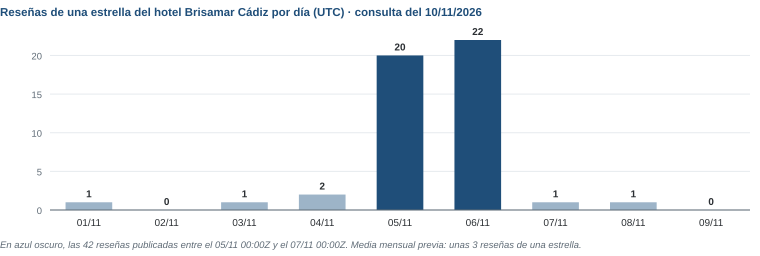
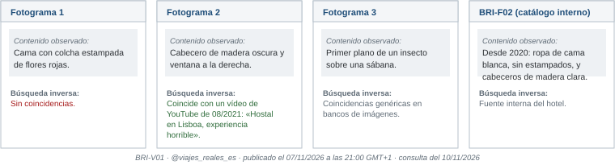
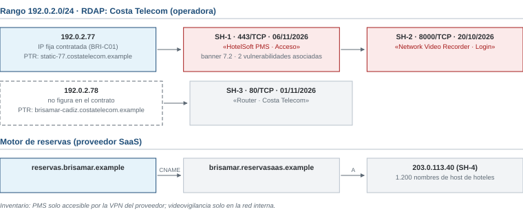

# Examen parcial · Modelo E5 · Hoteles Brisamar

*Ciberinteligencia (CIBINT) · Curso 2026-2027 · Temas 1 a 4*

| Nombre y apellidos | Profesor |
|---|---|
| | Hector Lazaro Arrechea Elissalt |

## Instrucciones

- **Duración:** parte individual, hasta 1 h 30 min (diseñada para unos 60 min). Parte grupal, 30 min, con enunciado aparte; empieza al recoger la individual.
- **Documentos y material:** este examen, las hojas de referencia (dossier de casos y anexo) y las hojas de respuesta. **Solo se corrigen las hojas de respuesta.** No se permiten apuntes, dispositivos ni comunicación con otras personas.
- **Referencias y horas:** cita el dossier por sus identificadores (por ejemplo, BRI-R01) y las normas por su referencia del anexo (N-xx). La marca Z indica UTC; la hora de Madrid en noviembre es GMT+1.
- **Advertencia:** el dossier contiene datos que pueden inducir a error de forma deliberada.

## Puntuación

| Bloque 1 | Bloque 2 | Bloque 3 | Bloque 4 | Parte grupal | Total |
|---|---|---|---|---|---|
| Tema 3 · 3,5 | Tema 2 · 1,5 | Tema 4 · 2,5 | Tema 1 · 1,0 | Temas 2, 3 y 4 · 1,5 | 10 |

Cada pregunta indica su puntuación y, cuando tiene varios elementos, la de cada uno. Se puntúa cada elemento correcto y justificado, por lo que una respuesta incompleta puede obtener puntuación parcial. Las respuestas incorrectas no restan. El parcial pesa un 25 % en la calificación final.

## Penalizaciones

| Situación | Penalización |
|---|---|
| Presentar inferencias como hechos, atribuir sin evidencia o presentar una exposición como intrusión | Hasta -0,25 por bloque |
| Proponer como válida una acción ilícita o un engaño | 0 en ese apartado |
| No unificar las zonas horarias cuando se pide | -0,1 en esa pregunta |
| Citar una norma o una fuente sin aplicarla al caso | Ese elemento no puntúa |
| Respuestas ilegibles o escritas fuera de las hojas de respuesta | No se corrigen |
| Copiar o usar dispositivos | 0 en el examen |

# Ejercicios

En el examen, las respuestas se escribían en hojas de respuesta aparte. Aquí puedes responder debajo de cada pregunta o en sus tablas.

## Bloque 1 · OSINT de personas y organizaciones (3,5 puntos)

Hojas de referencia: **Caso 1**. Preguntas de la directora del hotel de Cádiz:

- ¿Nos están atacando con reseñas falsas?
- ¿Es verdad lo del vídeo?
- ¿Pagamos a la agencia que nos ofrece borrarlas?

### 1.1 · Alias, cuentas y personas (0,5 puntos)

a) BRI-A01 y BRI-A02 usan el mismo alias. ¿Qué relación puede afirmarse entre ellas? (0,2)

b) ¿Pedirías a la plataforma que revise las reseñas de BRI-A03 y de BRI-A04? Justifica tu respuesta para cada una. (0,3 · 0,15 por cuenta)

### 1.2 · El patrón de reseñas (0,8 puntos)

a) Señala tres indicadores de actuación coordinada y di cuál es el más sólido. (0,4 · 0,1 por indicador y 0,1 por elegir el más sólido)

b) ¿Qué aporta al análisis la mención a la «habitación 214»? (0,2)

c) Indica una limitación de este análisis y quién podría reducirla. (0,2)

### 1.3 · El vídeo viral (0,9 puntos)

a) ¿Qué demuestra la coincidencia del fotograma 2? Distingue la fecha de publicación, la fecha atribuida al hecho y la fecha de consulta. (0,3)

b) ¿Qué aporta BRI-F02? ¿Es independiente del vídeo? ¿Qué reserva tiene? (0,3)

c) ¿Demuestra este análisis que en el hotel no hay chinches? Explica qué afirmación se ha comprobado y cuál no. (0,3)

### 1.4 · La agencia y la nota (1,3 puntos)

a) Indica qué puede afirmarse sobre ReputaClean y qué no. (0,2)

b) Plantea dos hipótesis sobre la relación entre la oferta de la agencia y la campaña de reseñas. Para cada una, indica la evidencia que la apoya o la debilita. (0,3 · 0,15 por hipótesis)

c) Redacta la nota para la directora. Responde a cada una de sus tres preguntas con un grado de confianza e incluye dos recomendaciones. (0,8 · 0,2 por respuesta y 0,1 por recomendación)

## Bloque 2 · Marco legal, ética y OPSEC (1,5 puntos)

Hojas de referencia: **Caso 2** y anexo.

### 2.1 · La petición sobre la exempleada (0,9 puntos)

a) Identifica cuatro problemas de la petición del director general. Para cada uno, indica qué parte de la petición lo provoca, en qué consiste y su referencia en el anexo. (0,6 · 0,15 por problema)

| Parte de la petición | Problema y referencia |
|---|---|
| | |
| | |
| | |
| | |

b) Reformula la petición como un requerimiento legítimo para el equipo de seguridad. Indica a quién corresponden los aspectos que quedan fuera. (0,3)

### 2.2 · Difusión con TLP (0,6 puntos)

Asigna una etiqueta TLP a cada producto y justifica a quién puede llegar.

Puntuación: 0,15 por producto.

| Producto | TLP | Justificación |
|---|---|---|
| T1 | | |
| T2 | | |
| T3 | | |
| T4 | | |

## Bloque 3 · OSINT técnico e infraestructura (2,5 puntos)

Hojas de referencia: **Caso 3**. El encargo solo autoriza la obtención pasiva sobre la conexión del hotel.

### 3.1 · Clasificación de las fichas (0,6 puntos)

Indica si cada ficha corresponde a la organización, a un proveedor o a una relación no demostrada, y justifícalo.

Puntuación: 0,15 por ficha.

| Ficha | Clasificación | Justificación |
|---|---|---|
| SH-1 | | |
| SH-2 | | |
| SH-3 | | |
| SH-4 | | |

### 3.2 · El sistema de gestión hotelera (0,8 puntos)

a) Redacta el hallazgo de SH-1 en pasado, con su fuente y su fecha. (0,2)

b) ¿Qué significa el campo «vulnerabilidades asociadas» y qué no demuestra? (0,3)

c) ¿Por qué es una discrepancia relevante respecto del inventario? ¿Qué pasos propones y quién debe darlos? (0,3)

### 3.3 · El grabador de vídeo (0,4 puntos)

a) ¿Por qué esta exposición es especialmente sensible en un hotel? (0,2)

b) ¿Qué debe hacerse, teniendo en cuenta la fecha de la observación? (0,2)

### 3.4 · Informe para la dirección (0,7 puntos)

a) Asigna una prioridad a cada hallazgo. (0,4 · 0,1 por hallazgo)

| Hallazgo | Prioridad | Siguiente paso y responsable |
|---|---|---|
| H1 · SH-1, sistema de gestión hotelera | | |
| H2 · SH-2, grabador de vídeo | | |
| H3 · SH-3 y PTR de 192.0.2.78 | | |
| H4 · SH-4, motor de reservas | | |

b) Explica al director general, sin tecnicismos, qué se ha observado, qué no significa y qué decisión se le pide. (0,3)

## Bloque 4 · Fundamentos y ciclo de inteligencia (1,0 puntos)

Hojas de referencia: **Caso 4**.

### 4.1 · Preguntas de inteligencia y estados de la información (1,0 puntos)

a) Formula tres preguntas de inteligencia que ayuden a la directora a decidir qué hacer con las reseñas antes del puente de diciembre. (0,6 · 0,2 por pregunta)

b) Clasifica cada elemento como dato, información o inteligencia. (0,4 · 0,1 por elemento)

| Elemento | Dato, información o inteligencia |
|---|---|
| a | |
| b | |
| c | |
| d | |

# Hojas de referencia

Las normas, los criterios y los operadores de búsqueda están en el [anexo de referencia](../../anexo-de-referencia.md).

**Contexto común.** Hoteles Brisamar es una cadena de seis hoteles de costa con dominio brisamar.example. Formas parte de su equipo de seguridad. La cadena es ficticia; las campañas contra hoteles de 2023 son reales. En noviembre, la hora de Madrid es GMT+1; la marca Z indica UTC.

## Caso 1 · Hotel Brisamar Cádiz

**Cuentas de reseñas (muestra)**

| ID | Cuenta | Datos |
|---|---|---|
| BRI-A01 | viajero_77, en la plataforma de reseñas | Alta el 04/11/2026. Tres reseñas de una estrella a tres hoteles distintos de Cádiz, publicadas el 05/11 y el 06/11. |
| BRI-A02 | viajero_77, en Instagram | Perfil de un hombre residente en Oslo, con fotos de viajes desde 2015. No hay referencias a Cádiz. |
| BRI-A03 | «Carmen R.», en la plataforma de reseñas | Alta en 2019, con 87 reseñas de lugares diversos. El 05/11 publicó: «El aire acondicionado de la habitación 305 hacía un ruido insoportable». |
| BRI-A04 | Sun_Lover_ES, en la plataforma de reseñas | Alta el 05/11/2026. Su único texto coincide literalmente con el de otras 11 reseñas. |

**BRI-R01 · Análisis de las reseñas de una estrella (consulta del 10/11/2026)**

- 42 de las 51 reseñas de una estrella de 2026 se publicaron entre el 05/11 00:00Z y el 07/11 00:00Z (figura 1).
- 37 de esas 42 proceden de cuentas creadas en noviembre de 2026.
- Cinco frases idénticas se repiten en las 42 reseñas.
- 29 reseñas mencionan «chinches en la habitación 214». La segunda planta tiene las habitaciones 201 a 212: no existe la 214.
- La habitación 305 existe y tiene un parte de mantenimiento del aire acondicionado del 04/11.

**BRI-V01 · El vídeo viral.** Lo publicó la cuenta de TikTok @viajes_reales_es, creada en 2024, cuyos vídeos anteriores son recopilaciones de contenido de otros autores. Texto: «Chinches en el Brisamar Cádiz esta semana». 180.000 reproducciones.

**La agencia que ofrece ayuda**

| ID | Fuente | Contenido |
|---|---|---|
| BRI-O01 | Correo recibido el 08/11/2026 desde info@reputaclean.example | «Hemos detectado una campaña contra su hotel. Podemos eliminar las reseñas negativas en 72 horas por 3.000 euros.» |
| BRI-O02 | Web reputaclean.example | «Agencia con 15 años de experiencia.» No hay un aviso legal que identifique a la sociedad. |
| BRI-O03 | Wayback Machine | Primera captura de reputaclean.example: 10/2026. |
| BRI-O04 | OpenCorporates | Sin resultados en España. Existe «ReputaClean OÜ», registrada en Estonia el 28/09/2026. |
| BRI-O05 | Boletín de la asociación hotelera provincial (09/11) | «Varios asociados han recibido ofertas parecidas», sin más detalles. |

## Caso 2 · Peticiones de la dirección

**La exempleada en TikTok.** Una camarera despedida en septiembre publica vídeos, con el alias @la_camarera_cansada, en los que critica las condiciones laborales del hotel. No nombra a compañeros ni a clientes. En uno de los vídeos se ve, de fondo, el tablón interno con el cuadrante de turnos. El director general escribe:

«Averigua quién es exactamente, dónde vive y con quién se junta. Y vigila todo lo que publique. Si hace falta, se lo encargamos a una consultora.»

**Caso real: campañas contra hoteles en plataformas de reserva (2023).** Akamai (septiembre de 2023) y Secureworks (finales de 2023) documentaron campañas que seguían estos pasos:

- Se enviaban correos al personal de los hoteles; por ejemplo, de un supuesto huésped que había perdido un documento.
- Esos correos instalaban malware que robaba los accesos del hotel a la plataforma de reservas.
- Con esos accesos, los atacantes escribían a los huéspedes desde la mensajería oficial de la plataforma y les pedían que volvieran a confirmar la tarjeta en una página de pago falsa.

La plataforma recordó que nunca pide datos de tarjeta por teléfono, SMS ni WhatsApp. Fuentes: Akamai Security Research y Help Net Security (04/12/2023).

**Productos sobre una campaña similar contra los huéspedes de Brisamar (octubre de 2026)**

| Producto | Contenido |
|---|---|
| T1 | Nota interna para la dirección con los nombres de los tres recepcionistas cuyas cuentas se usaron y lo que se sabe de cada caso. |
| T2 | Indicadores (dominios y remitentes) para la asociación hotelera provincial, que agrupa a 60 hoteles. |
| T3 | Aviso en la web: «Nunca pedimos datos de tarjeta por chat ni por mensaje». |
| T4 | Informe para INCIBE-CERT con la cronología, los indicadores y el número de huéspedes afectados. |

## Caso 3 · La conexión del hotel de Cádiz

Fecha de consulta: 12/11/2026. Según el inventario y el contrato BRI-C01:

- El sistema de gestión hotelera (PMS), con los datos de reservas, huéspedes y facturación, lo gestiona el proveedor HotelSoft y solo debe ser accesible a través de su VPN.
- El grabador de las cámaras de videovigilancia lo gestiona una empresa de seguridad y solo debe estar en la red interna.
- La línea de Internet contratada con Costa Telecom tiene la IP fija 192.0.2.77.

## Caso 4 · El encargo de la directora

La directora del hotel de Cádiz pide una valoración antes del puente de diciembre, cuando se concentran las reservas. Debe decidir si denuncia las reseñas ante la plataforma, si responde públicamente y si refuerza la atención al cliente. Elementos disponibles:

a) La reseña R-118 se publicó el 06/11/2026 a las 03:12Z.

b) 42 de las 51 reseñas de una estrella se publicaron en 48 horas desde cuentas creadas en noviembre.

c) Es probable que se trate de una campaña coordinada; conviene pedir a la plataforma su revisión antes del puente.

d) La cuenta viajero_77 tiene tres reseñas.
