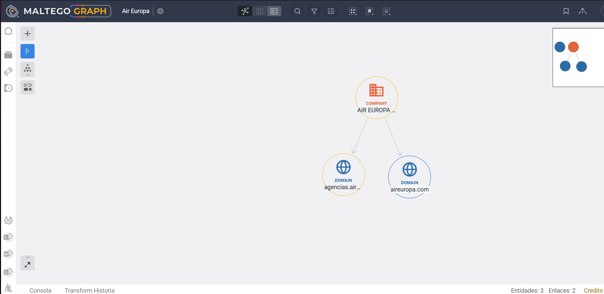

# A03 · Huella pública

## Estudiante

- Nombre: Sergio Rodríguez López  
- Carpeta personal: entregas/rodriguezSergio/A03/  
- Modalidad: Modalidad A · Organización  
- Objetivo: Air Europa (Globalia)
- ¿Es el objetivo de tu proyecto final?: Sí.  
- Punto de partida (dominio principal o identificadores propios): aireuropa.com  
- Periodo de obtención, con zona horaria: Del 28/10/2026 al 29/10/2026 (Europe/Madrid)

---

## 1. Resumen ejecutivo

El análisis de la huella pública de Air Europa revela una superficie de exposición actual controlada de cara al cliente general en su web principal, habiendo centralizado sus comunicaciones en formularios y redes sociales (OBT-01). Sin embargo, la investigación técnica y documental evidencia una huella residual y corporativa significativa. Destaca el hallazgo de direcciones de correo electrónico sensibles (como el del Delegado de Protección de Datos) expuestas en texto plano dentro de documentos PDF indexados (OBT-04), así como subdominios B2B (dirigidos a agencias de viajes) plenamente identificables (OBT-05). Desde la perspectiva de un atacante, esta información, sumada a la exposición de su estructura directiva en registros mercantiles (OBT-03), ofrece vectores viables para planificar campañas de suplantación de identidad interna (*spoofing* corporativo), fraudes dirigidos al personal o ataques de reconocimiento contra portales secundarios.

| Pregunta | Respuesta breve | Confianza | Referencias |
| :---- | :---- | :---- | :---- |
| PI-01 | Los perfiles actuales están delimitados, pero existen subdominios técnicos expuestos fuera del radar principal. | Alto | (OBT-01, OBT-02, OBT-05) |
| PI-02 | La entidad está vinculada abiertamente a la matriz Globalia y expone a sus administradores en registros mercantiles. | Alto | (OBT-03) |
| PI-03 | Documentación legal indexada expone en texto plano correos corporativos sensibles (ej. Delegado de Protección de Datos). | Alto | (OBT-04) |

---

## 2. Encargo

### 2.1 Objetivo elegido

**Modalidad A.** Se ha elegido Air Europa por tratarse de la organización afectada en el caso documentado de mi proyecto final. La elección permite establecer un análisis inicial de la exposición pública de su infraestructura corporativa y canales. Antes de iniciar, se ha comprobado que existe material suficiente mediante la consulta `site:aireuropa.com filetype:pdf` en Google (realizada el 2026-10-29), obteniendo múltiples resultados de documentos públicos oficiales.

### 2.2 Requerimiento

| Componente | Contenido |
| :---- | :---- |
| Destinatario | Responsable de seguridad de la información (CISO) de Air Europa. |
| Decisión | Determinar qué elementos de la huella pública corporativa deben ser minimizados o monitorizados para prevenir escenarios de suplantación interna, fraude o recopilación de inteligencia. |
| Objeto | La huella pública digital de Air Europa, abarcando su información corporativa, canales de comunicación, documentación expuesta y relaciones institucionales. |
| Horizonte | Corto plazo (para revisión antes de finalizar el trimestre actual), sujeto a la entrega de octubre de 2026\. |
| Alcance | Dominios oficiales, perfiles corporativos en redes, información societaria y documentos corporativos (PDF) indexados. |
| Exclusiones | Queda estrictamente excluido investigar datos de clientes/empleados; analizar filtraciones; y realizar escaneos activos sobre la infraestructura. |
| Producto | Informe de huella pública estructurado, con registro de obtención, evidencias anonimizadas y recomendaciones defensivas. |

**Requerimiento en una frase:** Informe de huella pública dirigido al CISO de Air Europa para identificar y minimizar los elementos corporativos expuestos a corto plazo, excluyendo escaneos activos e investigación de datos personales.

### 2.3 Preguntas de inteligencia

| Prioridad | Pregunta | Huella que cubre | Te ayuda a decidir |
| ----: | :---- | :---- | :---- |
| 1 | ¿Qué dominios, subdominios, correos de contacto y perfiles en redes presenta u operaba Air Europa que pudieran usarse para suplantar su identidad? | De canales | Identificar canales expuestos que deban monitorizarse para prevenir campañas de *phishing* o intrusión corporativa. |
| 2 | ¿Qué información societaria, marcas registradas y filiales están accesibles en registros públicos y buscadores? | Corporativa | Evaluar si la estructura corporativa expuesta facilita ataques de suplantación interna (Fraude del CEO). |
| 3 | ¿Qué relaciones tecnológicas o correos sensibles se declaran públicamente en los sitios web o documentos indexados de la aerolínea? | De relaciones | Determinar el riesgo de exposición documental y procedimental en fuentes abiertas. |

---

## 3. Plan de obtención

### 3.1 Herramientas por pregunta

| Pregunta | Herramienta | Alternativa descartada y motivo | Entrada | Qué expone y a quién | Resultado esperado |
| :---- | :---- | :---- | :---- | :---- | :---- |
| PI-01 | Google con operadores | Búsqueda simple (genera ruido) | `site:aireuropa.com "contacto"` | Envía la consulta a Google; no interactúa con la infraestructura de Air Europa. | Redes y canales indexados. |
| PI-01 | Wayback Machine | Caché de Google | `aireuropa.com/es/vuelos` | Envía la URL al Internet Archive; no interactúa con el objetivo. | Versiones históricas de la web para comparar cambios. |
| PI-02 | OpenCorporates | BORME comercial | "Air Europa" | Envía el término a OpenCorporates; sin contacto con el objetivo. | Ficha societaria vinculada. |
| PI-03 | Google (Filetype) | Buscadores de PDFs genéricos | `site:aireuropa.com filetype:pdf` | Envía la consulta a Google; no interactúa con el objetivo. | Documentos corporativos públicos. |
| PI-03 | Intelligence X | Google simple | `aireuropa.com` | Envía el dominio a intelx.io; consulta en su archivo sin tocar al objetivo. | Subdominios y foros técnicos. |
| Todas | Maltego | Esquemas manuales en papel | Dominios y perfiles | Procesa entidades localmente y envía consultas a transformaciones OSINT autorizadas. | Grafo visual de relaciones. |

### 3.2 Herramientas que no se usan

| Herramienta | Motivo |
| :---- | :---- |
| OpenSanctions | Las preguntas se centran en la exposición técnica y societaria, no en sanciones internacionales o exposición política de personas físicas. |
| Babel Street Insights | La monitorización de menciones multilingües y seguimiento en tiempo real excede el alcance del informe. |
| Google Lens / TinEye | No se requiere verificar el origen de fotografías en este encargo, sino texto e infraestructura corporativa. |
| Hunchly | El volumen de capturas es manejable de forma manual; no se precisa archivo completo de sesión. |
| Serus | La IA asistida para buscar filtraciones de identificadores excede las exclusiones del encargo. |

### 3.3 Configuración y seguridad de la operación

Perfil de investigación dedicado en contenedor web, sin sesiones personales activas. Carpeta de trabajo aislada. Uso de correos "calcetín" para registro en herramientas obligatorias (IntelX, Maltego). No se interactúa con el objetivo bajo ninguna circunstancia.

**Modalidad B · Fecha y hora de cierre del plan:** No aplica (Modalidad A).

---

## 4. Obtención

### 4.1 Registro de obtención

| ID | Herramienta | Consulta o acción exacta | Fecha y hora | Resultado | Límite | Evidencia |
| :---- | :---- | :---- | :---- | :---- | :---- | :---- |
| OBT-01 | Google | `site:aireuropa.com "contacto" OR "atención al cliente"` | 2026-10-29 20:00 | Se identifican la web principal de soporte y enlaces a redes sociales. No hay correos en texto plano indexados. | Muestra solo la indexación actual. | EV-01.png |
| OBT-02 | Wayback Machine | `https://www.aireuropa.com/es/vuelos` (Comparativa temporal) | 2026-10-29 20:15 | Las capturas históricas y recientes no cargan el contenido visual ni textual correctamente debido a scripts rotos. El análisis del código fuente no revela correos en texto plano. | La web dependía y depende de código dinámico (JS) que impide la lectura correcta del archivo histórico. | EV-02a.png, EV-02b.png, EV-02c.png |
| OBT-03 | OpenCorp. | `Air Europa` (Jurisdicción España) | 2026-10-29 20:30 | Entidad "AIR EUROPA LINEAS AEREAS SA", filial de la matriz Globalia y directivos. | Depende del refresco de datos del registro. | EV-03.png |
| OBT-04 | Google | `site:aireuropa.com filetype:pdf "privacidad" OR "condiciones"` | 2026-10-29 20:45 | Hallazgo de un documento médico (MEDIF) que expone el correo del Delegado de Protección de Datos (`delegadopd@aireuropa.com`). | Solo devuelve PDFs públicos y cacheados. | EV-04.png |
| OBT-05 | Intel X | `aireuropa.com` (selector de dominio) | 2026-10-29 21:00 | Menciones del dominio referenciando subdominios B2B (ej. `agencias.aireuropa.com`). | Límite de resultados de cuenta gratuita. | EV-05.png |
| OBT-06 | Maltego | Creación manual del grafo (OBT-01 a 05\) | 2026-10-29 21:15 | Representación visual que conecta la entidad legal con sus dominios y subdominios. | Requiere etiquetado manual y diseño por el analista. | EV-06.png |

### 4.2 Resultados por herramienta

- **Google:** Respondió a las preguntas PI-01 y PI-03. Se obtuvo la estructura de canales de contacto actuales (OBT-01) y documentación PDF expuesta con correos corporativos (OBT-04). El límite fue depender de lo indexado sin mostrar histórico previo.  
- **Wayback Machine:** Intentó responder a PI-01. Se obtuvo una comparativa entre la web de 2019 y 2026 (OBT-02), constatando una depuración de canales, pero encontrando un límite en la renderización de código JS obsoleto.  
- **OpenCorporates:** Respondió a PI-02. Confirmó el nombre legal y la vinculación a la matriz Globalia (OBT-03). Su límite es la actualización periódica desde el BORME.  
- **Intelligence X:** Respondió a PI-01 y PI-03. Localizó subdominios B2B no indexados directamente por Google, como `agencias.aireuropa.com` (OBT-05). Limitado por el número de accesos de la cuenta gratuita.  
- **Maltego:** Ayudó a unificar las respuestas, consolidando el mapeo visual de las entidades (OBT-06). Su límite residió en la dependencia de la introducción manual de los nodos y el etiquetado por parte del analista.

### 4.3 Revisión de la elección

| Pregunta | Herramienta prevista | Herramienta utilizada | Evidencia obtenida | ¿Resuelve la pregunta? | Cambio justificado |
| :---- | :---- | :---- | :---- | :---- | :---- |
| PI-01 | Google, Wayback Machine | Google, Wayback Machine | Canales actuales, error de carga histórico (EV-01, EV-02a, EV-02b, EV-02c) | Sí, muestra la evolución hacia redes/formularios y la dependencia de JS. | Ninguno. |
| PI-02 | OpenCorporates | OpenCorporates | Ficha societaria y directiva (EV-03) | Sí, confirma la matriz. | Ninguno. |
| PI-03 | Google (Filetype), Intel X | Google (Filetype), Intel X | PDF con correo sensible, subdominio B2B (EV-04, EV-05) | Sí, expone correos y accesos técnicos. | Ninguno. |
| Todas | Maltego | Maltego | Grafo visual de relaciones (EV-06) | Sí, representa visualmente las conexiones. | Ninguno. |

---

## 5. Análisis de la huella

### 5.1 Ficha del objetivo

| Campo | Dato | Referencia | Fecha del dato | Precaución |
| :---- | :---- | :---- | :---- | :---- |
| Nombre legal | AIR EUROPA LINEAS AEREAS S.A. | (OBT-03) | 2026-10-29 | No confundir con la matriz Globalia. |
| Marcas | Air Europa, SUMA | (OBT-01) | 2026-10-29 | SUMA opera áreas específicas de usuario. |
| Filiales o entidades relacionadas | Globalia (Matriz) | (OBT-03) | 2026-10-29 | Entidad matriz separada legalmente. |
| Dominios oficiales | `aireuropa.com`, `agencias.aireuropa.com` | (OBT-01, OBT-05) | 2026-10-29 | El subdominio de agencias es B2B. |
| Canales y perfiles oficiales | @AirEuropa (Redes), Formularios Web, `delegadopd@aireuropa.com` | (OBT-01, OBT-04) | 2026-10-29 | Enlazados desde web y PDFs oficiales. |
| Proveedores observados | Ninguno identificado en fuentes abiertas | N/A | 2026-10-29 | No se expusieron proveedores IT en la consulta. |

### 5.2 Huella por dimensiones

#### Corporativa o profesional

- **Observado:** La estructura legal se encuentra expuesta, mostrando la identidad "AIR EUROPA LINEAS AEREAS S.A." y su relación directa con la matriz Globalia (OBT-03).  
- **Valoración:** Fiabilidad máxima al provenir de agregadores de registros mercantiles oficiales. Credibilidad alta para la estructura corporativa. Falta contrastar con el registro mercantil originario (BORME) para validar el estado de los directivos actuales.

#### De canales

- **Observado:** La compañía ha depurado su web viva para canalizar el contacto hacia formularios y redes sociales (OBT-01). Sin embargo, se identifican subdominios técnicos dirigidos a agencias de viajes (OBT-05). La web histórica no retuvo correos expuestos debido a protecciones de código (OBT-02).  
- **Valoración:** Fiabilidad y credibilidad altas al basarse en la infraestructura actual indexada. Falta realizar escaneos de infraestructura para determinar si existen canales de desarrollo expuestos.

#### De relaciones

- **Observado:** A través de documentos indexados abiertamente, se han localizado correos de la dirección corporativa, como el del Delegado de Protección de Datos (`delegadopd@aireuropa.com`) (OBT-04).  
- **Valoración:** Fiabilidad absoluta al originarse de documentación oficial en los dominios de la aerolínea. Credibilidad total. Faltaría identificar a los proveedores tecnológicos, que no han aflorado en las búsquedas documentales.

### 5.3 Grafo de relaciones

| Relación | Tipo | Referencia |
| :---- | :---- | :---- |
| `aireuropa.com` \-\> @AirEuropa | Observada | (OBT-01) |
| `aireuropa.com` \-\> `agencias.aireuropa.com` | Observada | (OBT-05) |
| Globalia \-\> Air Europa Líneas Aéreas S.A. | Declarada | (OBT-03) |
| Air Europa \-\> `delegadopd@aireuropa.com` | Declarada | (OBT-04) |

### 5.4 Valoración de hallazgos clave

| Hallazgo | Referencias | Fiabilidad de la fuente | Credibilidad de la información | Hecho o inferencia | Contraste independiente |
| :---- | :---- | :---- | :---- | :---- | :---- |
| Exposición de correo del DPO en PDF | (OBT-04) | Alta (Web oficial) | Alta | Hecho | Contraste con el aviso de privacidad de la web. |
| Identificación de subdominios B2B | (OBT-05) | Alta (IntelX) | Alta | Hecho | Consulta directa del DNS. |
| Identidad jurídica y matriz | (OBT-03) | Alta (Registro) | Alta | Hecho | Publicaciones oficiales en el BORME. |

---

## 6. Perspectiva del atacante

| Información visible | Referencia | Cómo podría aprovecharla un atacante | A qué afectaría | Medida defensiva | Prioridad |
| :---- | :---- | :---- | :---- | :---- | :---- |
| Correo del DPO expuesto en un PDF | (OBT-04) | Realizar ataques de suplantación interna enviando correos falsos a los empleados pidiendo datos bajo el pretexto de cumplimiento legal. | A la confidencialidad interna y a la seguridad de los empleados. | Retirar el PDF de la indexación general de Google manteniendo su accesibilidad obligatoria solo vía web. | Alta |
| Subdominios dirigidos a agencias de viajes | (OBT-05) | Realizar reconocimientos sobre los paneles de acceso B2B (`agencias.aireuropa.com`) para intentar ataques de fuerza bruta. | A la integridad del sistema de reservas de terceros. | Ocultar paneles de administración y usar VPN/Zero Trust para el acceso B2B. | Alta |
| Nombres de directivos en registros | (OBT-03) | Campañas de ingeniería social suplantando ejecutivos (Fraude del CEO). | Área financiera. | Doble factor de autorización para pagos. | Media |

---

## 7. Limitaciones, datos descartados e incidencias

- **Preguntas no respondidas:** Durante la búsqueda de vectores históricos (OBT-02), no se pudo resolver con precisión la existencia de correos antiguos porque las capturas de Wayback Machine (2019) no renderizan visualmente debido a JS no preservado.

- **Datos descartados:** En Intelligence X (OBT-05), se descartaron resultados de brechas personales de terceros, limitando la atención a dominios corporativos. Todo dato personal ajeno al DPO fue ignorado.

- **Incidencias:** No se han registrado incidencias durante la obtención que requirieran parar o avisar por el canal privado.

---

## 8. Índice de evidencias

| Evidencia | Qué muestra | Fila del registro | Qué se ha ocultado |
| :---- | :---- | :---- | :---- |
| EV-01.png | Resultados de Google con canales de contacto. | OBT-01 | Datos de sesión de Google, usuario y correo propio. |
| EV-02a.png | Captura histórica web en Wayback Machine (2019) con redireccionamiento. | OBT-02 | Datos de navegación periféricos. |
| EV-02b.png | Fallo de renderizado de texto por variables JS en captura histórica (2019). | OBT-02 | Datos de navegación periféricos. |
| EV-02c.png | Captura histórica web en Wayback Machine (2026). | OBT-02 | Datos de navegación periféricos. |
| EV-03.png | Ficha societaria en OpenCorporates. | OBT-03 | Elementos de sesión y periféricos del navegador. |
| EV-04.png | Fragmento de documento PDF oficial exponiendo el correo del DPO. | OBT-04 | Sesión y entorno local. |
| EV-05.png | Resultados de Intelligence X con subdominios. | OBT-05 | Correo de cuenta gratuita y PII de terceros. |
| EV-06.png | Grafo de relaciones en Maltego (solo lienzo). | OBT-06 | Menús operativos e iniciales del usuario propio. |

---

## 9. Uso de inteligencia artificial

Ver [registro-ia.md](registro-ia.md).

---

## Comprobación

- [x] El objetivo cumple los requisitos de mi modalidad y no investigo a ninguna otra persona.  
- [x] Cerré los apartados 2 y 3 antes de la obtención: *commit* en la modalidad A, fecha de cierre en la modalidad B.  
- [x] Cada afirmación lleva su referencia `OBT` y la he comprobado.  
- [x] Las capturas están recortadas y anonimizadas.  
- [x] Entrego antes del viernes 30 de octubre a las 23:59.  
- [x] Modalidad A: solo he modificado `entregas/rodriguezSergio/A03/`. Modalidad B: nada está en el repositorio del curso.
