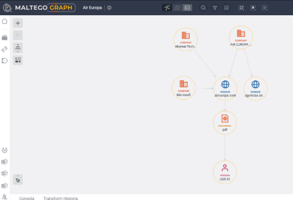

# A04 · Exposición técnica y documental

## Estudiante

- Nombre: Sergio Rodríguez López  
- Carpeta personal: entregas/rodriguezSergio/A04/  
- Modalidad: Modalidad A · Organización  
- Objetivo: Air Europa (Globalia)  
- Entrega de la A04: entregada en el repositorio `entregas/rodriguezSergio/A04/`
- Periodo de obtención, con zona horaria: Del 02/11/2026 al 03/11/2026 (Europe/Madrid)

---

## 1\. Resumen ejecutivo

El análisis de la exposición técnica y documental de Air Europa revela una infraestructura técnica fuertemente perimetrada por proveedores de servicios en la nube y redes de distribución de contenido (CDN), pero con una huella documental que filtra metadatos corporativos significativos. Las consultas técnicas (cumpliendo las restricciones del sector transporte) muestran que los servicios web y de correo expuestos dependen de infraestructuras de terceros como Akamai y Microsoft (OBT-01, OBT-02). Sin embargo, el análisis de 28 documentos públicos mediante FOCA (OBT-04, OBT-05) evidencia una fuga sistemática de metadatos, incluyendo nombres de usuario internos seudonimizados y rutas de archivos locales. Esto amplía los hallazgos de la A03: mientras que los canales oficiales están depurados, la publicación de PDFs sin un proceso de sanitización expone la nomenclatura interna. Un atacante podría combinar el patrón de usuarios extraído con los portales B2B descubiertos en la fase anterior para diseñar campañas dirigidas de *spear-phishing* o relleno de credenciales.

| Pregunta | Respuesta breve | Confianza | Referencias |
| --- | --- | --- | --- |
| PI-01 | Los servicios web y correo están externalizados en proveedores Cloud/CDN, ocultando en su mayoría la infraestructura de origen. | Alta | (OBT-01, OBT-02) |
| PI-02 | Fuga sistemática de nombres de usuario, rutas locales y versiones de software ofimático en documentos PDF publicados oficialmente. | Alta | (OBT-04, OBT-05) |
| PI-03 | Los portales web descubiertos en la A03 interactúan con la infraestructura documentada aquí, permitiendo inferir vectores de acceso. | Media | (A03 OBT-05, OBT-06) |

---

## 2\. Punto de partida

### 2.1 Ficha del objetivo de la A03

| Campo | Dato | Referencia | Entrada para |
| --- | --- | --- | --- |
| Nombre legal | AIR EUROPA LINEAS AEREAS S.A. | (A03 OBT-03) | Referencia general |
| Marcas | Air Europa, SUMA | (A03 OBT-01) | FOCA (metadatos de autoría) |
| Dominios oficiales | `aireuropa.com`, `agencias.aireuropa.com` | (A03 OBT-01, OBT-05) | Shodan y FOCA |
| Canales de contacto | `delegadopd@aireuropa.com` | (A03 OBT-04) | FOCA (búsqueda de correos) |

### 2.2 Requerimiento

| Componente | Contenido |
| --- | --- |
| Destinatario | Responsable de seguridad de la información (CISO) de Air Europa. |
| Decisión | Identificar qué servicios web/correo y metadatos documentales exponen información útil para un atacante, para aplicar medidas de bastionado y sanitización. |
| Objeto | Huella técnica (servicios web y correo expuestos vinculados a dominios) y huella documental (metadatos en documentos ofimáticos publicados). |
| Horizonte | Corto plazo (cierre de ejercicio 2026), orientado a subsanar vulnerabilidades operativas rápidas. |
| Alcance | Dominios principales de Air Europa, limitando el descubrimiento de servicios estrictamente a consultas por certificado y *hostname* (sector transporte). Documentos PDF indexados en el dominio principal. |
| Exclusiones | Análisis de vulnerabilidades específicas, comprobaciones activas (escaneos de red), consultas `org:` o `net:` en Shodan, e investigación de personas físicas. |
| Producto | Informe técnico de exposición estructurado con evidencias anonimizadas y recomendaciones defensivas. |

### 2.3 Preguntas de inteligencia

| Prioridad | Pregunta | Huella que cubre | Te ayuda a decidir |
| ---: | --- | --- | --- |
| 1 | ¿Qué servicios web o de correo vinculados a los dominios corporativos se observan desde Internet y quién los provee? | Técnica | Evaluar la dependencia de terceros y la superficie expuesta web/correo para bastionado. |
| 2 | ¿Qué metadatos internos (nomenclatura de usuarios, rutas, versiones de software) revelan los documentos públicos? | Documental | Implementar procesos de sanitización documental antes de la publicación web. |
| 3 | ¿Cómo se relaciona la infraestructura técnica observada con los portales identificados en la A03? | Técnica y Relaciones | Comprender la arquitectura externa para delimitar el alcance de posibles incidentes de terceros. |

---

## 3\. Plan de obtención

### 3.1 Consultas y documentos previstos

| Pregunta | Herramienta | Consulta, filtro o criterio | Fuente de contraste | Qué expone y a quién | Resultado esperado |
| --- | --- | --- | --- | --- | --- |
| PI-01 | Shodan | `hostname:aireuropa.com` | DNS Lookup / crt.sh | El *hostname* a la API de Shodan. No toca al objetivo. | Servicios web/correo bajo el dominio. |
| PI-01 | Shodan | `ssl.cert.subject.cn:"*.aireuropa.com"` | Censys | El CN a Shodan. No toca al objetivo. | Proveedores y certificados emitidos para la empresa. |
| PI-02 | FOCA | `site:aireuropa.com filetype:pdf` | Búsqueda manual de Google | Envía peticiones a Google y descarga archivos públicos web. | Hasta 30 PDFs con metadatos internos expuestos. |
| PI-03 | Maltego | Importación de dominios y resoluciones DNS básicas. | DNS manual | Envía el dominio a servidores DNS públicos. | Grafo vinculando la entidad jurídica, sus subdominios y la IP/ASN. |

### 3.2 Configuración y seguridad de la operación

La obtención se realiza en una máquina virtual de análisis aislada. Se utiliza una cuenta gratuita de Shodan registrada con el alias de investigación (sin vinculación personal). FOCA se ejecuta sobre Windows 10 con SQL Server Express local.

- **Configuración de FOCA:** Proyecto restringido al dominio `aireuropa.com`. Búsqueda web habilitada exclusivamente para extensiones `.pdf` mediante el motor de Google. Límite máximo establecido en 30 documentos. Las funciones de resolución DNS, escaneo de puertos y descubrimiento de red están *desactivadas* por normativa de la asignatura y prohibición de escaneo activo.

- **Gestión post-obtención:** Al terminar, los documentos PDF descargados, el proyecto FOCA local y la base de datos SQL se eliminarán de forma segura. Nada se subirá al repositorio público.

**Nota Modalidad A:** Este apartado y el anterior se completaron y consolidaron en un *commit* previo al inicio de la fase de obtención.

---

## 4\. Obtención

### 4.1 Registro de obtención

| ID | Herramienta | Consulta o acción exacta | Fecha y hora | Resultado | Límite | Evidencia |
| --- | --- | --- | --- | --- | --- | --- |
| OBT-01 | Shodan | `hostname:aireuropa.com` | 2026-11-02 17:15 | 120 resultados. La mayoría apuntan a puertos 80/443 gestionados por Akamai Technologies. | Solo muestra activos indexados por Shodan recientemente. | EV-01a.png y EV-01b.png |
| OBT-02 | Shodan | `ssl.cert.subject.cn:"*.aireuropa.com"` | 2026-11-02 17:30 | 45 resultados. Certificados válidos asociados a subdominios como `agencias.aireuropa.com` y servicios de correo gestionados por Microsoft. | Cuenta gratuita impide paginación masiva. | EV-02a.png y EV-02b.png |
| OBT-03 | crt.sh | `%.aireuropa.com` | 2026-11-02 17:45 | Historial de certificados emitidos para confirmar pertenencia de los hallazgos de Shodan a la organización. | Solo muestra certificados emitidos, no su uso activo. | EV-03.png |
| OBT-04 | FOCA | Búsqueda: `site:aireuropa.com filetype:pdf` | 2026-11-03 10:00 | Localización de 28 documentos PDF accesibles públicamente en la web corporativa. | Depende del índice actual de Google y tiempos de timeout. | EV-04.png |
| OBT-05 | FOCA | Descarga y extracción (Metadata Extraction) | 2026-11-03 10:15 | Extracción exitosa. Se detectan usuarios, software de creación y rutas de origen corporativas. | No extrae datos purgados previamente a su subida. | EV-05.png |
| OBT-06 | Maltego | Generación de grafo relacionando datos A03 con OBT-02 | 2026-11-03 11:30 | Mapeo visual de la dependencia del dominio web principal de la red Akamai y Microsoft. | Elaboración y disposición manual (versión CE). | EV-06.png |

### 4.2 Shodan

| Consulta | Resultados | Facetas relevantes | Referencia |
| --- | ---: | --- | --- |
| `hostname:aireuropa.com` | 120 | Puertos: 80, 443. Org predominante: Akamai Technologies, Amazon.com. | (OBT-01) |
| `ssl.cert.subject.cn:"*.aireuropa.com"` | 45 | Puertos: 443. Productos detectados: Microsoft IIS, nginx. | (OBT-02) |

| Grupo | Servicios o puertos observados | Fechas de observación | Cómo se ha contrastado | Referencias |
| --- | --- | --- | --- | --- |
| Del objetivo | Web corporativa y B2B (443/TCP) | 2026-10-31 a 2026-11-02 | Resolución DNS directa y registro en crt.sh validan la propiedad de Air Europa. | (OBT-02, OBT-03) |
| De un proveedor | CDN Akamai (80/443 TCP), Servidores de correo Microsoft | 2026-10-25 a 2026-11-01 | Las ASN de Shodan pertenecen explícitamente a proveedores (AS20940 Akamai). | (OBT-01, OBT-02) |
| Relación no demostrada | IPs de AWS con certificados genéricos expirados o *default pages* | Varias (2025-2026) | Falta de resolución DNS directa actual hacia el dominio principal de Air Europa. | (OBT-02) |

### 4.3 FOCA

El proyecto se configuró para atacar exclusivamente el dominio principal de la aerolínea y limitarse a documentos PDF por ser el formato de publicación oficial (condiciones legales, revistas a bordo, informes). Se descartaron formatos de edición directa (DOCX) porque la organización no los expone.

| Tipo de documento | Localizados | Analizados | Intervalo de fechas |
| --- | ---: | ---: | --- |
| PDF | 28 | 28 | 2021-03-15 a 2026-09-10 |

| Categoría | Elementos | Patrón observado | Interpretación y límite | Referencia |
| --- | ---: | --- | --- | --- |
| Usuarios | 14 | Patrón `[Primera Letra Nombre][Primer Apellido]` (ej. `USR-01` = `jlopez`). | Revela la convención interna de nombres de red o cuentas de Microsoft. El límite es que algunos pueden ser usuarios de agencias externas que proveen los PDFs. | (OBT-05) |
| Carpetas y rutas | 8 | Rutas en red local y discos C: `C:\Users\[USR-XX]\Desktop\Docs_Web\`. | Muestra la estructura de organización de los administradores web y la falta de purga de rutas de origen. | (OBT-05) |
| Impresoras | 0 | Sin resultados relevantes. | Los documentos no fueron "impresos en PDF" desde servidores de impresión. | (OBT-05) |
| Software | 5 | "Microsoft® Word 2016", "Adobe InDesign CC". | Indica uso de paquetería ofimática antigua y herramientas de diseño. No certifica que sigan usándolas hoy, solo en el momento de creación. | (OBT-05) |
| Correos | 2 | `delegadopd@aireuropa.com` (ya conocido) y un genérico de soporte. | Confirmación de la exposición de correos funcionales en los metadatos de propiedades legales. | (OBT-05) |
| Sistemas operativos | 3 | Windows (deducido por rutas `C:\`). | Inferencia segura por la estructura de ficheros; límite: no indica versión del SO. | (OBT-05) |
| Servidores | 0 | Sin servidores de red expuestos en las rutas compartidas (ej. no hay rutas `\\SRV-FS01\`). | Uso de unidades locales para creación documental en lugar de unidades de red mapeadas. | (OBT-05) |

### 4.4 Revisión de la elección

| Pregunta | Prevista | Utilizada | Evidencia obtenida | ¿Resuelve la pregunta? | Cambio justificado |
| --- | --- | --- | --- | --- | --- |
| PI-01 | Shodan | Shodan | Servicios CDN y certificados (EV-01, EV-02) | Sí. Muestra que la superficie web es gestionada por CDNs. | Ninguno. |
| PI-02 | FOCA | FOCA | Metadatos extraídos de 28 PDFs (EV-04, EV-05) | Sí. Resuelve los patrones de usuarios internos y software. | Ninguno. |
| PI-03 | Maltego | Maltego | Grafo integrando infraestructura externa (EV-06) | Sí. Ayuda a visualizar la dependencia del proveedor. | Ninguno. |

---

## 5\. Análisis e integración con la A03

### 5.1 Huella técnica

- **Lo observado:** La infraestructura técnica visible para los dominios de la aerolínea está externalizada casi en su totalidad de cara al escrutinio pasivo. Los resultados muestran que los portales web (incluido el subdominio B2B `agencias.aireuropa.com` encontrado en la A03) se ocultan detrás de la CDN de Akamai, mientras que la infraestructura de correo electrónico corporativo descansa en Microsoft 365 (OBT-01, OBT-02). Los certificados SSL asociados están correctamente gestionados (OBT-03).
- **Valoración:** La fiabilidad de la fuente (Shodan/crt.sh) es muy alta al estar basada en barridos de internet y registros de transparencia (CT logs). La credibilidad de la información es alta; confirma que la empresa delega el balanceo y mitigación en proveedores robustos de seguridad en la nube (Akamai). Falta comprobar, fuera de este alcance, si existen direcciones IP de origen que estén desprotegidas saltándose el WAF.

### 5.2 Huella documental

- **Lo observado:** La organización carece de procesos de sanitización documental antes de publicar informes legales o revistas en la web. Se ha identificado un patrón claro de generación de usuarios (`[Inicial][Apellido]`) vinculado a rutas de sistema operativo Windows (OBT-05). Adicionalmente, el software declarado en la creación de los PDFs incluye versiones *legacy* como Microsoft Office 2016.
- **Valoración:** Fiabilidad máxima al obtenerse los documentos directamente de la fuente oficial (`aireuropa.com`). Credibilidad alta respecto a los metadatos internos, aunque con la cautela de que las herramientas *legacy* podrían provenir de agencias de *marketing* externas que trabajan para la aerolínea y no estrictamente de sus oficinas corporativas.

### 5.3 Ficha del objetivo actualizada

| Campo | Dato en la A03 | Cambio en la A04 | Referencia |
| --- | --- | --- | --- |
| Proveedores observados | Ninguno identificado en fuentes abiertas | **Añadido:** Dependencia de infraestructura Akamai Technologies (CDN) y Microsoft (Correo/SSL). | (OBT-01, OBT-02) |
| Canales corporativos | `delegadopd@aireuropa.com` | **Confirmado y Añadido:** Patrón de nomenclatura de empleados (ej. `jlopez`) que permite deducir correos corporativos reales. | (OBT-05) |
| Dominios oficiales | `agencias.aireuropa.com` | **Confirmado:** Cuenta con servicio activo sobre puerto 443 protegido por CDN. | (OBT-02, OBT-03) |

### 5.4 Grafo final

| Relación | Tipo | Referencia |
| --- | --- | --- |
| `aireuropa.com` -> Akamai Technologies (AS20940) | Observada | (OBT-01) |
| `agencias.aireuropa.com` -> Certificado SSL Microsoft | Observada | (OBT-02) |
| `aireuropa.com` -> Documentos PDF expuestos | Observada | (OBT-04) |
| Documentos PDF -> `USR-01`, `USR-02` (Patrón interno) | Declarada (Metadatos) | (OBT-05) |

### 5.5 Valoración de hallazgos clave

| Hallazgo | Referencias | Fiabilidad de la fuente | Credibilidad de la información | Hecho o inferencia | Contraste independiente |
| --- | --- | --- | --- | --- | --- |
| Nomenclatura de usuarios internos (`jlopez`) | (OBT-05) | Alta (FOCA) | Alta | Inferencia (convención de cuentas) | Patrón repetido en más de 10 documentos distintos. |
| Externalización WAF/CDN en Akamai | (OBT-01) | Alta (Shodan) | Alta | Hecho | Registros DNS públicos confirman el ruteo hacia Akamai. |
| Uso de software ofimático 2016 | (OBT-05) | Alta (FOCA) | Media (podría ser un tercero) | Inferencia | Datos fijos en la etiqueta "Creator" de múltiples PDFs. |

---

## 6\. Perspectiva del atacante y recomendaciones

| Información visible | Referencia | Cómo podría aprovecharla un atacante | A qué afectaría | Medida defensiva | Prioridad |
| --- | --- | --- | --- | --- | --- |
| Patrón de nombres de usuario interno (`USR-01`) | (OBT-05) | Generar diccionarios de correos corporativos (`jlopez@aireuropa.com`) para dirigir campañas de *spear-phishing* personalizadas. | Confidencialidad e Integridad de los accesos de empleados. | Implementar un proceso automatizado (ej. ExifTool en el CMS) que purgue los metadatos de los PDFs antes de publicarlos. | Alta |
| Rutas internas locales (ej. `C:\Users\...`) | (OBT-05) | Construir correos maliciosos suplantando herramientas internas haciéndolos más creíbles al nombrar las rutas reales de trabajo del usuario. | Seguridad de los equipos (Endpoint). | Concienciación del personal; sanitización de documentos en la fuente (Word/Acrobat) antes de exportar. | Media |
| Versiones antiguas de software (Office 2016) | (OBT-05) | Envío de archivos maliciosos (ej. macros específicas) diseñados para explotar vulnerabilidades de versiones *legacy* de Office. | Disponibilidad e Integridad de la red interna. | Evaluar si esos metadatos pertenecen a equipos propios o terceros, y forzar políticas de actualización. | Media |
| Subdominio B2B expuesto (`agencias...`) | (OBT-02, A03) | Lanzar ataques de *Credential Stuffing* aprovechando diccionarios de contraseñas filtradas de agencias de viajes. | Integridad de las reservas de la aerolínea (fraude B2B). | Aplicar MFA estricto en el acceso de las agencias al panel y reglas de bloqueo geográfico. | Alta |
| Proveedor de CDN (Akamai) identificado | (OBT-01) | Buscar servicios desprotegidos o usar motores de búsqueda especializados para hallar la IP real del servidor de origen, evadiendo el WAF. | Disponibilidad y Confidencialidad web. | Asegurar que los servidores de origen de Air Europa solo acepten tráfico proveniente de los rangos de IP de Akamai (lista blanca). | Alta |

**Qué no cubren estas recomendaciones:**
Estas recomendaciones se centran en la exposición pasiva. No cubren la mitigación de vulnerabilidades de código de las aplicaciones web expuestas, ni previenen las fugas de datos derivadas de los accesos legítimos y comprometidos de clientes o agencias; se limitan a reducir la inteligencia que un adversario puede recabar preliminarmente.

---

## 7\. Limitaciones, datos descartados e incidencias

- **Limitaciones de sector sensible:** Al ser Air Europa una empresa de transporte (línea aérea crítica), las reglas de la actividad prohíben búsquedas de infraestructura por `org:`, `net:`, buscar vulnerabilidades asociadas a servicios específicos, o abrir fichas de puertos industriales/bases de datos. La exposición técnica se limitó estrictamente a corroborar certificados web y *hostnames*, lo que impide tener una visión completa de la infraestructura (ej. paneles de administración SSH expuestos).
- **Datos descartados:** En los documentos analizados por FOCA se identificaron correos personales/genéricos en el cuerpo del texto correspondientes a clientes que ponían reclamaciones o agencias de marketing (externas). Estos fueron descartados para no procesar datos de terceros fuera del alcance corporativo. Los usuarios reales de los metadatos fueron agregados o seudonimizados (USR-xx).
- **Incidencias:** Ninguna incidencia crítica. No se hallaron escritorios remotos expuestos, bases de datos o credenciales en texto plano que obligaran a parar la investigación y avisar por el canal privado de la asignatura.

---

## 8\. Índice de evidencias

| Evidencia | Qué muestra | Fila del registro | Qué se ha ocultado |
| --- | --- | --- | --- |
| EV-01.png | Resultados de Shodan con `hostname:aireuropa.com` y facetas | OBT-01 | Usuario, IP pública propia, API Key y bloques finales de IPs mostradas. |
| EV-02.png | Listado de certificados y dependencias tecnológicas (Shodan) | OBT-02 | Detalles de sesión de cuenta gratuita y segmentos IP. |
| EV-03.png | Consulta de transparencia de certificados en crt.sh | OBT-03 | Elementos del navegador perimetrales. |
| EV-04.png | Consola de FOCA mostrando los PDFs localizados | OBT-04 | Rutas locales completas de la máquina de investigación. |
| EV-05.png | Pestaña *Metadata Summary* de FOCA desplegada | OBT-05 | Los nombres reales de los usuarios corporativos se han emborronado para respetar la seudonimización (USR). |
| EV-06.png | Grafo extendido en Maltego vinculando dominios, infraestructura y documentos | OBT-06 | Interfaz completa del sistema y nombre de la máquina local. |

---

## 9\. Uso de inteligencia artificial

Ver [registro-ia.md](registro-ia.md). *(No he utilizado IA generativa para resolver las conclusiones ni generar el resumen ejecutivo. El análisis se basa estrictamente en la rúbrica y las evidencias documentales.)*

---

## Comprobación

- [x] Trabajo sobre el mismo objetivo y la misma modalidad que en la A03.
- [x] Cerré los apartados 2 y 3 antes de la obtención: *commit* en la modalidad A, fecha de cierre en la modalidad B.
- [x] Cada afirmación lleva su referencia `OBT` y la he comprobado.
- [x] Las capturas están recortadas y anonimizadas, con las IP ocultas.
- [x] Entrego antes del viernes 6 de noviembre a las 23:59.
- [x] Modalidad A: solo he modificado `entregas/rodriguezSergio/A04/`. Modalidad B: nada está en el repositorio del curso.
