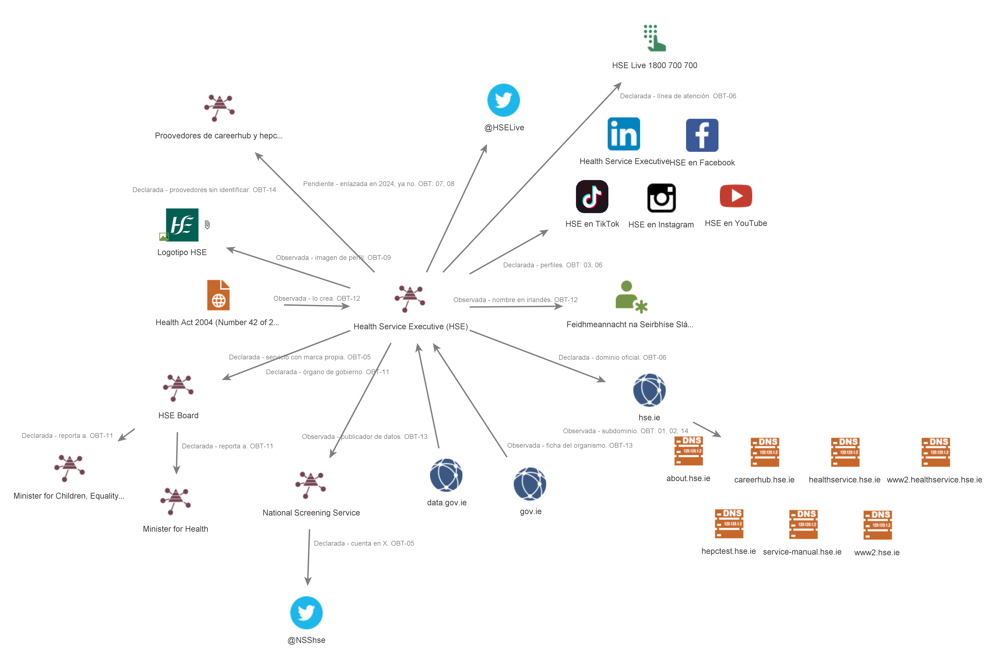

# A03 · Huella pública

## Estudiante

- Nombre: Eirik Alberto Rosete León
- Carpeta personal: [/entregas/roseteEirik](/entregas/roseteEirik/)
- Modalidad: A (Organización)
- Objetivo: Health Service Executive (HSE)
- ¿Es el objetivo de tu proyecto final?: Sí
- Punto de partida (dominio principal o identificadores propios): hse.ie
- Periodo de obtención, con zona horaria: 04/11/2026 y 13/11/2026, UTC+1 (Madrid)

---

## 1. Resumen ejecutivo

La huella pública del HSE es amplia y casi toda la publica el propio organismo. La Health Act 2004 lo crea como Feidhmeannacht na Seirbhíse Sláinte y su consejo reporta al Minister for Health (OBT-11, OBT-12). No es una sociedad, por lo que OpenCorporates solo devuelve homónimos (OBT-10). Sus canales se reparten entre hse.ie, al menos siete subdominios y perfiles en seis redes sociales (OBT-02, OBT-06, OBT-14). Lo más aprovechable para un atacante es que no hay una lista estable de canales: la web dejó de enlazar a X, pero @HSELive sigue verificada (OBT-07, OBT-08). No aparecen dominios que imiten al HSE en la primera página, lo que no descarta que existan (OBT-04). Se recomienda publicar una página única de canales oficiales y vigilar dominios y perfiles parecidos.

| Pregunta | Respuesta breve | Confianza | Referencias |
|---|---|---|---|
| P1. Dominios, subdominios y perfiles | hse.ie y al menos siete subdominios; perfiles en LinkedIn, X, Facebook, Instagram, TikTok y YouTube; X ya no figura en el pie; sin dominios parecidos en la primera página | Media | OBT-01 a OBT-09, OBT-14 |
| P2. Entidad legal y entidades relacionadas | Organismo creado por la Health Act 2004; consejo que reporta al Minister for Health; National Screening Service con marca propia | Alta | OBT-05, OBT-10 a OBT-13 |
| P3. Terceros vinculados | Redes sociales declaradas; proveedores de careerhub.hse.ie y hepctest.hse.ie sin nombre | Baja | OBT-05, OBT-06, OBT-14 |

---

## 2. Encargo

### 2.1 Objetivo elegido

Modalidad A. El objetivo es el Health Service Executive (HSE), servicio público de salud de Irlanda y objetivo de mi proyecto final (ataque de ransomware Conti, 2021). Como el ataque empezó con un correo de phishing, interesa saber qué identidad, canales y relaciones del HSE podría usar un atacante para hacerse pasar por él. Esta actividad no amplía el alcance aprobado del proyecto.

Cumple los requisitos de la modalidad A. Es un organismo público con actividad en Irlanda (UE) que publica su información institucional en su propio dominio (estructura, consejo de dirección, actas e informes en hse.ie y about.hse.ie). Su base legal, la Health Act 2004, está en el Irish Statute Book.

Para comprobar que hay material para la A04, el 30/10/2026 consulté site:hse.ie filetype:pdf. Aparecen PDF alojados en www.hse.ie y assets.hse.ie e igualmente hay pdf indexados dentro de about.hse.ie, que he consultado previamente para el avance del proyecto final el 28/10/2026.

### 2.2 Requerimiento

| Componente | Contenido |
|---|---|
| Destinatario | Responsable de Seguridad de la Información (CISO) del HSE |
| Decisión | Qué información pública del HSE podría aprovechar un atacante para preparar un engaño, una suplantación o un reconocimiento, y qué conviene revisar o reducir |
| Objeto | La huella pública institucional y digital del HSE accesible por fuentes abiertas |
| Horizonte | Antes de iniciar la A04, que se entrega el 6/11/2026 |
| Alcance | Fuentes abiertas y pasivas: Google, Wayback Machine, OpenCorporates, TinEye, Irish Statute Book y web pública del HSE. Grafo manual en Maltego |
| Exclusiones | Datos de pacientes, personal y proveedores; materiales, filtraciones o foros del ataque de 2021; nombres de personas (solo cargos si hace falta); abrir sitios sospechosos de suplantación; homónimos como el Health and Safety Executive británico (hse.gov.uk); escaneos, consultas DNS y transformaciones de Maltego contra el HSE; contacto con la organización |
| Producto | Informe de huella pública con registro de obtención, evidencias, ficha del objetivo para la A04, grafo de Maltego y matriz de perspectiva del atacante. TLP:CLEAR tras revisar que solo hay datos institucionales. Es un supuesto académico por lo que el informe no se le envía |

Requerimiento en una frase: identificar, antes de la A04 y solo con fuentes abiertas pasivas, qué identidad legal, canales y relaciones del HSE están al alcance de cualquiera, qué podría aprovechar un atacante y qué conviene revisar o reducir.

### 2.3 Preguntas de inteligencia

| Prioridad | Pregunta | Huella que cubre | Te ayuda a decidir |
|---:|---|---|---|
| 1 | ¿Qué dominios, subdominios y perfiles oficiales tiene el HSE, desde cuándo, y qué otros parecidos existen sin que los declare? | Canales | Qué canales confirmar como oficiales y cuáles revisar, retirar o vigilar |
| 2 | ¿Qué entidad legal hay detrás de la marca HSE, en qué norma se apoya y qué entidades relacionadas comparten su marca o sus dominios? | Corporativa | Qué entidades y dominios forman parte del objetivo y pasan a la A04 |
| 3 | ¿Qué terceros (analítica, formación, empleo, redes sociales) aparecen vinculados a sus canales, y el vínculo lo declara el HSE o solo se observa? | Relaciones | Qué relaciones con terceros revisar o exponer menos por servir de pretexto en un engaño |

---

## 3. Plan de obtención

### 3.1 Herramientas por pregunta

| Pregunta | Herramienta | Alternativa descartada y motivo | Entrada | Qué expone y a quién | Resultado esperado |
|---|---|---|---|---|---|
| P1 | Google con operadores | Babel Street: comercial y pensada para fuentes multilingües; aquí todo está en inglés | site:hse.ie -site:www.hse.ie, "Health Service Executive" (site:x.com OR site:facebook.com OR site:linkedin.com), intitle:"HSE" "Health Service Executive" -site:hse.ie -site:gov.ie | Envía las consultas a Google, sin sesión. Solo llega al HSE al abrir una página pública suya | Subdominios indexados, perfiles oficiales y candidatos no declarados |
| P1 | TinEye (opcional) | Google Lens: requiere sesión de Google y da coincidencias aproximadas | URL del logotipo publicado en www.hse.ie | Envía la URL de la imagen a TinEye. No toca al objetivo | Dominios ajenos que reutilizan el logotipo, registrados sin abrirlos |
| P1 | Wayback Machine | archive.today: menos cobertura histórica | URL de la página de www.hse.ie donde declara sus canales oficiales (obtenida con Google) | Envía la URL a Internet Archive. No toca al objetivo | Canales añadidos o retirados entre dos capturas fechadas |
| P2 | OpenCorporates | BORME: solo recoge sociedades españolas | "Health Service Executive" (Irlanda) y "HSE" para homónimos | Envía la búsqueda a OpenCorporates. No toca al objetivo | Probable consulta vacía (organismo creado por ley) y homónimos con su número de registro |
| P2 | Google con operadores | Wikipedia: fuente secundaria | site:hse.ie ("board" OR "annual report"), site:irishstatutebook.ie "Health Act 2004", site:gov.ie "Health Service Executive" | Envía las consultas a Google; visita páginas públicas del HSE | Estructura y órganos de gobierno que declara el HSE, norma de creación, organismo del que depende y entidades relacionadas |
| P3 | Google con operadores | Revisar código fuente o cabeceras: es análisis técnico, propio de la A04 | site:hse.ie (intitle:cookies OR intitle:privacy) "third party" | Envía las consultas a Google; visita páginas públicas del HSE | Terceros declarados por el propio HSE |
| P3 | Maltego Community | draw.io: no guarda tipos de entidad ni fuentes | Entidades introducidas a mano desde las filas OBT, sin transformaciones | Solo el inicio de sesión en Maltego. No toca al objetivo | Grafo con relaciones observadas, declaradas y pendientes |

### 3.2 Herramientas que no se usan

| Herramienta | Motivo |
|---|---|
| Intelligence X / Serus | Con el dominio hse.ie pueden devolver material filtrado en 2021, prohibido por las reglas reforzadas |
| Hunchly | No responde a ninguna pregunta; las evidencias se conservan con capturas propias y su hash |
| Google Lens | Alternativa a TinEye, descartada en 3.1 |
| OpenSanctions | Ninguna pregunta requiere comprobar sanciones y llevaría a buscar personas |
| Babel X / Babel Street | Licencia comercial; las fuentes están en inglés |
| BORME | Solo recoge sociedades españolas |

### 3.3 Configuración y seguridad de la operación

Identidad de investigación: la del Tema 2, con correo dedicado, usada solo para Maltego. El resto de consultas se hacen sin cuenta.

Navegador y perfil: Brave en incógnito con perfil dedicado, sin sesiones personales ni sincronización; historial borrado al cerrar.

Interacción con el objetivo: solo páginas públicas del HSE necesarias para una pregunta, sin formularios ni áreas con acceso.

Carpeta de trabajo: carpeta local cifrada fuera del repositorio, solo accesible por mí. Capturas originales con su hash SHA-256 y copias redactadas van a entregas/roseteEirik/A03/evidencias/.

---

## 4. Obtención

### 4.1 Registro de obtención

| ID | Herramienta | Consulta o acción exacta | Fecha y hora | Resultado | Límite | Evidencia |
|---|---|---|---|---|---|---|
| OBT-01 | Google | site:hse.ie filetype:pdf | 2026-11-04 08:45 | Indexación pública de documentos en subdominios (healthservice.hse.ie y www2.healthservice.hse.ie): protocolos de medicamentos, formularios clínicos, circulares y regímenes de tratamiento | Dependencia de la indexación de Google con mucho ruido clínico | EV-01 |
| OBT-02 | Google | site:hse.ie -site:www.hse.ie | 2026-11-04 08:48 | Detección de subdominios: about.hse.ie (HSE organisation website: información institucional y empleo) y careerhub.hse.ie (portal de carreras sanitarias); about.hse.ie menciona agencias financiadas por el HSE | Solo muestra subdominios indexados; no descubre portales internos ni no enlazados | EV-02 |
| OBT-03 | Google | "Health Service Executive" (site:x.com OR site:facebook.com OR site:linkedin.com) | 2026-11-04 07:41 | Identificación de la página de empresa del HSE en LinkedIn (más de 266 000 seguidores, Dublín 8) y de sus ofertas de empleo; sin resultados de X ni Facebook en primera página | Google no indexa todos los perfiles; la titularidad se contrasta en OBT-05 | EV-03 |
| OBT-04 | Google | intitle:"HSE" "Health Service Executive" -site:hse.ie -site:gov.ie | 2026-11-04 07:55 | Referencias de terceros al HSE: hospitalvot.org, instituteofpublichealth.org, esn-eu.org, aroundlab.org y nature.com; sin homónimos ni dominios que imiten al HSE en primera página | Solo se revisa la primera página; terceros no verificados | EV-04 |
| OBT-05 | Google | site:hse.ie "follow us" | 2026-11-04 08:03 | Localización de páginas que enlazan a redes: careerhub.hse.ie remite a Instagram, Facebook y X, y el National Screening Service (www2.healthservice.hse.ie) a X (@NSShse) y LinkedIn | Fuente autodeclarada; los fragmentos no muestran las cuentas exactas de Instagram, Facebook y X | EV-05 |
| OBT-06 | Navegador | Visita a about.hse.ie: portada, menú y pie de página | 2026-11-04 09:18 | Identificación de canales declarados en el pie de página: Facebook, Instagram, TikTok, YouTube y LinkedIn, sin enlace a X; línea HSE Live (1800 700 700 y 00 353 1 240 8787). Menú institucional: Jobs, Our work, Teams, News, Publications y Leadership and operations | Fuente autodeclarada; la visita queda en los registros del HSE; el pie no muestra el nombre de cada cuenta | EV-06-01, EV-06-02 |
| OBT-07 | Wayback Machine | Calendario de [Wayback Machine](https://web.archive.org/web/*/https://about.hse.ie/) y captura del [homepage de 2024](https://web.archive.org/web/20240308134446/https://about.hse.ie/), comparada con la versión actual (OBT-06) | 2026-11-04 09:31 | Comparativa temporal: 97 capturas entre el 14/12/2023 y el 19/10/2026. La captura del 08/03/2024 es la versión beta de la web y su pie enlaza a Facebook, Instagram, TikTok, YouTube, LinkedIn y X (twitter.com/HSELive); en la versión actual el enlace a X ya no aparece | La fecha de captura no es la de publicación; no se sabe cuándo ni por qué se retiró el enlace a X | EV-07-01, EV-07-02 |
| OBT-08 | Navegador | Visita sin sesión a x.com/HSELive | 2026-11-04 09:35 | Identificación de la cuenta verificada HSE Ireland (@HSELive): 274,8 mil seguidores, 41,8 mil publicaciones, creada en agosto de 2009 y enlazada a hse.ie. Última publicación visible del 21 de enero de 2026; el banner remite a Facebook, Instagram y LinkedIn para mensajes directos | X limita el contenido visible sin sesión; no confirma si la cuenta sigue gestionada activamente | EV-07-03 |
| OBT-09 | TinEye | Imagen de perfil de @HSELive: pbs.twimg.com/profile_images/1676505270028058625/J0aWYb1S_400x400.jpg | 2026-11-04 13:24 | Identificación de 59 coincidencias del logotipo, indexado por primera vez el 18/06/2017. Primeros resultados: alamy.com (banco de imágenes, foto de 2022 con el logotipo de fondo), www2.healthservice.hse.ie y www2.hse.ie (uso oficial, 2026) | Solo el índice de TinEye; se revisan los primeros resultados; la imagen buscada es la de X, no la de la web | EV-08 |
| OBT-10 | OpenCorporates | "Health Service Executive" y "HSE", todas las jurisdicciones | 2026-11-04 13:33 | Consulta vacía para el HSE: "Health Service Executive" devuelve 4 sociedades inactivas de EE. UU. y Puerto Rico con nombres parecidos. "HSE" devuelve 3.351 sociedades homónimas (Alemania, Bolivia, Bulgaria, EE. UU., Reino Unido…), sin relación con el objetivo | Solo cubre sociedades inscritas; el HSE es un organismo creado por ley y no figura; no se filtró por Irlanda | EV-09-01, EV-09-02 |
| OBT-11 | Google | site:hse.ie ("board" OR "annual report") | 2026-11-04 13:38 | Localización de páginas institucionales en about.hse.ie: HSE Board, que reporta al Minister for Health y al Minister for Children, Equality, Disability, Integration and Youth; HSE Annual Report and Financial Statements 2025 (publicado en julio de 2026); publicaciones con actas del consejo y pagos a proveedores | Fuente autodeclarada; solo fragmentos de los primeros resultados | EV-10 |
| OBT-12 | Google | site:irishstatutebook.ie "Health Act 2004" | 2026-11-04 13:45 | Localización de la Health Act 2004 (Number 42 of 2004) en el Irish Statute Book: ley que crea un organismo llamado Feidhmeannacht na Seirbhíse Sláinte (el fragmento se corta antes del nombre en inglés); versión en PDF y secciones como Schedule 1 y Section 7 | Solo fragmentos; la ley tiene modificaciones posteriores que no se revisaron | EV-11 |
| OBT-13 | Google | site:gov.ie "Health Service Executive" | 2026-11-04 13:46 | Identificación del HSE en webs del Gobierno: ficha en gov.ie que remite a su web propia; ficha en aioffice.gov.ie que lo describe como proveedor público de salud y servicios sociales, con el nombre escrito "Health Services Executive"; ficha de organización en datacatalogue.gov.ie y de publicador en data.gov.ie | Solo fragmentos de la primera página; no se abrió cada ficha | EV-12 |
| OBT-14 | Google | site:hse.ie (intitle:cookies OR intitle:privacy) "third party" | 2026-11-04 13:47 | Detección de dos subdominios nuevos: hepctest.hse.ie (Hepatitis C Home Test, aviso de cookies y política de privacidad de marzo de 2023) y service-manual.hse.ie (Cookies statement). Políticas de privacidad de careerhub.hse.ie y hepctest.hse.ie que declaran proveedores externos que tratan datos por cuenta del HSE, sin nombrarlos; el aviso del National Screening Service solo indica que no cede datos a terceros sin permiso | Los fragmentos no nombran a los terceros; no se abrió cada aviso | EV-13 |
| OBT-15 | Maltego | Grafo manual con las entidades de OBT-01 a OBT-14, sin transformaciones | 2026-11-13 22:30 | 27 entidades y 26 enlaces: el HSE, su base legal, dominios, perfiles y terceros, con cada enlace etiquetado como declarado, observado o pendiente y su OBT | Grafo manual; solo representa lo ya obtenido; la forma del grafo no prueba ninguna relación | EV-14 |

### 4.2 Resultados por herramienta

#### Google con operadores

- Pregunta respondida: P1, P2 y P3
- Resultado: Subdominios about, careerhub, healthservice, www2.healthservice, hepctest y service-manual (OBT-01, OBT-02, OBT-14); página de LinkedIn y páginas que enlazan a redes (OBT-03, OBT-05); la Health Act 2004, el consejo y las fichas del Gobierno (OBT-11 a OBT-13)
- Límite: Solo lo indexado y las primeras páginas; los fragmentos no siempre dan el dato completo

#### Wayback Machine

- Pregunta respondida: P1
- Resultado: 97 capturas de about.hse.ie. La del 08/03/2024 enlaza a X en el pie; la actual no (OBT-06, OBT-07). La cuenta @HSELive sigue verificada (OBT-08)
- Límite: La fecha de captura no es la del cambio

#### OpenCorporates

- Pregunta respondida: P2
- Resultado: Consulta vacía para el HSE; solo homónimos (OBT-10). Encaja con un organismo creado por ley (OBT-12)
- Límite: Solo sociedades inscritas; sin filtro por Irlanda

#### TinEye (herramienta opcional)

- Pregunta respondida: P1
- Resultado: 59 coincidencias de la imagen de @HSELive, entre ellas www2.hse.ie y www2.healthservice.hse.ie (OBT-09). Une la cuenta de X con el logotipo de las webs oficiales
- Límite: Solo los primeros resultados; la coincidencia no prueba quién gestiona la cuenta

#### Maltego

- Pregunta respondida: P3 y la relación entre P1 y P2
- Resultado: Grafo manual con 27 entidades y 26 enlaces etiquetados (OBT-15)
- Límite: Sin transformaciones; solo representa lo obtenido

### 4.3 Revisión de la elección

| Pregunta | Herramienta prevista | Herramienta utilizada | Evidencia obtenida | ¿Resuelve la pregunta? | Cambio justificado |
|---|---|---|---|---|---|
| P1 | Google con operadores | Google con operadores | EV-01 a EV-05, EV-13 | En parte: solo lo indexado | Sin cambio |
| P1 | TinEye | TinEye | EV-08 | En parte | Entrada: imagen de @HSELive en lugar del logotipo de www.hse.ie, por ser la cuenta a contrastar |
| P1 | Wayback Machine | Wayback Machine y visitas a about.hse.ie y X | EV-06-01 a EV-07-03 | Sí | Los canales se declaran en about.hse.ie; se añadió la visita a X |
| P2 | OpenCorporates | OpenCorporates | EV-09-01, EV-09-02 | No: consulta vacía | Identidad legal resuelta con OBT-12 |
| P2 | Google con operadores | Google con operadores | EV-10 a EV-12 | Sí | Sin cambio |
| P3 | Google con operadores | Google con operadores | EV-13 | En parte: terceros sin nombre | Sin cambio |
| P3 | Maltego | Maltego | EV-14 | Sí | Sin cambio |

---

## 5. Análisis de la huella

### 5.1 Ficha del objetivo

| Campo | Dato | Referencia | Fecha del dato | Precaución |
|---|---|---|---|---|
| Nombre legal | Health Service Executive; en irlandés, Feidhmeannacht na Seirbhíse Sláinte. Creado por la Health Act 2004 | OBT-12, OBT-13 | 2004; consulta 2026-11-04 | No es una sociedad (OBT-10) |
| Marcas | HSE, HSE Ireland, HSE Live y National Screening Service | OBT-05, OBT-06, OBT-08 | 2026-11-04 | Homónimos sin relación (OBT-10) |
| Entidades relacionadas | HSE Board y los ministerios a los que reporta; gov.ie y data.gov.ie | OBT-11, OBT-13 | 2026-11-04 | Agencias financiadas no listadas |
| Dominios oficiales | hse.ie; www2, about, careerhub, healthservice, www2.healthservice, hepctest y service-manual | OBT-01, OBT-02, OBT-09, OBT-14 | 2026-11-04 | Solo los indexados |
| Canales y perfiles oficiales | LinkedIn; @HSELive y @NSShse; Facebook, Instagram, TikTok y YouTube; HSE Live 1800 700 700 | OBT-03, OBT-05, OBT-06, OBT-08 | 2026-11-04 | @HSELive ya no figura en el pie; cuatro cuentas sin nombre |
| Proveedores observados | Redes sociales; proveedores de careerhub y hepctest sin nombre | OBT-06, OBT-14 | 2026-11-04 | Declarados por el HSE |

### 5.2 Huella por dimensiones

#### Corporativa o profesional

Observado: La Health Act 2004 crea un organismo llamado Feidhmeannacht na Seirbhíse Sláinte (OBT-12); el nombre Health Service Executive lo usan el HSE y gov.ie (OBT-11, OBT-13). Su consejo reporta a dos ministros y publica informe anual, actas y pagos a proveedores (OBT-11). OpenCorporates solo tiene homónimos (OBT-10).

Valoración: Fuentes oficiales y ajenas al HSE: fiabilidad alta y datos confirmados. Faltan las modificaciones de la ley.

#### De canales

Observado: hse.ie tiene al menos siete subdominios con funciones distintas (OBT-01, OBT-02, OBT-14). El pie de about.hse.ie enlaza a cinco redes y a HSE Live; en 2024 también enlazaba a X (OBT-06, OBT-07). @HSELive sigue verificada y usa el logotipo de las webs oficiales (OBT-08, OBT-09).

Valoración: Fuente autodeclarada: fiabilidad alta. La titularidad de @HSELive es probable, no segura. La ausencia de dominios parecidos es un resultado débil.

#### De relaciones

Observado: El HSE declara sus redes sociales (OBT-05, OBT-06). careerhub y hepctest declaran proveedores que tratan datos, sin nombrarlos (OBT-14). Fuera del HSE, el logotipo aparece en un banco de imágenes (OBT-09).

Valoración: Relaciones declaradas pero incompletas: aparte de las redes, ningún tercero tiene nombre. Los proveedores técnicos quedan para la A04.

### 5.3 Grafo de relaciones

Leyenda: cada enlace lleva el tipo, la relación y la fila OBT. Declarada, la afirma el HSE; observada, aparece en una fuente independiente; pendiente, sin contrastar.

| Relación | Tipo | Referencia |
|---|---|---|
| Health Act 2004 → HSE y nombre en irlandés | Observada | OBT-12 |
| HSE → HSE Board → ministerios | Declarada | OBT-11 |
| gov.ie y data.gov.ie → HSE | Observada | OBT-13 |
| HSE → hse.ie | Declarada | OBT-06 |
| hse.ie → siete subdominios | Observada | OBT-01, OBT-02, OBT-09, OBT-14 |
| HSE → National Screening Service → @NSShse | Declarada | OBT-05 |
| HSE → LinkedIn, Facebook, Instagram, TikTok, YouTube y HSE Live | Declarada | OBT-03, OBT-06 |
| HSE → @HSELive | Pendiente | OBT-07, OBT-08 |
| HSE → logotipo | Observada | OBT-09 |
| HSE → proveedores sin identificar | Declarada | OBT-14 |

### 5.4 Valoración de hallazgos clave

| Hallazgo | Referencias | Fiabilidad de la fuente | Credibilidad de la información | Hecho o inferencia | Contraste independiente |
|---|---|---|---|---|---|
| Organismo creado por ley, no una sociedad | OBT-10, OBT-12 | Alta | Confirmada | Hecho | OpenCorporates sin ficha |
| Retirada del enlace a X entre 2024 y 2026 | OBT-06, OBT-07 | Alta | Confirmada | Hecho | Dos versiones con fecha |
| @HSELive como cuenta del HSE | OBT-07 a OBT-09 | Media | Probable | Inferencia | Logotipo y enlace a hse.ie |
| Al menos siete subdominios | OBT-01, OBT-02, OBT-14 | Alta | Confirmada | Hecho | Varias consultas |
| Ausencia de dominios que imiten al HSE | OBT-04, OBT-09 | Media | Posible | Inferencia | Solo primeras páginas |

---

## 6. Perspectiva del atacante

| Información visible | Referencia | Cómo podría aprovecharla un atacante | A qué afectaría | Medida defensiva | Prioridad |
|---|---|---|---|---|---|
| Pie sin X mientras @HSELive sigue verificada | OBT-06 a OBT-08 | Presentación de un perfil falso como nueva cuenta oficial | Ciudadanos; reputación del HSE | Página única con los canales oficiales y su estado | Alta |
| Siete subdominios con portales distintos | OBT-02, OBT-14 | Imitación creíble de un portal secundario (empleo, test, cribado) | Candidatos y usuarios de programas | Inventario público de portales; vigilancia de dominios parecidos | Alta |
| Línea HSE Live publicada | OBT-06 | Uso del nombre HSE Live como pretexto en llamadas | Ciudadanos | Aviso de qué datos nunca pide HSE Live | Media |
| Pagos a proveedores publicados | OBT-11 | Suplantación de un proveedor con un falso cambio de cuenta | Área financiera | Verificación por canal conocido de cambios bancarios | Media |
| Logotipo con 59 copias indexadas | OBT-09 | Apariencia oficial para un engaño | Reputación del HSE | Búsqueda inversa periódica del logotipo | Baja |

---

## 7. Limitaciones, datos descartados e incidencias

Limitaciones: Solo se revisaron las primeras páginas de Google y TinEye, así que no se descartan dominios parecidos (OBT-04, OBT-09). No se sabe cuándo se retiró el enlace a X (OBT-07) ni el nombre de cuatro cuentas (OBT-06). Los terceros no tienen nombre (OBT-14).

Datos descartados: Homónimos de OpenCorporates y el Health and Safety Executive británico (OBT-10). Webs de terceros que citan al HSE (OBT-04). La persona del resultado de alamy.com, tapada en EV-08 (OBT-09). Nombres de personas del consejo (OBT-11).

Incidencias: No hubo incidencias.

---

## 8. Índice de evidencias

| Evidencia | Qué muestra | Fila del registro | Qué se ha ocultado |
|---|---|---|---|
| EV-01 | Consulta site:hse.ie filetype:pdf | OBT-01 | Nada |
| EV-02 | Consulta de subdominios | OBT-02 | Nada |
| EV-03 | Consulta de perfiles en redes | OBT-03 | Nada |
| EV-04 | Menciones externas al HSE | OBT-04 | Nada |
| EV-05 | Páginas con enlaces a redes | OBT-05 | Nada |
| EV-06-01 | Portada y menú de about.hse.ie | OBT-06 | Nada |
| EV-06-02 | Pie de about.hse.ie con canales | OBT-06 | Nada |
| EV-07-01 | Calendario de Wayback Machine | OBT-07 | Nada |
| EV-07-02 | Captura de 2024 con enlace a X | OBT-07 | Nada |
| EV-07-03 | Perfil @HSELive sin sesión | OBT-08 | Nada |
| EV-08 | Resultado de TinEye | OBT-09 | Foto y nombre de una persona |
| EV-09-01 | OpenCorporates: "Health Service Executive" | OBT-10 | Nada |
| EV-09-02 | OpenCorporates: "HSE" | OBT-10 | Nada |
| EV-10 | Consejo e informe anual | OBT-11 | Nada |
| EV-11 | Health Act 2004 | OBT-12 | Nada |
| EV-12 | El HSE en webs del Gobierno | OBT-13 | Nada |
| EV-13 | Avisos de cookies y privacidad | OBT-14 | Nada |
| EV-14 | Grafo de Maltego | OBT-15 | Nada |

---

## 9. Uso de inteligencia artificial

Ver [registro-ia.md](registro-ia.md).

---

## Comprobación

- [x] El objetivo cumple los requisitos de mi modalidad y no investigo a ninguna otra persona.
- [x] Cerré los apartados 2 y 3 antes de la obtención: *commit* en la modalidad A, fecha de cierre en la modalidad B.
- [x] Cada afirmación lleva su referencia `OBT` y la he comprobado.
- [x] Las capturas están recortadas y anonimizadas.
- [ ] Entrego antes del viernes 30 de octubre a las 23:59.
- [x] Modalidad A: solo he modificado `entregas/apellidoNombre/A03/`. Modalidad B: nada está en el repositorio del curso.
