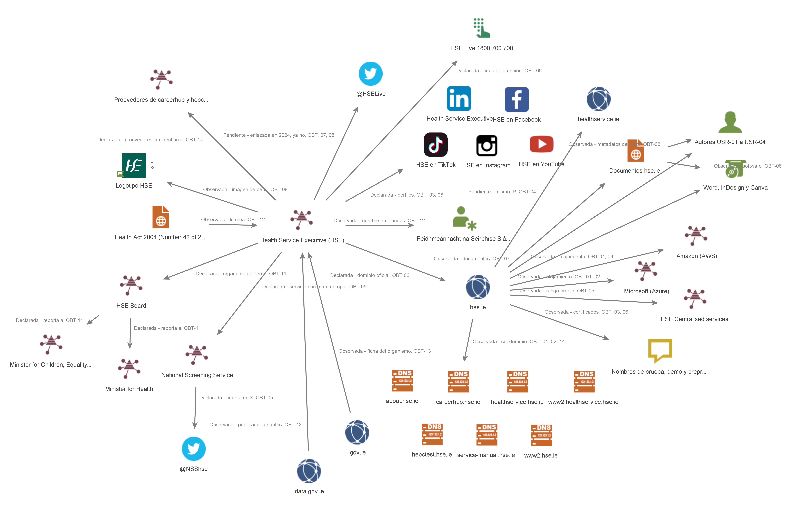

# A04 · Exposición técnica y documental

## Estudiante

- Nombre: Eirik Alberto Rosete León
- Carpeta personal: [/entregas/roseteEirik](/entregas/roseteEirik/)
- Modalidad: A (Organización)
- Objetivo: Health Service Executive (HSE)
- Entrega de la A03 (enlace al *pull request* o «entregada en el Campus Virtual»): 
- Periodo de obtención, con zona horaria: 13/11/2026, UTC+1 (Madrid)

---

## 1. Resumen ejecutivo

La huella técnica del HSE está repartida entre rangos propios y proveedores. Shodan muestra 171 resultados con nombres de hse.ie, casi todos web en el puerto 443. La mayoría está en Amazon y Microsoft, y una parte menor en rangos a nombre de HSE Centralised services (OBT-01, OBT-04, OBT-05). Los certificados hacen públicos nombres de entornos de prueba, demo, desarrollo y preproducción, como myhseselfservicetest, dev.odti o creds.preprod (OBT-02, OBT-03, OBT-06). La A04 cambia una conclusión de la A03: allí no se veía ningún proveedor técnico, y ahora Amazon, Microsoft y los emisores de certificados forman parte de la ficha. También aparece healthservice.ie, un dominio que la A03 no tenía, aunque su relación con el HSE queda pendiente (OBT-04). En los documentos, 4 de 15 conservan el nombre de una persona como autor y muestran una mezcla de versiones de Word, InDesign y Canva (OBT-08). Se recomienda revisar qué entornos no productivos necesitan estar en Internet, limpiar los metadatos antes de publicar y declarar en una lista pública los dominios oficiales.

| Pregunta | Respuesta breve | Confianza | Referencias |
|---|---|---|---|
| P1. Servicios web y de correo y proveedores | Web en 443 sobre todo; la mayoría en Amazon y Microsoft; una parte en rangos propios de HSE Centralised services; correo con Postfix en el puerto 25 | Alta | OBT-01, OBT-02, OBT-04, OBT-05 |
| P2. Nombres en certificados | Entornos de prueba, demo, desarrollo y preproducción, y portales como idp, staff y api que no salían en la A03 | Alta | OBT-02, OBT-03, OBT-06 |
| P3. Metadatos de documentos | Nombres de personal en 4 de 15 documentos, autores genéricos en otros y software variado; sin correos ni rutas; sin fechas | Media | OBT-07, OBT-08 |

---

## 2. Punto de partida

### 2.1 Ficha del objetivo de la A03

| Campo | Dato | Referencia | Entrada para |
|---|---|---|---|
| Nombre legal | Health Service Executive (Feidhmeannacht na Seirbhíse Sláinte), creado por la Health Act 2004 | A03 OBT-12 | Atribución de certificados y documentos |
| Marcas | HSE, HSE Live y National Screening Service | A03 OBT-05, A03 OBT-06 | Lectura de certificados y metadatos |
| Entidades relacionadas | HSE Board, ministerios, gov.ie y data.gov.ie | A03 OBT-11, A03 OBT-13 | Separación de documentos del Gobierno |
| Dominios oficiales | hse.ie y siete subdominios: about, careerhub, healthservice, www2.healthservice, hepctest, service-manual y www2 | A03 OBT-01, A03 OBT-02, A03 OBT-09, A03 OBT-14 | Shodan, crt.sh y Maltego |
| Canales y perfiles | LinkedIn, X, Facebook, Instagram, TikTok, YouTube y línea HSE Live | A03 OBT-03, A03 OBT-06, A03 OBT-08 | Solo el grafo |
| Proveedores observados | Redes sociales y proveedores sin nombre | A03 OBT-06, A03 OBT-14 | Separación de servicios de proveedor |

### 2.2 Requerimiento

| Componente | Contenido |
|---|---|
| Destinatario | Responsable de Seguridad de la Información (CISO) del HSE |
| Decisión | Qué servicios visibles desde Internet y qué metadatos de sus documentos podría aprovechar un atacante, y qué conviene corregir |
| Objeto | Servicios web y de correo con nombres de hse.ie y metadatos de los documentos publicados en hse.ie |
| Horizonte | Antes de la entrega de la A04, el 13/11/2026 |
| Alcance | Shodan con hostname:, ssl: y ssl.cert.subject.cn: sobre hse.ie; crt.sh como contraste; Maltego para documentos y grafo |
| Exclusiones | Las de la A03; org:, net:, búsquedas por producto y fichas que no sean web o correo; abrir IP o puertos; escaneos y consultas DNS; vulnerabilidades de servicios concretos; personas de los metadatos |
| Producto | Informe con registro, evidencias con IP y nombres ocultos, metadatos seudonimizados, grafo final y recomendaciones. Supuesto académico |

### 2.3 Preguntas de inteligencia

| Prioridad | Pregunta | Huella que cubre | Te ayuda a decidir |
|---:|---|---|---|
| 1 | ¿Qué servicios web y de correo con nombres de hse.ie se observan desde Internet, desde cuándo, y cuáles están en rangos de un proveedor y no del HSE? | Técnica | Qué servicios entran en el inventario propio y cuáles revisar con su proveedor |
| 2 | ¿Qué nombres de sistemas o subdominios aparecen en los certificados de hse.ie que no salían en la A03? | Técnica | Qué nombres revisar porque los certificados los hacen públicos |
| 3 | ¿Qué revelan los metadatos de los documentos publicados en hse.ie (autores, software, fechas y correos) y qué parte procede de terceros? | Documental | Si conviene limpiar los metadatos antes de publicar y en qué tipos de documento |

---

## 3. Plan de obtención

### 3.1 Consultas y documentos previstos

| Pregunta | Herramienta | Consulta, filtro o criterio | Fuente de contraste | Qué expone y a quién | Resultado esperado |
|---|---|---|---|---|---|
| P1 | Shodan | hostname:hse.ie y dos fichas de servicios web o de correo | crt.sh | Envía hse.ie a Shodan. No llega al HSE | Servicios y facetas; en cada ficha, puerto, producto, fecha y titular del rango |
| P1 | Shodan | ssl:"hse.ie" | crt.sh | Envía hse.ie a Shodan. No llega al HSE | Servicios con certificados que mencionan hse.ie, también en proveedores |
| P2 | Shodan | ssl.cert.subject.cn:hse.ie | crt.sh | Envía hse.ie a Shodan. No llega al HSE | Certificados emitidos para hse.ie |
| P2 | crt.sh | %.hse.ie | Shodan y ficha de la A03 | Envía hse.ie a crt.sh. No llega al HSE | Nombres de los certificados y sus fechas |
| P3 | Maltego | To Files (Office) sobre hse.ie | Propiedades de un documento en el navegador | Envía hse.ie a un buscador. No llega al HSE | Documentos indexados, por tipo |
| P3 | Maltego | Parse meta information sobre documentos variados | Propiedades de un documento en el navegador | El servidor de Maltego descarga cada documento: la descarga llega al HSE | Autores, software, fechas y correos |

### 3.2 Configuración y seguridad de la operación

Cuenta de Shodan: gratuita. Sin API, descargas, escaneos ni Shodan Images.

Sustitución de FOCA: por indicación del docente, los metadatos se obtienen con dos transforms de Maltego, que buscan los documentos y leen sus metadatos sin descargarlos en mi equipo. Son los únicos transforms que se ejecutan; ninguno de DNS, IP, correo ni personas.

Selección de documentos de tipos, subdominios y años distintos.

Navegador y carpeta de trabajo: Brave en incógnito con el perfil de la A03. Capturas originales fuera del repositorio; en evidencias/ solo copias con IP, usuario y nombres tapados. Nombres y correos de los metadatos como USR-01.

Al terminar: se borran los grafos de esta actividad y no se entregan exportaciones.

---

## 4. Obtención

### 4.1 Registro de obtención

| ID | Herramienta | Consulta o acción exacta | Fecha y hora | Resultado | Límite | Evidencia |
|---|---|---|---|---|---|---|
| OBT-01 | Shodan | hostname:hse.ie | 2026-11-13 23:07 | 171 resultados. Irlanda 168; puertos 443 (138), 80 (16), 25 (5), 5003 y 16002 (3); Amazon (82), HSE Centralised services (42), Microsoft (28), Asiera Technology Services (10); AWS ELB (62) y Azure Application Gateway (23) | Solo lo indexado; primera página con cuenta gratuita | EV-01-01, EV-01-02 |
| OBT-02 | Shodan | ssl:hse.ie | 2026-11-13 23:11 | 135 resultados. Puertos 443 (131) y 25 (4); Amazon (82), Microsoft (28), HSE Centralised services (17); nombres nuevos: odti.hse.ie, myhseselfservicedemo.hse.ie y covidvaccine.hse.ie | Escrita sin comillas, mismo filtro; certificados en proveedores compartidos | EV-02-01, EV-02-02 |
| OBT-03 | Shodan | ssl.cert.subject.cn:hse.ie | 2026-11-13 23:13 | 120 resultados con el mismo reparto. Certificados de GoDaddy y Amazon para *.api.hse.ie, myhseselfservicedemo.hse.ie, covidvaccine.hse.ie y creds.preprod.hse-app.hse.ie | No prueba que el servicio siga activo | EV-03-01, EV-03-02 |
| OBT-04 | Shodan | Ficha de un resultado en Amazon (443) | 2026-11-13 23:17 | AmazonS3, "Book a COVID-19 test - HSE", visto el 2026-11-11, Amazon EC2 eu-west-1. Nombres crsbirths, crsdeaths y crsmarriages.hse.ie y tres de healthservice.ie | Titular del rango: Amazon | EV-04-01 |
| OBT-05 | Shodan | Ficha de un resultado en rango propio (80 y 443) | 2026-11-13 23:18 | SAP ESS/MSS Maintenance Site (403), visto el 2026-11-11 y el 2026-11-13. HSE Centralised services, ISP Irish Government (AS15806). Nombre myhseselfservicedemo.hse.ie | Banner declarado; no se abrió la IP | EV-04-02 |
| OBT-06 | crt.sh | %.hse.ie | 2026-11-13 23:21 | Certificados de octubre de 2026 (GoDaddy, Starfield, Let's Encrypt). Confirma www.srs, odti, covidvaccine y healthservice.hse.ie; añade dev.odti, idp, staff, xds, *.nmpc y trolleygar.hse.ie | Solo certificados emitidos | EV-05 |
| OBT-07 | Maltego | To Files (Office) [Using Search Engine] sobre Domain hse.ie | 2026-11-13 23:24 | 24 documentos: regímenes clínicos del NCCP, guías, una circular de RR. HH., formularios y folletos | Depende del índice del buscador | EV-06 |
| OBT-08 | Maltego | Parse meta information sobre 15 documentos de OBT-07 | 2026-11-13 23:27 | 6 autores: 4 nombres de persona (USR-01 a USR-04) y 2 genéricos (HSE, National HR). Software: Word 2016, LTSC y Microsoft 365, Acrobat PDF Maker 20, InDesign 18.1 y 19.5 (Macintosh) y Canva. Sin correos, rutas ni impresoras | Metadatos de autor o de plantilla | EV-07 |
| OBT-09 | Maltego | Ampliación manual del grafo de la A03 | 2026-11-13 23:48 | 8 entidades nuevas: Amazon, Microsoft, HSE Centralised services, nombres de prueba, healthservice.ie, documentos, autores y software | La forma del grafo no prueba relaciones | EV-08 |

### 4.2 Shodan

Se leyeron las facetas de las tres consultas antes de abrir las dos fichas. Solo se abrieron fichas de servicios web.

| Consulta | Resultados | Facetas relevantes | Referencia |
|---|---:|---|---|
| hostname:hse.ie | 171 | Puertos 443 (138), 80 (16), 25 (5), 5003 y 16002 (3 cada uno); Amazon (66 + 16), HSE Centralised services (42), Microsoft (28); AWS ELB (62) y Azure Application Gateway (23) | OBT-01 |
| ssl:hse.ie | 135 | Puertos 443 (131) y 25 (4); Amazon (66 + 16), Microsoft (28), HSE Centralised services (17); Postfix smtpd (4) | OBT-02 |
| ssl.cert.subject.cn:hse.ie | 120 | Mismo reparto que ssl:hse.ie, algo menor | OBT-03 |

| Grupo | Servicios o puertos observados | Fechas de observación | Cómo se ha contrastado | Referencias |
|---|---|---|---|---|
| Del objetivo | Web (80 y 443) de myhseselfservicedemo.hse.ie, myhseselfservicetest.hse.ie, www.srs.hse.ie y www.sdu.hse.ie en rangos de HSE Centralised services (ISP Irish Government) | 2026-11-11 a 2026-11-13 | Titular del rango a nombre del HSE, nombres bajo hse.ie y certificado con ese nombre común; www.srs.hse.ie también figura en crt.sh | OBT-01, OBT-03, OBT-05, OBT-06 |
| De un proveedor | Web (443) en Amazon (AWS ELB, EC2, S3) y Microsoft (Azure Application Gateway): api.hse.ie, odti.hse.ie, covidvaccine.hse.ie, creds.preprod.hse-app.hse.ie y los servicios de la ficha de OBT-04. Correo (25) con Postfix | 2026-11-11 a 2026-11-13 | Certificados con nombre común bajo hse.ie; titular del rango: el proveedor | OBT-01 a OBT-04 |
| Relación no demostrada | dora.hse.ie (NTP) y otros resultados de Asiera Technology Services CLG; puertos 5003 y 16002; nombres de healthservice.ie, otro dominio que no estaba en la A03 | 2026-11-13 | Sin contraste: titular ajeno al HSE; fichas no abiertas por no ser web ni correo | OBT-01, OBT-04 |

### 4.3 FOCA

No se usa FOCA. Por indicación del docente, los documentos y sus metadatos se obtienen con dos transforms de Maltego (OBT-07, OBT-08), como se justificó en el apartado 3.2.

Criterio: de los 24 documentos localizados se analizaron 15, elegidos para cubrir temas y unidades distintos (oncología, recursos humanos, salud pública, hospitales, formación). Los nombres de persona de los metadatos se sustituyen por USR-01 a USR-04.

| Tipo de documento | Localizados | Analizados | Intervalo de fechas |
|---|---:|---:|---|
| Documentos de hse.ie (PDF y ofimáticos) | 24 | 15 | No visible en el grafo de Maltego |

| Categoría | Elementos | Patrón observado | Interpretación y límite | Referencia |
|---|---:|---|---|---|
| Usuarios | 6 | 4 nombres de persona, dos con su equipo (USR-01 a USR-04); 2 genéricos: HSE y National HR | Los nombres personales pueden ser del autor del documento o de la plantilla; los genéricos indican que parte de los documentos se publican sin autor personal | OBT-08 |
| Carpetas y rutas | 0 | Sin rutas | El transform no mostró rutas; no prueba que no existan en otros documentos | OBT-08 |
| Impresoras | 0 | Sin impresoras | Igual que en rutas | OBT-08 |
| Software | 7 | Microsoft Word (2016, LTSC y Microsoft 365) con Acrobat PDF Maker; Adobe InDesign 18.1 y 19.5; Canva | Word con PDF Maker indica conversión desde Word, no el equipo exacto. InDesign y Canva apuntan a documentos maquetados, que pueden ser de un tercero | OBT-08 |
| Correos | 0 | Sin correos | Ningún documento analizado conserva un correo en sus metadatos | OBT-08 |
| Sistemas operativos | 1 | Macintosh, en las dos versiones de InDesign | Inferencia por el nombre del programa; no se ve la versión del sistema | OBT-08 |
| Servidores | 0 | Sin servidores | No aparece ninguno en los metadatos | OBT-08 |

### 4.4 Revisión de la elección

| Pregunta | Prevista | Utilizada | Evidencia obtenida | ¿Resuelve la pregunta? | Cambio justificado |
|---|---|---|---|---|---|
| P1 | Shodan con hostname: y dos fichas | Shodan con hostname: y dos fichas | EV-01-01, EV-01-02, EV-04-01, EV-04-02 | Sí: reparto de servicios entre rangos propios y proveedores | Sin cambio |
| P1 | Shodan con ssl: | Shodan con ssl: | EV-02-01, EV-02-02 | Sí | Consulta escrita sin comillas; mismo filtro con un solo término |
| P2 | Shodan con ssl.cert.subject.cn: y crt.sh | Shodan con ssl.cert.subject.cn: y crt.sh | EV-03-01, EV-03-02, EV-05 | Sí: nombres de entornos de prueba, demo y preproducción | Sin cambio |
| P3 | FOCA | Maltego (To Files y Parse meta information) | EV-06, EV-07 | En parte: autores y software, sin fechas | Sustitución por indicación del docente |

---

## 5. Análisis e integración con la A03

### 5.1 Huella técnica

Observado: Shodan tiene 171 resultados con nombres de hse.ie, casi todos web en el 443 (OBT-01). La mayoría está en Amazon y Microsoft y una parte en rangos de HSE Centralised services (OBT-01, OBT-05). Los certificados nombran entornos de prueba, demo y preproducción que no salían en la A03 (OBT-02, OBT-03), y crt.sh añade dev.odti, idp y staff (OBT-06).

Valoración: Shodan es fiable para saber qué observó, no el estado actual. La atribución es firme en los rangos propios; en Amazon y Microsoft depende del certificado. No se revisaron los puertos 5003 y 16002.

### 5.2 Huella documental

Observado: Maltego localizó 24 documentos de hse.ie y se analizaron 15 (OBT-07, OBT-08). Cuatro conservan el nombre de una persona como autor, dos de ellos con su equipo (USR-01 a USR-04). Otros usan autores genéricos, HSE o National HR. Los programas van de Microsoft Word 2016 a Word para Microsoft 365, con Acrobat PDF Maker, y de Adobe InDesign para Macintosh a Canva. No aparecen correos, rutas ni impresoras.

Valoración: Los metadatos salen de los propios documentos publicados: fiabilidad alta. La credibilidad es media para saber quién los escribió: un nombre puede ser del autor de la plantilla o de un tercero, y InDesign y Canva suelen indicar maquetación externa. La mezcla de versiones de Word indica que no hay un único proceso de publicación que limpie los metadatos; es una inferencia, no un hecho. Faltan las fechas, que el transform no mostró.

### 5.3 Ficha del objetivo actualizada

| Campo | Dato en la A03 | Cambio en la A04 | Referencia |
|---|---|---|---|
| Dominios oficiales | hse.ie y siete subdominios | Añade: api.hse.ie, odti.hse.ie, covidvaccine.hse.ie, www.srs.hse.ie, www.sdu.hse.ie, crsbirths, crsdeaths y crsmarriages.hse.ie; nombres de prueba, demo, desarrollo y preproducción; idp.hse.ie, staff.hse.ie, xds.hse.ie y nmpc.hse.ie | OBT-01 a OBT-04, OBT-06 |
| Dominios relacionados | No aparecían | Añade como pendiente: healthservice.ie, en la misma IP que nombres de hse.ie | OBT-04 |
| Proveedores observados | Redes sociales y proveedores sin nombre | Añade: Amazon (AWS) y Microsoft (Azure) como alojamiento; GoDaddy y Amazon como emisores de certificados. Confirma que la A03 no podía ver los proveedores técnicos | OBT-01 a OBT-04 |
| Infraestructura propia | No aparecía | Añade: rangos de HSE Centralised services con ISP Irish Government (AS15806) | OBT-01, OBT-05 |
| Software y autores de documentos | No aparecía | Añade: autores personales en 4 de 15 documentos (USR-01 a USR-04) y software de Word, InDesign y Canva. Cambia la valoración de la A03: además de canales, el HSE expone nombres de su personal a través de los documentos | OBT-08 |

### 5.4 Grafo final

Leyenda: cada enlace lleva en su etiqueta el tipo, la relación y la fila OBT. Declarada, la afirma el propio HSE; observada, aparece en una fuente independiente; pendiente, sin contrastar.

| Relación | Tipo | Referencia |
|---|---|---|
| hse.ie → Amazon (AWS) | Observada | OBT-01, OBT-04 |
| hse.ie → Microsoft (Azure) | Observada | OBT-01, OBT-02 |
| hse.ie → HSE Centralised services (rango propio) | Observada | OBT-01, OBT-05 |
| hse.ie → nombres de prueba, demo y preproducción | Observada | OBT-03, OBT-06 |
| hse.ie → healthservice.ie | Pendiente | OBT-04 |
| hse.ie → documentos de hse.ie | Observada | OBT-07 |
| Documentos → autores USR-01 a USR-04 | Observada | OBT-08 |
| Documentos → Word, InDesign y Canva | Observada | OBT-08 |

### 5.5 Valoración de hallazgos clave

| Hallazgo | Referencias | Fiabilidad de la fuente | Credibilidad de la información | Hecho o inferencia | Contraste independiente |
|---|---|---|---|---|---|
| La mayoría de los servicios con nombres de hse.ie están en Amazon y Microsoft | OBT-01, OBT-02 | Alta (Shodan) | Confirmada | Hecho | Titular del rango en cada ficha |
| Certificados para entornos de prueba, demo, desarrollo y preproducción | OBT-02, OBT-03, OBT-05, OBT-06 | Alta (Shodan y crt.sh) | Confirmada | Hecho | crt.sh muestra además dev.odti.hse.ie |
| Rangos propios a nombre de HSE Centralised services | OBT-01, OBT-05 | Alta (Shodan) | Confirmada | Hecho | ISP Irish Government y ASN en la ficha |
| healthservice.ie como dominio del HSE | OBT-04 | Media | Posible | Inferencia | Misma IP y título "Book a COVID-19 test - HSE"; sin otra fuente |
| Nombres de personal como autor en documentos publicados | OBT-08 | Alta (los documentos) | Probable | Hecho que aparezcan; inferencia que sean sus autores | Se repiten con su equipo en más de un documento |

---

## 6. Perspectiva del atacante y recomendaciones

| Información visible | Referencia | Cómo podría aprovecharla un atacante | A qué afectaría | Medida defensiva | Prioridad |
|---|---|---|---|---|---|
| Nombres de prueba, demo, desarrollo y preproducción en certificados públicos | OBT-02, OBT-03, OBT-05, OBT-06 | Identificación de entornos que suelen tener menos controles que producción, como punto de partida de un reconocimiento | Portal de autoservicio del personal y aplicaciones en preproducción | Revisión de qué entornos no productivos necesitan estar en Internet; acceso restringido por VPN o lista de IP | Alta |
| Página de mantenimiento de SAP ESS/MSS en los nombres myhseselfservice | OBT-01, OBT-05 | Uso del nombre del portal de autoservicio como pretexto creíble en un correo dirigido al personal | Personal del HSE | Aviso interno con las direcciones oficiales del portal; vigilancia de dominios parecidos | Media |
| Servicios distintos en una misma IP de Amazon (reserva de test de COVID-19 y registros civiles) | OBT-04 | Relación de servicios que parecen independientes para dar credibilidad a una página falsa de uno de ellos | Ciudadanos que usan esos servicios | Inventario de nombres por servicio y retirada de los que ya no se usan | Media |
| Dominio healthservice.ie con servicios del HSE, no declarado en la A03 | OBT-04 | Confusión entre dominios oficiales que facilita registrar otros parecidos | Ciudadanos | Lista pública de dominios oficiales que incluya healthservice.ie, si es del HSE | Media |
| Nombres de personal y de su equipo en los metadatos de documentos públicos | OBT-08 | Uso del nombre real de un empleado y de su equipo para hacer creíble un correo dirigido | Personal que figura como autor | Limpieza de metadatos antes de publicar, con una herramienta en el flujo de publicación | Alta |
| Versiones de Word, InDesign y Canva en los metadatos | OBT-08 | Preparación de un adjunto falso que imite el formato de los documentos del HSE | Personal que recibe documentos | La misma limpieza de metadatos; plantillas oficiales con autor genérico | Media |

Qué no cubren estas recomendaciones: no cubren fallos de las aplicaciones ni de las versiones de los servicios, que no se comprobaron. Tampoco los servicios que Shodan no indexa, los de Asiera Technology Services ni los puertos 5003 y 16002, que no se abrieron. Solo reducen la información que se ve desde fuera.

---

## 7. Limitaciones, datos descartados e incidencias

Limitaciones: Shodan refleja lo observado entre el 2026-11-11 y el 2026-11-13. Con la cuenta gratuita solo se vio la primera página. Sin org: ni net: pueden faltar servicios. De los documentos se analizaron 15 de 24, sin fechas.

Datos descartados: Las IP, de las que solo se muestran los dos primeros bloques. Los resultados de Asiera Technology Services CLG y de los puertos 5003 y 16002, que no se abrieron por no ser web ni correo. Las versiones de producto y la faceta de sistema operativo, que no se asocian a ningún fallo. Los nombres de persona de los metadatos, sustituidos por USR-01 a USR-04 y tapados en EV-07; no se investigó a ninguna.

Incidencias: No hubo incidencias. No apareció ningún escritorio remoto, panel industrial, base de datos ni credencial, y no hizo falta avisar por el canal privado.

---

## 8. Índice de evidencias

| Evidencia | Qué muestra | Fila del registro | Qué se ha ocultado |
|---|---|---|---|
| EV-01-01 | Consulta hostname:hse.ie con total, países, puertos y primeros resultados | OBT-01 | Dos últimos bloques de cada IP |
| EV-01-02 | Facetas de organizaciones, productos y sistemas operativos de hostname:hse.ie | OBT-01 | Dos últimos bloques de cada IP |
| EV-02-01 | Consulta ssl:hse.ie con total, países, puertos y primeros resultados | OBT-02 | Dos últimos bloques de cada IP |
| EV-02-02 | Facetas y resultados de ssl:hse.ie con certificados | OBT-02 | Dos últimos bloques de cada IP, también dentro de nombres de host |
| EV-03-01 | Consulta ssl.cert.subject.cn:hse.ie con total y facetas | OBT-03 | Dos últimos bloques de cada IP, también dentro de nombres de host |
| EV-03-02 | Facetas y certificados de ssl.cert.subject.cn:hse.ie | OBT-03 | Dos últimos bloques de cada IP, también dentro de nombres de host |
| EV-04-01 | Ficha de un servicio en Amazon con nombres de hse.ie y healthservice.ie | OBT-04 | Dos últimos bloques de la IP en la pestaña, la URL, el título y los nombres de host |
| EV-04-02 | Ficha de un servicio en rango de HSE Centralised services | OBT-05 | Dos últimos bloques de la IP en la pestaña, la URL, el título y los nombres de host |
| EV-05 | Búsqueda %.hse.ie en crt.sh, primera página ordenada por fecha | OBT-06 | Nada: sin sesión ni IP |
| EV-06 | Documentos de hse.ie localizados con Maltego | OBT-07 | Nada: solo títulos de documentos públicos |
| EV-07 | Metadatos de los 15 documentos en Maltego | OBT-08 | Nombres de persona en las etiquetas de autor, con bloque opaco |
| EV-08 | Grafo final de Maltego con los nodos de la A03 y los nuevos | OBT-09 | Nada: sin datos de la cuenta de Maltego |

---

## 9. Uso de inteligencia artificial

Ver [registro-ia.md](registro-ia.md).

---

## Comprobación

- [x] Trabajo sobre el mismo objetivo y la misma modalidad que en la A03.
- [x] Cerré los apartados 2 y 3 antes de la obtención: *commit* en la modalidad A, fecha de cierre en la modalidad B.
- [x] Cada afirmación lleva su referencia `OBT` y la he comprobado.
- [x] Las capturas están recortadas y anonimizadas, con las IP ocultas.
- [ ] Entrego antes del viernes 6 de noviembre a las 23:59.
- [x] Modalidad A: solo he modificado `entregas/apellidoNombre/A04/`. Modalidad B: nada está en el repositorio del curso.
